# Chapter 0: How Loudspeakers Work

## 0.10 ELECTRODYNAMIC SPEAKERS

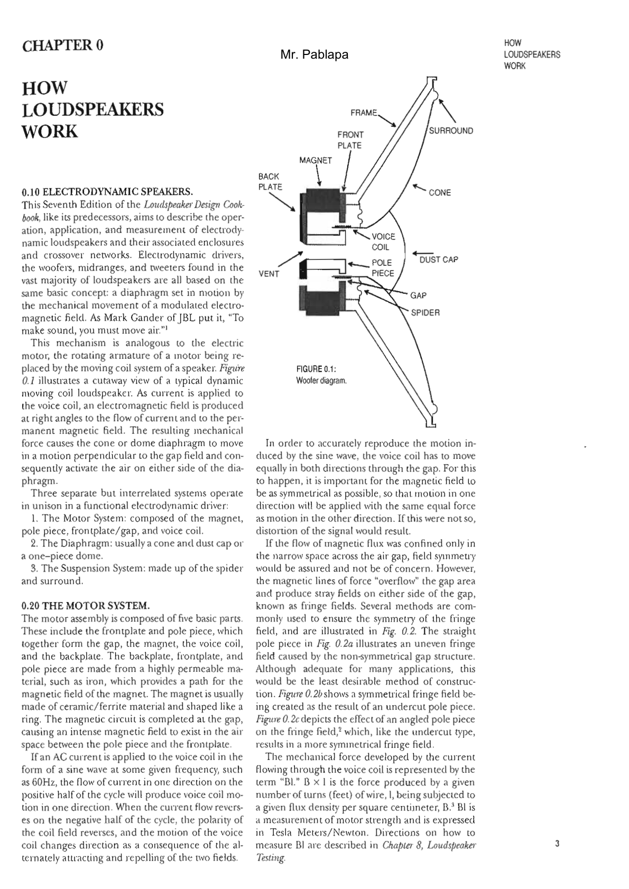

This Seventh Edition of the *Loudspeaker Design Cookbook*, like its predecessors, aims to describe the operation, application, and measurement of electrodynamic loudspeakers and their associated enclosures and crossover networks. Electrodynamic drivers, the woofers, midranges, and tweeters found in the vast majority of loudspeakers are all based on the same basic concept: a diaphragm set in motion by the mechanical movement of a modulated electromagnetic field. As Mark Gander of JBL put it, "To make sound, you must move air."¹

This mechanism is analogous to the electric motor, the rotating armature of a motor being replaced by the moving coil system of a speaker. *Figure 0.1* illustrates a cutaway view of a typical dynamic moving coil loudspeaker. As current is applied to the voice coil, an electromagnetic field is produced at right angles to the flow of current and to the permanent magnetic field. The resulting mechanical force causes the cone or dome diaphragm to move in a motion perpendicular to the gap field and consequently activate the air on either side of the diaphragm.

Three separate but interrelated systems operate in unison in a functional electrodynamic driver:
1. The Motor System: composed of the magnet, pole piece, frontplate/gap, and voice coil.
2. The Diaphragm: usually a cone and dust cap or a one-piece dome.
3. The Suspension System: made up of the spider and surround.

### FIGURE 0.1: Woofer diagram
(Diagram showing: FRAME, SURROUND, CONE, DUST CAP, GAP, SPIDER, VOICE COIL, POLE PIECE, VENT, FRONT PLATE, MAGNET, BACK PLATE)

## 0.20 THE MOTOR SYSTEM

The motor assembly is composed of five basic parts. These include the frontplate and pole piece, which together form the gap, the magnet, the voice coil, and the backplate. The backplate, frontplate, and pole piece are made from a highly permeable material, such as iron, which provides a path for the magnetic field of the magnet. The magnet is usually made of ceramic/ferrite material and shaped like a ring. The magnetic circuit is completed at the gap, causing an intense magnetic field to exist in the air space between the pole piece and the frontplate.

If an AC current is applied to the voice coil in the form of a sine wave at some given frequency, such as 60Hz, the flow of current in one direction on the positive half of the cycle will produce voice coil motion in one direction. When the current flow reverses on the negative half of the cycle, the polarity of the coil field reverses, and the motion of the voice coil changes direction as a consequence of the alternately attracting and repelling of the two fields.

In order to accurately reproduce the motion induced by the sine wave, the voice coil has to move equally in both directions through the gap. For this to happen, it is important for the magnetic field to be as symmetrical as possible, so that motion in one direction will be applied with the same equal force as motion in the other direction. If this were not so, distortion of the signal would result.

If the flow of magnetic flux was confined only in the narrow space across the air gap, field symmetry would be assured and not be of concern. However, the magnetic lines of force "overflow" the gap area and produce stray fields on either side of the gap, known as fringe fields. Several methods are commonly used to ensure the symmetry of the fringe field, and are illustrated in *Fig. 0.2*. The straight pole piece in *Fig. 0.2a* illustrates an uneven fringe field caused by the non-symmetrical gap structure. Although adequate for many applications, this would be the least desirable method of construction. *Figure 0.2b* shows a symmetrical fringe field being created as the result of an undercut pole piece. *Figure 0.2c* depicts the effect of an angled pole piece on the fringe field,² which, like the undercut type, results in a more symmetrical fringe field.

The mechanical force developed by the current flowing through the voice coil is represented by the term "Bl." B x l is the force produced by a given number of turns (feet) of wire, l, being subjected to a given flux density per square centimeter, B.³ Bl is a measurement of motor strength and is expressed in Tesla Meters/Newton. Directions on how to measure Bl are described in *Chapter 8, Loudspeaker Testing*.

---

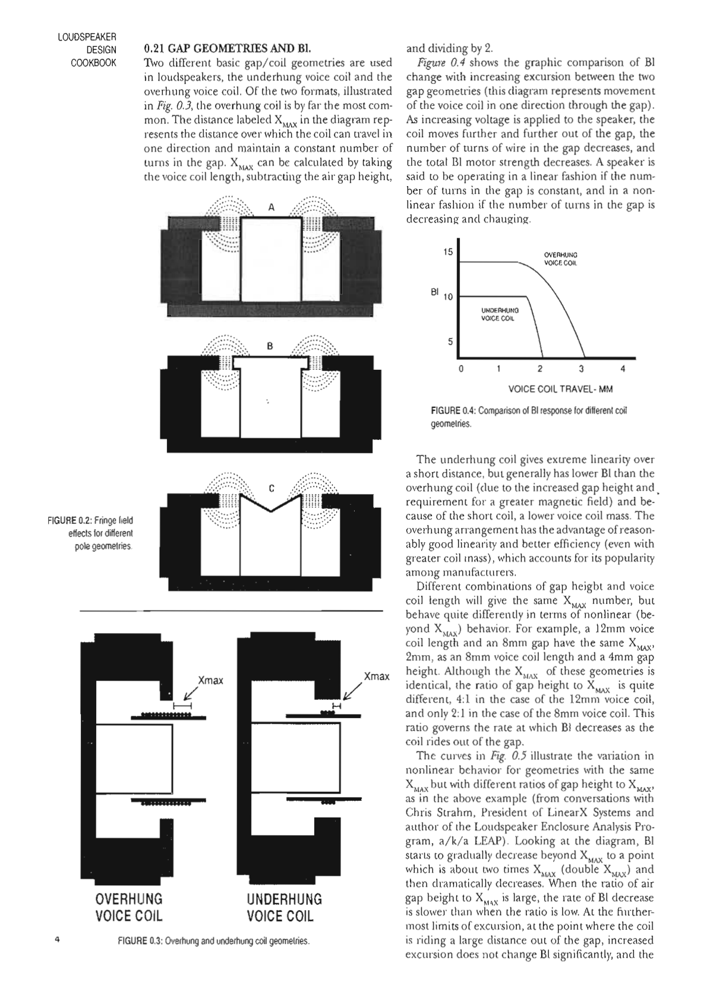

## 0.21 GAP GEOMETRIES AND Bl.

Two different basic gap/coil geometries are used in loudspeakers, the underhung voice coil and the overhung voice coil. Of the two formats, illustrated in *Fig. 0.3*, the overhung coil is by far the most common. The distance labeled $X_{MAX}$ in the diagram represents the distance over which the coil can travel in one direction and maintain a constant number of turns in the gap. $X_{MAX}$ can be calculated by taking the voice coil length, subtracting the air gap height, and dividing by 2.

*Figure 0.4* shows the graphic comparison of Bl change with increasing excursion between the two gap geometries (this diagram represents movement of the voice coil in one direction through the gap). As increasing voltage is applied to the speaker, the coil moves further and further out of the gap, the number of turns of wire in the gap decreases, and the total Bl motor strength decreases. A speaker is said to be operating in a linear fashion if the number of turns in the gap is constant, and in a non-linear fashion if the number of turns in the gap is decreasing and changing.

### FIGURE 0.2: Fringe field effects for different pole geometries.
(Diagrams showing A: straight, B: undercut, C: angled)

### FIGURE 0.3: Overhung and underhung coil geometries.
(Diagrams illustrating Overhung Voice Coil and Underhung Voice Coil with $X_{MAX}$ and gap height H labeled)

### FIGURE 0.4: Comparison of Bl response for different coil geometries.
(Graph showing Bl vs Voice Coil Travel - mm for Overhung and Underhung voice coils)

The underhung coil gives extreme linearity over a short distance, but generally has lower Bl than the overhung coil (due to the increased gap height and requirement for a greater magnetic field) and because of the short coil, a lower voice coil mass. The overhung arrangement has the advantage of reasonably good linearity and better efficiency (even with greater coil mass), which accounts for its popularity among manufacturers.

Different combinations of gap height and voice coil length will give the same $X_{MAX}$ number, but behave quite differently in terms of nonlinear (beyond $X_{MAX}$) behavior. For example, a 12mm voice coil length and an 8mm gap have the same $X_{MAX}$, 2mm, as an 8mm voice coil length and a 4mm gap height. Although the $X_{MAX}$ of these geometries is identical, the ratio of gap height to $X_{MAX}$ is quite different, 4:1 in the case of the 12mm voice coil, and only 2:1 in the case of the 8mm voice coil. This ratio governs the rate at which Bl decreases as the coil rides out of the gap.

The curves in *Fig. 0.5* illustrate the variation in nonlinear behavior for geometries with the same $X_{MAX}$ but with different ratios of gap height to $X_{MAX}$, as in the above example (from conversations with Chris Strahm, President of LinearX Systems and author of the Loudspeaker Enclosure Analysis Program, a/k/a LEAP). Looking at the diagram, Bl starts to gradually decrease beyond $X_{MAX}$ to a point which is about two times $X_{MAX}$ (double $X_{MAX}$) and then dramatically decreases. When the ratio of air gap height to $X_{MAX}$ is large, the rate of Bl decrease is slower than when the ratio is low. At the furthermost limits of excursion, at the point where the coil is riding a large distance out of the gap, increased excursion does not change Bl significantly, and the...

---

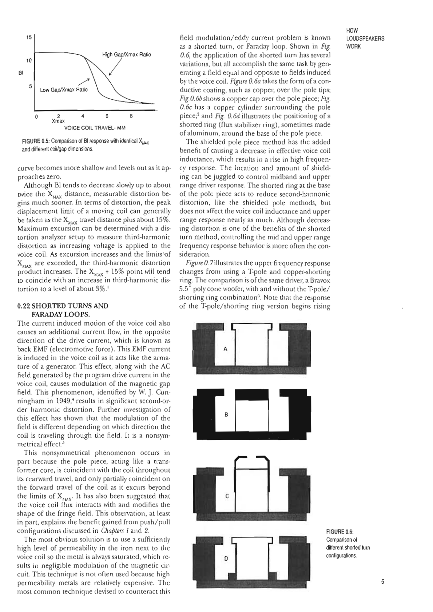

### FIGURE 0.5: Comparison of Bl response with identical $X_{MAX}$ and different coil/gap dimensions.
(Graph showing Bl vs Voice Coil Travel - mm with curves for High Gap/Xmax Ratio and Low Gap/Xmax Ratio)

...curve becomes more shallow and levels out as it approaches zero.

Although Bl tends to decrease slowly up to about twice the $X_{MAX}$ distance, measurable distortion begins much sooner. In terms of distortion, the peak displacement limit of a moving coil can generally be taken as the $X_{MAX}$ travel distance plus about 15%. Maximum excursion can be determined with a distortion analyzer setup to measure third-harmonic distortion as increasing voltage is applied to the voice coil. As excursion increases and the limits of $X_{MAX}$ are exceeded, the third-harmonic distortion product increases. The $X_{MAX}$ + 15% point will tend to coincide with an increase in third-harmonic distortion to a level of about 3%.¹

## 0.22 SHORTED TURNS AND FARADAY LOOPS.

The current induced motion of the voice coil also causes an additional current flow, in the opposite direction of the drive current, which is known as back EMF (electromotive force). This EMF current is induced in the voice coil as it acts like the armature of a generator. This effect, along with the AC field generated by the program drive current in the voice coil, causes modulation of the magnetic gap field. This phenomenon, identified by W. J. Cunningham in 1949,⁴ results in significant second-order harmonic distortion. Further investigation of this effect has shown that the modulation of the field is different depending on which direction the coil is traveling through the field. It is a non-symmetrical effect.⁵

This nonsymmetrical phenomenon occurs in part because the pole piece, acting like a transformer core, is coincident with the coil throughout its rearward travel, and only partially coincident on the forward travel of the coil as it excurs beyond the limits of $X_{MAX}$. It has also been suggested that the voice coil flux interacts with and modifies the shape of the fringe field. This observation, at least in part, explains the benefit gained from push/pull configurations discussed in *Chapters 1 and 2*.

The most obvious solution is to use a sufficiently high level of permeability in the iron next to the voice coil so the metal is always saturated, which results in negligible modulation of the magnetic circuit. This technique is not often used because high permeability metals are relatively expensive. The most common technique devised to counteract this field modulation/eddy current problem is known as a shorted turn, or Faraday loop. Shown in *Fig. 0.6*, the application of the shorted turn has several variations, but all accomplish the same task by generating a field equal and opposite to fields induced by the voice coil. *Figure 0.6a* takes the form of a conductive coating, such as copper, over the pole tips; *Fig. 0.6b* shows a copper cap over the pole piece; *Fig. 0.6c* has a copper cylinder surrounding the pole piece;² and *Fig. 0.6d* illustrates the positioning of a shorted ring (flux stabilizer ring), sometimes made of aluminum, around the base of the pole piece.

The shielded pole piece method has the added benefit of causing a decrease in effective voice coil inductance, which results in a rise in high frequency response. The location and amount of shielding can be juggled to control midband and upper range driver response. The shorted ring at the base of the pole piece acts to reduce second-harmonic distortion, like the shielded pole methods, but does not affect the voice coil inductance and upper range response nearly as much. Although decreasing distortion is one of the benefits of the shorted turn method, controlling the mid and upper range frequency response behavior is more often the consideration.

*Figure 0.7* illustrates the upper frequency response changes from using a T-pole and copper-shorting ring. The comparison is of the same driver, a Bravox 5.5" poly cone woofer; with and without the T-pole/shorting ring combination⁶. Note that the response of the T-pole/shorting ring version begins rising...

### FIGURE 0.6: Comparison of different shorted turn configurations.
(Diagrams A, B, C, D showing various shorting ring/cap placements)

---

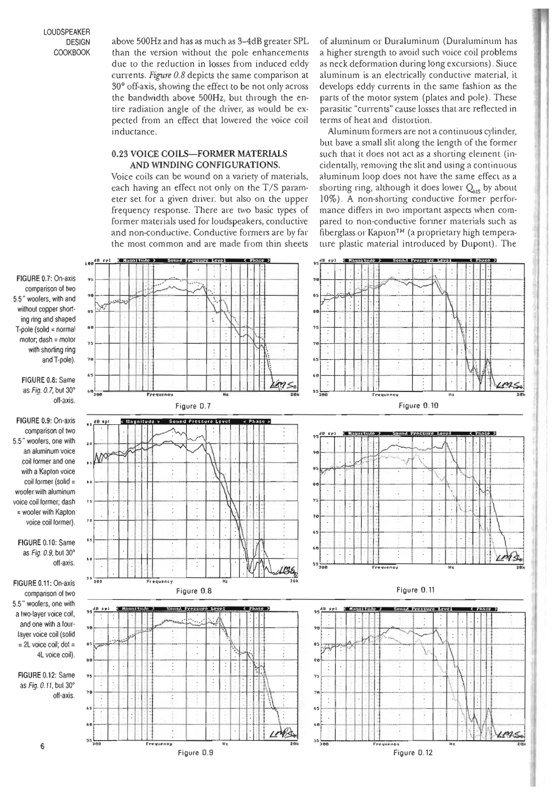

...above 500Hz and has as much as 3-4dB greater SPL than the version without the pole enhancements due to the reduction in losses from induced eddy currents. *Figure 0.8* depicts the same comparison at 30° off-axis, showing the effect to be not only across the bandwidth above 500Hz, but through the entire radiation angle of the driver, as would be expected from an effect that lowered the voice coil inductance.

## 0.23 VOICE COILS—FORMER MATERIALS AND WINDING CONFIGURATIONS.

Voice coils can be wound on a variety of materials, each having an effect not only on the T/S parameter set for a given driver, but also on the upper frequency response. There are two basic types of former materials used for loudspeakers, conductive and non-conductive. Conductive formers are by far the most common and are made from thin sheets of aluminum or Duraluminum (Duraluminum has a higher strength to avoid such voice coil problems as neck deformation during long excursions). Since aluminum is an electrically conductive material, it develops eddy currents in the same fashion as the parts of the motor system (plates and pole). These parasitic "currents" cause losses that are reflected in terms of heat and distortion.

Aluminum formers are not a continuous cylinder, but have a small slit along the length of the former such that it does not act as a shorting element (incidentally, removing the slit and using a continuous aluminum loop does not have the same effect as a shorting ring, although it does lower $Q_{MS}$ by about 10%). A non-shorting conductive former performance differs in two important aspects when compared to non-conductive former materials such as fiberglass or Kaptonâ„¢ (a proprietary high temperature plastic material introduced by Dupont). The...

### FIGURE 0.7: On-axis comparison of two 5.5" woofers, with and without copper shorting ring and shaped T-pole (solid = motor with shorting ring and T-pole).

### FIGURE 0.8: Same as Fig. 0.7, but 30° off-axis.

### FIGURE 0.9: On-axis comparison of two 5.5" woofers, one with an aluminum voice coil former and one with a Kapton voice coil former (solid = woofer with aluminum voice coil former; dash = woofer with Kapton voice coil former).

### FIGURE 0.10: Same as Fig. 0.9, but 30° off-axis.

### FIGURE 0.11: On-axis comparison of two 5.5" woofers, one with a two-layer voice coil, and one with a four-layer voice coil (solid = 2L voice coil; dot = 4L voice coil).

### FIGURE 0.12: Same as Fig. 0.11, but 30° off-axis.

---

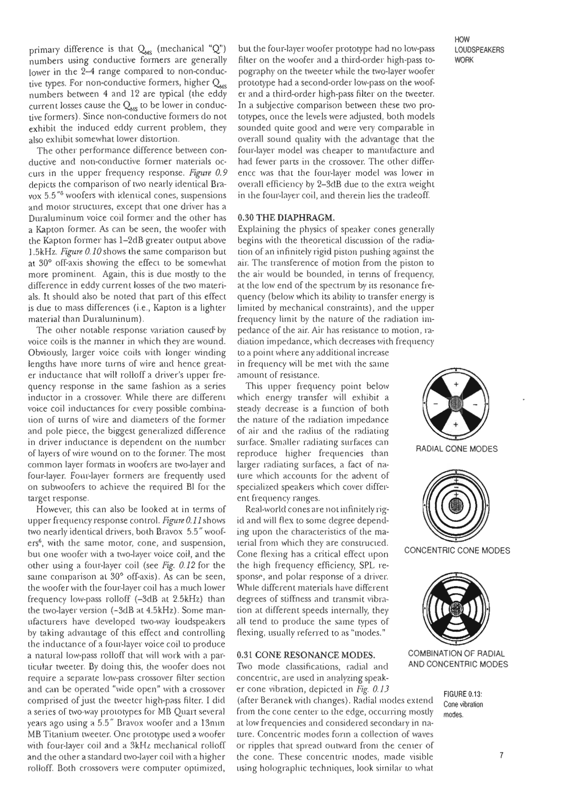

...primary difference is that $Q_{MS}$ (mechanical "Q") numbers using conductive formers are generally lower in the 2-4 range compared to non-conductive types. For non-conductive formers, higher $Q_{MS}$ numbers between 4 and 12 are typical (the eddy current losses cause the $Q_{MS}$ to be lower in conductive formers). Since non-conductive formers do not exhibit the induced eddy current problem, they also exhibit somewhat lower distortion.

The other performance difference between conductive and non-conductive former materials occurs in the upper frequency response. *Figure 0.9* depicts the comparison of two nearly identical Bravox 5.5"⁶ woofers with identical cones, suspensions and motor structures, except that one driver has a Duraluminum voice coil former and the other has a Kapton former. As can be seen, the woofer with the Kapton former has 1-2dB greater output above 1.5kHz. *Figure 0.10* shows the same comparison but at 30° off-axis showing the effect to be somewhat more prominent. Again, this is due mostly to the difference in eddy current losses of the two materials. It should also be noted that part of this effect is due to mass differences (i.e., Kapton is a lighter material than Duraluminum).

The other notable response variation caused by voice coils is the manner in which they are wound. Obviously, larger voice coils with longer winding lengths have more turns of wire and hence greater inductance that will rolloff a driver's upper frequency response in the same fashion as a series inductor in a crossover. While there are different voice coil inductances for every possible combination of turns of wire and diameters of the former and pole piece, the biggest generalized difference in driver inductance is dependent on the number of layers of wire wound on to the former. The most common layer formats in woofers are two-layer and four-layer. Four-layer formers are frequently used on subwoofers to achieve the required Bl for the target response.

However, this can also be looked at in terms of upper frequency response control. *Figure 0.11* shows two nearly identical drivers, both Bravox 5.5" woofers⁶, with the same motor, cone, and suspension, but one woofer with a two-layer voice coil, and the other using a four-layer coil (see *Fig. 0.12* for the same comparison at 30° off-axis). As can be seen, the woofer with the four-layer coil has a much lower frequency low-pass rolloff (-3dB at 2.5kHz) than the two-layer version (-3dB at 4.5kHz). Some manufacturers have developed two-way loudspeakers by taking advantage of this effect and controlling the inductance of a four-layer voice coil to produce a natural low-pass rolloff that will work with a particular tweeter. By doing this, the woofer does not require a separate low-pass crossover filter section and can be operated "wide open" with a crossover comprised of just the tweeter high-pass filter. I did a series of two-way prototypes for MB Quart several years ago using a 5.5" Bravox woofer and a 13mm MB Titanium tweeter. One prototype used a woofer with four-layer coil and a 3kHz mechanical rolloff and the other a standard two-layer coil with a higher rolloff. Both crossovers were computer optimized, but the four-layer woofer prototype had no low-pass filter on the woofer and a third-order high-pass topography on the tweeter while the two-layer woofer prototype had a second-order low-pass on the woofer and a third-order high-pass filter on the tweeter. In a subjective comparison between these two prototypes, once the levels were adjusted, both models sounded quite good and were very comparable in overall sound quality with the advantage that the four-layer model was cheaper to manufacture and had fewer parts in the crossover. The other difference was that the four-layer model was lower in overall efficiency by 2-3dB due to the extra weight in the four-layer coil, and therein lies the tradeoff.

## 0.30 THE DIAPHRAGM.

Explaining the physics of speaker cones generally begins with the theoretical discussion of the radiation of an infinitely rigid piston pushing against the air. The transference of motion from the piston to the air would be bounded, in terms of frequency, at the low end of the spectrum by its resonance frequency (below which its ability to transfer energy is limited by mechanical constraints), and the upper frequency limit by the nature of the radiation impedance of the air. Air has resistance to motion, radiation impedance, which decreases with frequency to a point where any additional increase in frequency will be met with the same amount of resistance.

This upper frequency point below which energy transfer will exhibit a steady decrease is a function of both the nature of the radiation impedance of air and the radius of the radiating surface. Smaller radiating surfaces can reproduce higher frequencies than larger radiating surfaces, a fact of nature which accounts for the advent of specialized speakers which cover different frequency ranges.

Real-world cones are not infinitely rigid and will flex to some degree depending upon the characteristics of the material from which they are constructed. Cone flexing has a critical effect upon the high frequency efficiency, SPL response, and polar response of a driver. While different materials have different degrees of stiffness and transmit vibration at different speeds internally, they all tend to produce the same types of flexing, usually referred to as "modes."

### 0.31 CONE RESONANCE MODES.

Two mode classifications, radial and concentric, are used in analyzing speaker cone vibration, depicted in *Fig. 0.13* (after Beranek with changes). Radial modes extend from the cone center to the edge, occurring mostly at low frequencies and considered secondary in nature. Concentric modes form a collection of waves or ripples that spread outward from the center of the cone. These concentric modes, made visible using holographic techniques, look similar to what...

### FIGURE 0.13: Cone vibration modes.
(Diagrams showing: RADIAL CONE MODES, CONCENTRIC CONE MODES, COMBINATION OF RADIAL AND CONCENTRIC MODES)
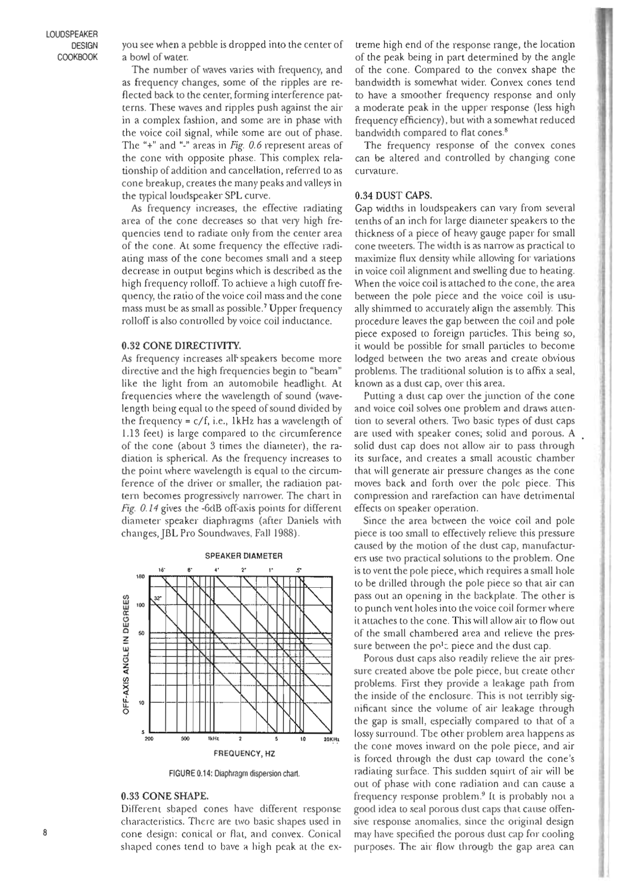

...you see when a pebble is dropped into the center of a bowl of water.
The number of waves varies with frequency, and as frequency changes, some of the ripples are reflected back to the center, forming interference patterns. These waves and ripples push against the air in a complex fashion, and some are in phase with the voice coil signal, while some are out of phase. The "+" and "-" areas in *Fig. 0.6* represent areas of the cone with opposite phase. This complex relationship of addition and cancellation, referred to as cone breakup, creates the many peaks and valleys in the typical loudspeaker SPL curve.
As frequency increases, the effective radiating area of the cone decreases so that very high frequencies tend to radiate only from the center area of the cone. At some frequency the effective radiating mass of the cone becomes small and a steep decrease in output begins which is described as the high frequency rolloff. To achieve a high cutoff frequency, the ratio of the voice coil mass and the cone mass must be as small as possible.⁷ Upper frequency rolloff is also controlled by voice coil inductance.

## 0.32 CONE DIRECTIVITY.
As frequency increases all speakers become more directive and the high frequencies begin to "beam" like the light from an automobile headlight. At frequencies where the wavelength of sound (wavelength being equal to the speed of sound divided by the frequency = c/f, i.e., 1kHz has a wavelength of 1.13 feet) is large compared to the circumference of the cone (about 3 times the diameter), the radiation is spherical. As the frequency increases to the point where wavelength is equal to the circumference of the driver or smaller, the radiation pattern becomes progressively narrower. The chart in *Fig. 0.14* gives the -6dB off-axis points for different diameter speaker diaphragms (after Daniels with changes, JBL Pro Soundwaves, Fall 1988).

### FIGURE 0.14: Diaphragm dispersion chart.
(Graph showing OFF-AXIS ANGLE IN DEGREES vs FREQUENCY, HZ for SPEAKER DIAMETER: 15", 8", 4", 2", 1", .5")

## 0.33 CONE SHAPE.
Different shaped cones have different response characteristics. There are two basic shapes used in cone design: conical or flat, and convex. Conical shaped cones tend to have a high peak at the extreme high end of the response range, the location of the peak being in part determined by the angle of the cone. Compared to the convex shape the bandwidth is somewhat wider. Convex cones tend to have a smoother frequency response and only a moderate peak in the upper response (less high frequency efficiency), but with a somewhat reduced bandwidth compared to flat cones.⁸
The frequency response of the convex cones can be altered and controlled by changing cone curvature.

## 0.34 DUST CAPS.
Gap widths in loudspeakers can vary from several tenths of an inch for large diameter speakers to the thickness of a piece of heavy gauge paper for small cone tweeters. The width is as narrow as practical to maximize flux density while allowing for variations in voice coil alignment and swelling due to heating. When the voice coil is attached to the cone, the area between the pole piece and the voice coil is usually shimmed to accurately align the assembly. This procedure leaves the gap between the coil and pole piece exposed to foreign particles. This being so, it would be possible for small particles to become lodged between the two areas and create obvious problems. The traditional solution is to affix a seal, known as a dust cap, over this area.
Putting a dust cap over the junction of the cone and voice coil solves one problem and draws attention to several others. Two basic types of dust caps are used with speaker cones; solid and porous. A solid dust cap does not allow air to pass through its surface, and creates a small acoustic chamber that will generate air pressure changes as the cone moves back and forth over the pole piece. This compression and rarefaction can have detrimental effects on speaker operation.
Since the area between the voice coil and pole piece is too small to effectively relieve this pressure caused by the motion of the dust cap, manufacturers use two practical solutions to the problem. One is to vent the pole piece, which requires a small hole to be drilled through the pole piece so that air can pass out an opening in the backplate. The other is to punch vent holes into the voice coil former where it attaches to the cone. This will allow air to flow out of the small chambered area and relieve the pressure between the pole piece and the dust cap.
Porous dust caps also readily relieve the air pressure created above the pole piece, but create other problems. First they provide a leakage path from the inside of the enclosure. This is not terribly significant since the volume of air leakage through the gap is small, especially compared to that of a lossy surround. The other problem area happens as the cone moves inward on the pole piece, and air is forced through the dust cap toward the cone's radiating surface. This sudden squirt of air will be out of phase with cone radiation and can cause a frequency response problem.⁹ It is probably not a good idea to seal porous dust caps that cause offensive response anomalies, since the original design may have specified the porous dust cap for cooling purposes. The air flow through the gap area can...

---

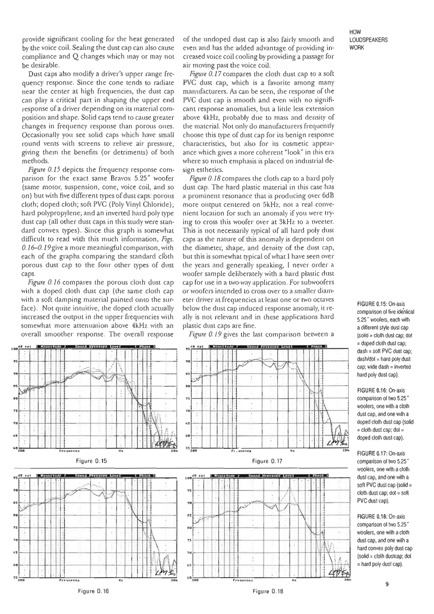

...provide significant cooling for the heat generated by the voice coil. Sealing the dust cap can also cause compliance and Q changes which may or may not be desirable.
Dust caps also modify a driver's upper range frequency response. Since the cone tends to radiate near the center at high frequencies, the dust cap can play a critical part in shaping the upper end response of a driver depending on its material composition and shape. Solid caps tend to cause greater changes in frequency response than porous ones. Occasionally you see solid caps which have small round vents with screens to relieve air pressure, giving them the benefits (or detriments) of both methods.
*Figure 0.15* depicts the frequency response comparison for the exact same Bravox 5.25" woofer (same motor, suspension, cone, voice coil, and so on) but with five different types of dust caps: porous cloth; doped cloth; soft PVC (Poly Vinyl Chloride); hard polypropylene; and an inverted hard poly type dust cap (all other dust caps in this study were standard convex types). Since this graph is somewhat difficult to read with this much information, *Figs. 0.16-0.19* give a more meaningful comparison, each of the graphs comparing the standard cloth porous dust cap to the four other types of dust caps.
*Figure 0.16* compares the porous cloth dust cap with a doped cloth dust cap (the same cloth cap with a soft damping material painted onto the surface). Not quite intuitive, the doped cloth actually increased the output in the upper frequencies with somewhat more attenuation above 4kHz with an overall smoother response. The overall response of the undoped dust cap is also fairly smooth and even and has the added advantage of providing increased voice coil cooling by providing a passage for air moving past the voice coil.
*Figure 0.17* compares the cloth dust cap to a soft PVC dust cap, which is a favorite among many manufacturers. As can be seen, the response of the PVC dust cap is smooth and even with no significant response anomalies, but a little less extension above 4kHz, probably due to mass and density of the material. Not only do manufacturers frequently choose this type of dust cap for its benign response characteristics, but also for its cosmetic appearance which gives a more coherent "look" in this era where so much emphasis is placed on industrial design esthetics.
*Figure 0.18* compares the cloth cap to a hard poly dust cap. The hard plastic material in this case has a prominent resonance that is producing over 6dB more output centered on 5kHz, not a real convenient location for such an anomaly if you were trying to cross this woofer over at 3kHz to a tweeter. This is not necessarily typical of all hard poly dust caps as the nature of this anomaly is dependent on the diameter, shape, and density of the dust cap, but this is somewhat typical of what I have seen over the years and generally speaking, I never order a woofer sample deliberately with a hard plastic dust cap for use in a two-way application. For subwoofers or woofers intended to cross over to a smaller diameter driver at frequencies at least one or two octaves below the dust cap induced response anomaly, it really is not relevant and in these applications hard plastic dust caps are fine.
*Figure 0.19* gives the last comparison between a...

### FIGURE 0.15: On-axis comparison of five identical 5.25" woofers, each with a different style dust cap (solid = cloth dust cap; dot = doped cloth dust cap; dash = soft PVC dust cap; dash/dot = hard poly dust cap; wide dash = inverted hard poly dust cap).

### FIGURE 0.16: On-axis comparison of two 5.25" woofers, one with a cloth dust cap, and one with a doped cloth dust cap (solid = cloth dust cap; dot = doped cloth dust cap).

### FIGURE 0.17: On-axis comparison of two 5.25" woofers, one with a cloth dust cap, and one with a soft PVC dust cap (solid = cloth dust cap; dot = soft PVC dust cap).

### FIGURE 0.18: On-axis comparison of two 5.25" woofers, one with a cloth dust cap, and one with a hard convex poly dust cap (solid = cloth dust cap; dot = hard poly dust cap).

---

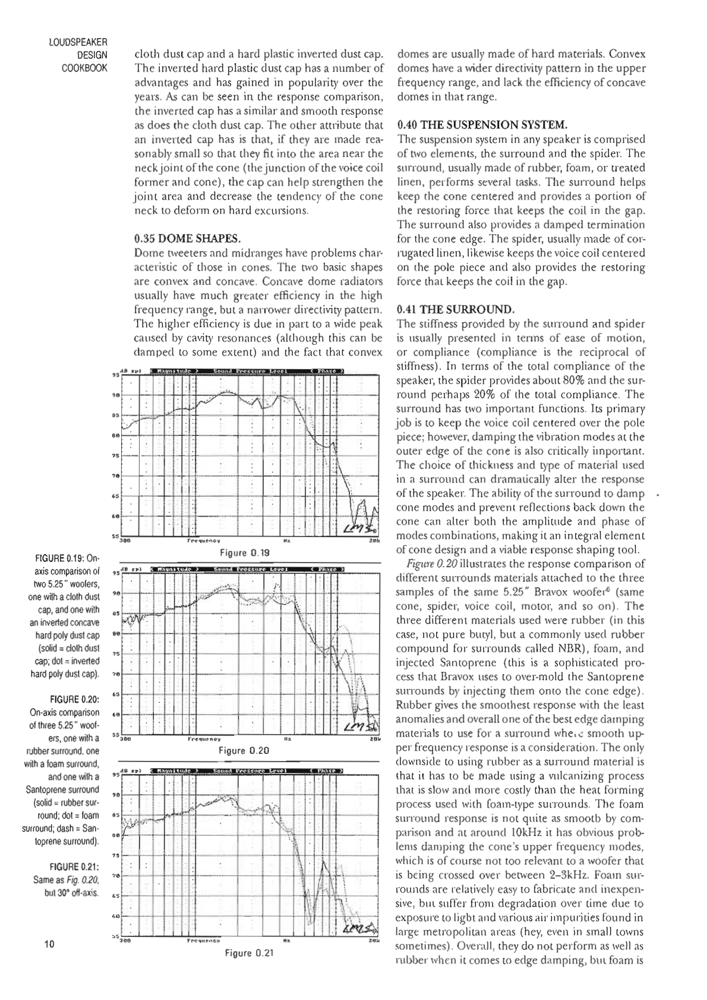

...cloth dust cap and a hard plastic inverted dust cap. The inverted hard plastic dust cap has a number of advantages and has gained in popularity over the years. As can be seen in the response comparison, the inverted cap has a similar and smooth response as does the cloth dust cap. The other attribute that an inverted cap has is that, if they are made reasonably small so that they fit into the area near the neck joint of the cone (the junction of the voice coil former and cone), the cap can help strengthen the joint area and decrease the tendency of the cone neck to deform on hard excursions.

## 0.35 DOME SHAPES.
Dome tweeters and midranges have problems characteristic of those in cones. The two basic shapes are convex and concave. Concave dome radiators usually have much greater efficiency in the high frequency range, but a narrower directivity pattern. The higher efficiency is due in part to a wide peak caused by cavity resonances (although this can be damped to some extent) and the fact that convex domes are usually made of hard materials. Convex domes have a wider directivity pattern in the upper frequency range, and lack the efficiency of concave domes in that range.

## 0.40 THE SUSPENSION SYSTEM.
The suspension system in any speaker is comprised of two elements, the surround and the spider. The surround, usually made of rubber, foam, or treated linen, performs several tasks. The surround helps keep the cone centered and provides a portion of the restoring force that keeps the coil in the gap. The surround also provides a damped termination for the cone edge. The spider, usually made of corrugated linen, likewise keeps the voice coil centered on the pole piece and also provides the restoring force that keeps the coil in the gap.

## 0.41 THE SURROUND.
The stiffness provided by the surround and spider is usually presented in terms of ease of motion, or compliance (compliance is the reciprocal of stiffness). In terms of the total compliance of the speaker, the spider provides about 80% and the surround perhaps 20% of the total compliance. The surround has two important functions. Its primary job is to keep the voice coil centered over the pole piece; however, damping the vibration modes at the outer edge of the cone is also critically important. The choice of thickness and type of material used in a surround can dramatically alter the response of the speaker. The ability of the surround to damp cone modes and prevent reflections back down the cone can alter both the amplitude and phase of modes combinations, making it an integral element of cone design and a viable response shaping tool.
*Figure 0.20* illustrates the response comparison of different surrounds materials attached to the three samples of the same 5.25" Bravox woofer⁶ (same cone, spider, voice coil, motor, and so on). The three different materials used were rubber (in this case, not pure butyl, but a commonly used rubber compound for surrounds called NBR), foam, and injected Santoprene (this is a sophisticated process that Bravox uses to over-mold the Santoprene surrounds by injecting them onto the cone edge). Rubber gives the smoothest response with the least anomalies and overall one of the best edge damping materials to use for a surround where smooth upper frequency response is a consideration. The only downside to using rubber as a surround material is that it has to be made using a vulcanizing process that is slow and more costly than the heat forming process used with foam-type surrounds. The foam surround response is not quite as smooth by comparison and at around 10kHz it has obvious problems damping the cone's upper frequency modes, which is of course not too relevant to a woofer that is being crossed over between 2-3kHz. Foam surrounds are relatively easy to fabricate and inexpensive, but suffer from degradation over time due to exposure to light and various air impurities found in large metropolitan areas (hey, even in small towns sometimes). Overall, they do not perform as well as rubber when it comes to edge damping, but foam is...

### FIGURE 0.19: On-axis comparison of two 5.25" woofers, one with a cloth dust cap, and one with an inverted concave hard poly dust cap (solid = cloth dust cap; dot = inverted hard poly dust cap).

### FIGURE 0.20: On-axis comparison of three 5.25" woofers, one with a rubber surround, one with a foam surround, and one with a Santoprene surround (solid = rubber surround; dot = foam surround; dash = Santoprene surround).

### FIGURE 0.21: Same as Fig. 0.20, but 30° off-axis.

---

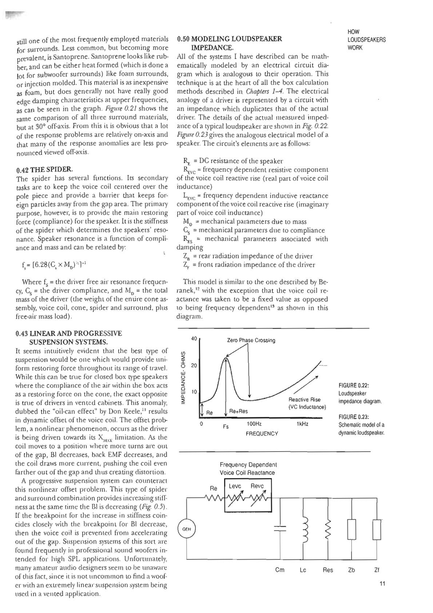

...still one of the most frequently employed materials for surrounds. Less common, but becoming more prevalent, is Santoprene. Santoprene looks like rubber, and can be either heat formed (which is done a lot for subwoofer surrounds) like foam surrounds, or injection molded. This material is as inexpensive as foam, but does generally not have really good edge damping characteristics at upper frequencies, as can be seen in the graph. *Figure 0.21* shows the same comparison of all three surround materials, but at 30° off-axis. From this it is obvious that a lot of the response problems are relatively on-axis and that many of the response anomalies are less pronounced viewed off-axis.

## 0.42 THE SPIDER.
The spider has several functions. Its secondary tasks are to keep the voice coil centered over the pole piece and provide a barrier that keeps foreign particles away from the gap area. The primary purpose, however, is to provide the main restoring force (compliance) for the speaker. It is the stiffness of the spider which determines the speakers' resonance. Speaker resonance is a function of compliance and mass and can be related by:

$$f_s = [6.28(C_s \times M_D)^{1/2}]^{-1}$$

Where $f_s$ = the driver free air resonance frequency, $C_s$ = the driver compliance, and $M_D$ = the total mass of the driver (the weight of the entire cone assembly, voice coil, cone, spider and surround, plus free-air mass load).

## 0.43 LINEAR AND PROGRESSIVE SUSPENSION SYSTEMS.
It seems intuitively evident that the best type of suspension would be one which would provide uniform restoring force throughout its range of travel. While this can be true for closed box type speakers where the compliance of the air within the box acts as a restoring force on the cone, the exact opposite is true of drivers in vented cabinets. This anomaly, dubbed the "oil-can effect" by Don Keele,¹⁰ results in dynamic offset of the voice coil. The offset problem, a nonlinear phenomenon, occurs as the driver is being driven towards its $X_{MAX}$ limitation. As the coil moves to a position where more turns are out of the gap, Bl decreases, back EMF decreases, and the coil draws more current, pushing the coil even farther out of the gap and thus creating distortion.
A progressive suspension system can counteract this nonlinear offset problem. This type of spider and surround combination provides increasing stiffness at the same time the Bl is decreasing (*Fig. 0.5*). If the breakpoint for the increase in stiffness coincides closely with the breakpoint for Bl decrease, then the voice coil is prevented from accelerating out of the gap. Suspension systems of this sort are found frequently in professional sound woofers intended for high SPL applications. Unfortunately, many amateur audio designers seem to be unaware of this fact, since it is not uncommon to find a woofer with an extremely linear suspension system being used in a vented application.

## 0.50 MODELING LOUDSPEAKER IMPEDANCE.
All of the systems I have described can be mathematically modeled by an electrical circuit diagram which is analogous to their operation. This technique is at the heart of all the box calculation methods described in *Chapters 1-4*. The electrical analogy of a driver is represented by a circuit with an impedance which duplicates that of the actual driver. The details of the actual measured impedance of a typical loudspeaker are shown in *Fig. 0.22*. *Figure 0.23* gives the analogous electrical model of a speaker. The circuit's elements are as follows:

$R_e$ = DC resistance of the speaker
$R_{EVC}$ = frequency dependent resistive component of the voice coil reactive rise (real part of voice coil inductance)
$L_{EVC}$ = frequency dependent inductive reactance component of the voice coil reactive rise (imaginary part of voice coil inductance)
$M_D$ = mechanical parameters due to mass
$C_s$ = mechanical parameters due to compliance
$R_{ES}$ = mechanical parameters associated with damping
$Z_B$ = rear radiation impedance of the driver
$Z_F$ = front radiation impedance of the driver

This model is similar to the one described by Beranek,¹¹ with the exception that the voice coil reactance was taken to be a fixed value as opposed to being frequency dependent¹² as shown in this diagram.

### FIGURE 0.22: Loudspeaker impedance diagram.
(Graph showing IMPEDANCE- OHMS vs FREQUENCY with labels: Re, Fs, Re+Res, Zero Phase Crossing, Reactive Rise (VC Inductance))

### FIGURE 0.23: Schematic model of a dynamic loudspeaker.
(Circuit diagram showing: GEN, Re, Frequency Dependent Voice Coil Reactance (Levc, Revc), Cm, Lc, Res, Zb, Zf)

---

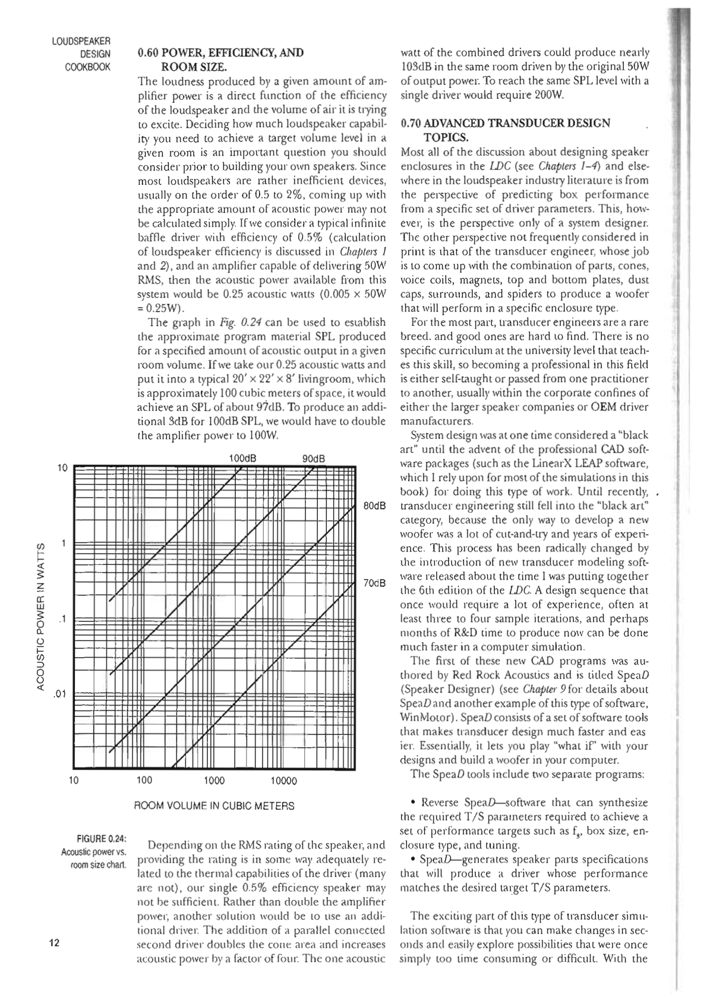

## 0.60 POWER, EFFICIENCY, AND ROOM SIZE.
The loudness produced by a given amount of amplifier power is a direct function of the efficiency of the loudspeaker and the volume of air it is trying to excite. Deciding how much loudspeaker capability you need to achieve a target volume level in a given room is an important question you should consider prior to building your own speakers. Since most loudspeakers are rather inefficient devices, usually on the order of 0.5 to 2%, coming up with the appropriate amount of acoustic power may not be calculated simply. If we consider a typical infinite baffle driver with efficiency of 0.5% (calculation of loudspeaker efficiency is discussed in *Chapters 1 and 2*), and an amplifier capable of delivering 50W RMS, then the acoustic power available from this system would be 0.25 acoustic watts (0.005 x 50W = 0.25W).
The graph in *Fig. 0.24* can be used to establish the approximate program material SPL produced for a specified amount of acoustic output in a given room volume. If we take our 0.25 acoustic watts and put it into a typical 20' x 22' x 8' livingroom, which is approximately 100 cubic meters of space, it would achieve an SPL of about 97dB. To produce an additional 3dB for 100dB SPL, we would have to double the amplifier power to 100W.

### FIGURE 0.24: Acoustic power vs. room size chart.
(Graph showing ACOUSTIC POWER IN WATTS vs ROOM VOLUME IN CUBIC METERS with SPL lines for 100dB, 90dB, 80dB, 70dB)

Depending on the RMS rating of the speaker, and providing the rating is in some way adequately related to the thermal capabilities of the driver (many are not), our single 0.5% efficiency speaker may not be sufficient. Rather than double the amplifier power, another solution would be to use an additional driver. The addition of a parallel connected second driver doubles the cone area and increases acoustic power by a factor of four. The one acoustic watt of the combined drivers could produce nearly 103dB in the same room driven by the original 50W of output power. To reach the same SPL level with a single driver would require 200W.

## 0.70 ADVANCED TRANSDUCER DESIGN TOPICS.
Most all of the discussion about designing speaker enclosures in the *LDC* (see *Chapters 1-4*) and elsewhere in the loudspeaker industry literature is from the perspective of predicting box performance from a specific set of driver parameters. This, however, is the perspective only of a system designer. The other perspective not frequently considered in print is that of the transducer engineer, whose job is to come up with the combination of parts, cones, voice coils, magnets, top and bottom plates, dust caps, surrounds, and spiders to produce a woofer that will perform in a specific enclosure type.
For the most part, transducer engineers are a rare breed, and good ones are hard to find. There is no specific curriculum at the university level that teaches this skill, so becoming a professional in this field is either self-taught or passed from one practitioner to another, usually within the corporate confines of either the larger speaker companies or OEM driver manufacturers.
System design was at one time considered a "black art" until the advent of the professional CAD software packages (such as the LinearX LEAP software, which I rely upon for most of the simulations in this book) for doing this type of work. Until recently, transducer engineering still fell into the "black art" category, because the only way to develop a new woofer was a lot of cut-and-try and years of experience. This process has been radically changed by the introduction of new transducer modeling software released about the time I was putting together the 6th edition of the *LDC*. A design sequence that once would require a lot of experience, often at least three to four sample iterations, and perhaps months of R&D time to produce now can be done much faster in a computer simulation.
The first of these new CAD programs was authored by Red Rock Acoustics and is titled SpeaD (Speaker Designer) (see *Chapter 9* for details about SpeaD and another example of this type of software, WinMotor). SpeaD consists of a set of software tools that makes transducer design much faster and easier. Essentially, it lets you play "what if" with your designs and build a woofer in your computer.
The SpeaD tools include two separate programs:
* Reverse SpeaD—software that can synthesize the required T/S parameters required to achieve a set of performance targets such as $f_s$, box size, enclosure type, and tuning.
* SpeaD—generates speaker parts specifications that will produce a driver whose performance matches the desired target T/S parameters.
The exciting part of this type of transducer simulation software is that you can make changes in seconds and easily explore possibilities that were once simply too time consuming or difficult. With the...
# Loudspeaker Design Cookbook - Transcription Part 3

## Page 13
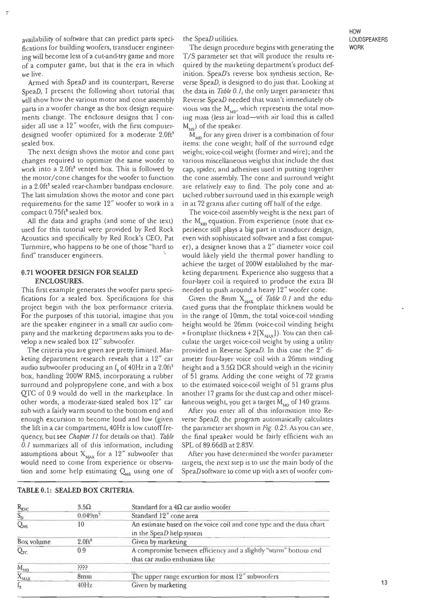

availability of software that can predict parts specifications for building woofers, transducer engineering will become less of a cut-and-try game and more of a computer game, but that is the era in which we live.

Armed with SpeaD and its counterpart, Reverse SpeaD, I present the following short tutorial that will show how the various motor and cone assembly parts in a woofer change as the box design requirements change. The enclosure designs that I consider all use a 12" woofer, with the first computer-designed woofer optimized for a moderate 2.0ft³ sealed box.

The next design shows the motor and cone part changes required to optimize the same woofer to work into a 2.0ft³ vented box. This is followed by the motor/cone changes for the woofer to function in a 2.0ft³ sealed rear-chamber bandpass enclosure. The last simulation shows the motor and cone part requirements for the same 12" woofer to work in a compact 0.75ft³ sealed box.

All the data and graphs (and some of the text) used for this tutorial were provided by Red Rock Acoustics and specifically by Red Rock's CEO, Pat Turnmire, who happens to be one of those "hard to find" transducer engineers.

### 0.71 WOOFER DESIGN FOR SEALED ENCLOSURES.

This first example generates the woofer parts specifications for a sealed box. Specifications for this project begin with the box performance criteria. For the purposes of this tutorial, imagine that you are the speaker engineer in a small car audio company and the marketing department asks you to develop a new sealed box 12" subwoofer.

The criteria you are given are pretty limited. Marketing department research reveals that a 12" car audio subwoofer producing an f₃ of 40Hz in a 2.0ft³ box, handling 200W RMS, incorporating a rubber surround and polypropylene cone, and with a box QTC of 0.9 would do well in the marketplace. In other words, a moderate-sized sealed box 12" car sub with a fairly warm sound to the bottom end and enough excursion to become loud and low (given the lift in a car compartment, 40Hz is low cutoff frequency, but see Chapter 11 for details on that). Table 0.1 summarizes all of this information, including assumptions about XMAX for a 12" subwoofer that would need to come from experience or observation and some help estimating QMS using one of the SpeaD utilities.

The design procedure begins with generating the T/S parameter set that will produce the results required by the marketing department's product definition. SpeaD's reverse box synthesis section, Reverse SpeaD, is designed to do just that. Looking at the data in Table 0.1, the only target parameter that Reverse SpeaD needed that wasn't immediately obvious was the MMD, which represents the total moving mass (less air load—with air load this is called MMS) of the speaker.

MMD for any given driver is a combination of four items: the cone weight; half of the surround edge weight; voice-coil weight (former and wire); and the various miscellaneous weights that include the dust cap, spider, and adhesives used in putting together the cone assembly. The cone and surround weight are relatively easy to find. The poly cone and attached rubber surround used in this example weigh in at 72 grams after cutting off half of the edge.

The voice-coil assembly weight is the next part of the MMD equation. From experience (note that experience still plays a big part in transducer design, even with sophisticated software and a fast computer), a designer knows that a 2" diameter voice coil would likely yield the thermal power handling to achieve the target of 200W established by the marketing department. Experience also suggests that a four-layer coil is required to produce the extra Bl needed to push around a heavy 12" woofer cone.

Given the 8mm XMAX of Table 0.1 and the educated guess that the frontplate thickness would be in the range of 10mm, the total voice-coil winding height would be 26mm (voice-coil winding height = frontplate thickness + 2[XMAX]). You can then calculate the target voice-coil weight by using a utility provided in Reverse SpeaD. In this case the 2" diameter four-layer voice coil with a 26mm winding height and a 3.5Ω DCR should weigh in the vicinity of 51 grams. Adding the cone weight of 72 grams to the estimated voice-coil weight of 51 grams plus another 17 grams for the dust cap and other miscellaneous weight, you get a target MMD of 140 grams.

After you enter all of this information into Reverse SpeaD, the program automatically calculates the parameter set shown in Fig. 0.25. As you can see, the final speaker would be fairly efficient with an SPL of 89.66dB at 2.83V.

After you have determined the woofer parameter targets, the next step is to use the main body of the SpeaD software to come up with a set of woofer com-

**TABLE 0.1: SEALED BOX CRITERIA.**

| Parameter | Value | Notes |
| :--- | :--- | :--- |
| REVC | 3.5Ω | Standard for a 4Ω car audio woofer |
| SD | 0.049m² | Standard 12" cone area |
| QMS | 10 | An estimate based on the voice coil and cone type and the data chart in the SpeaD help system |
| Box volume | 2.0ft³ | Given by marketing |
| QTC | 0.9 | A compromise between efficiency and a slightly "warm" bottom end that car audio enthusiasts like |
| MMD | ???? | |
| XMAX | 8mm | The upper range excursion for most 12" subwoofers |
| f₃ | 40Hz | Given by marketing |

---

## Page 14
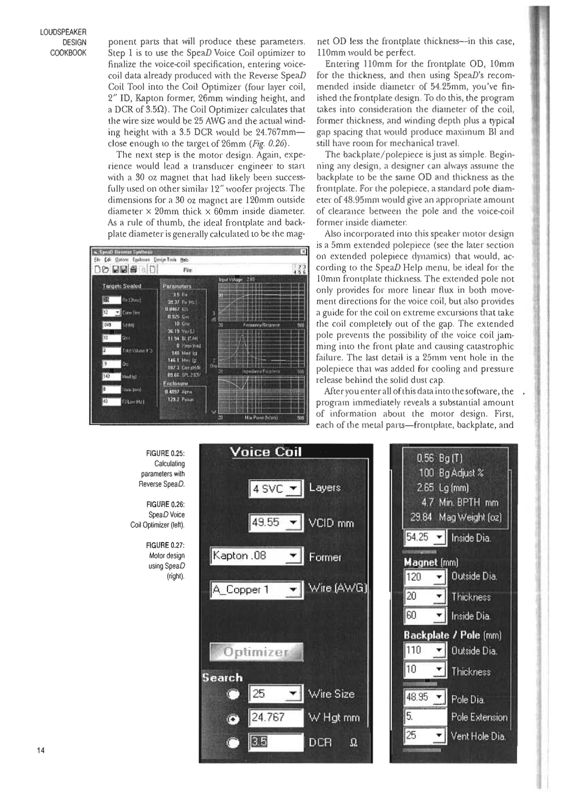

ponent parts that will produce these parameters. Step 1 is to use the SpeaD Voice Coil optimizer to finalize the voice-coil specification, entering voice-coil data already produced with the Reverse SpeaD Coil Tool into the Coil Optimizer (four layer coil, 2" ID, Kapton former, 26mm winding height, and a DCR of 3.5Ω). The Coil Optimizer calculates that the wire size would be 25 AWG and the actual winding height with a 3.5 DCR would be 24.767mm—close enough to the target of 26mm (Fig. 0.26).

The next step is the motor design. Again, experience would lead a transducer engineer to start with a 30 oz magnet that had likely been successfully used on other similar 12" woofer projects. The dimensions for a 30 oz magnet are 120mm outside diameter x 20mm thick x 60mm inside diameter. As a rule of thumb, the ideal frontplate and backplate diameter is generally calculated to be the magnet OD less the frontplate thickness—in this case, 110mm would be perfect.

Entering 110mm for the frontplate OD, 10mm for the thickness, and then using SpeaD's recommended inside diameter of 54.25mm, you've finished the frontplate design. To do this, the program takes into consideration the diameter of the coil, former thickness, and winding depth plus a typical gap spacing that would produce maximum Bl and still have room for mechanical travel.

The backplate/polepiece is just as simple. Beginning any design, a designer can always assume the backplate to be the same OD and thickness as the frontplate. For the polepiece, a standard pole diameter of 48.95mm would give an appropriate amount of clearance between the pole and the voice-coil former inside diameter.

Also incorporated into this speaker motor design is a 5mm extended polepiece (see the later section on extended polepiece dynamics) that would, according to the SpeaD Help menu, be ideal for the 10mm frontplate thickness. The extended pole not only provides for more linear flux in both movement directions for the voice coil, but also provides a guide for the coil on extreme excursions that take the coil completely out of the gap. The extended pole prevents the possibility of the voice coil jamming into the front plate and causing catastrophic failure. The last detail is a 25mm vent hole in the polepiece that was added for cooling and pressure release behind the solid dust cap.

After you enter all of this data into the software, the program immediately reveals a substantial amount of information about the motor design. First, each of the metal parts—frontplate, backplate, and

**FIGURE 0.25:** Calculating parameters with Reverse SpeaD.
**FIGURE 0.26:** SpeaD Voice Coil Optimizer (left).
**FIGURE 0.27:** Motor design using SpeaD (right).

---

## Page 15
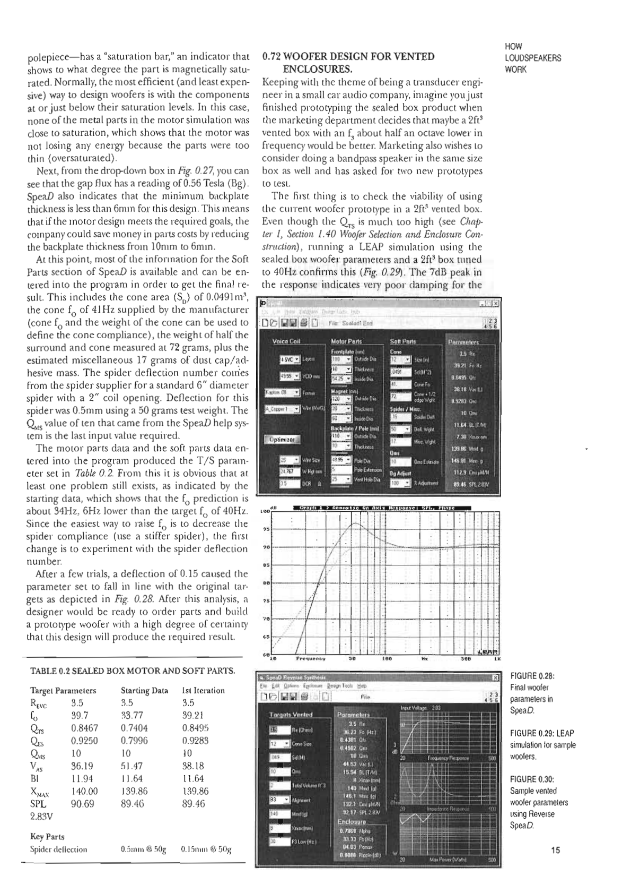

polepiece—has a "saturation bar," an indicator that shows to what degree the part is magnetically saturated. Normally, the most efficient (and least expensive) way to design woofers is with the components at or just below their saturation levels. In this case, none of the metal parts in the motor simulation was close to saturation, which shows that the motor was not losing any energy because the parts were too thin (oversaturated).

Next, from the drop-down box in Fig. 0.27, you can see that the gap flux has a reading of 0.56 Tesla (Bg). SpeaD also indicates that the minimum backplate thickness is less than 6mm for this design. This means that if the motor design meets the required goals, the company could save money in parts costs by reducing the backplate thickness from 10mm to 6mm.

At this point, most of the information for the Soft Parts section of SpeaD is available and can be entered into the program in order to get the final result. This includes the cone area (SD) of 0.0491m², the cone f₀ of 41Hz supplied by the manufacturer (cone f₀ and the weight of the cone can be used to define the cone compliance), the weight of half the surround and cone measured at 72 grams, plus the estimated miscellaneous 17 grams of dust cap/adhesive mass. The spider deflection number comes from the spider supplier for a standard 6" diameter spider with a 2" coil opening. Deflection for this spider was 0.5mm using a 50 grams test weight. The QMS value of ten that came from the SpeaD help system is the last input value required.

The motor parts data and the soft parts data entered into the program produced the T/S parameter set in Table 0.2. From this it is obvious that at least one problem still exists, as indicated by the starting data, which shows that the fâ‚€ prediction is about 34Hz, 6Hz lower than the target fâ‚€ of 40Hz. Since the easiest way to raise fâ‚€ is to decrease the spider compliance (use a stiffer spider), the first change is to experiment with the spider deflection number.

After a few trials, a deflection of 0.15 caused the parameter set to fall in line with the original targets as depicted in Fig. 0.28. After this analysis, a designer would be ready to order parts and build a prototype woofer with a high degree of certainty that this design will produce the required result.

### 0.72 WOOFER DESIGN FOR VENTED ENCLOSURES.

Keeping with the theme of being a transducer engineer in a small car audio company, imagine you just finished prototyping the sealed box product when the marketing department decides that maybe a 2ft³ vented box with an f₃ about half an octave lower in frequency would be better. Marketing also wishes to consider doing a bandpass speaker in the same size box as well and has asked for two new prototypes to test.

The first thing is to check the viability of using the current woofer prototype in a 2ft³ vented box. Even though the QTS is much too high (see Chapter 1, Section 1.40 Woofer Selection and Enclosure Construction), running a LEAP simulation using the sealed box woofer parameters and a 2ft³ box tuned to 40Hz confirms this (Fig. 0.29). The 7dB peak in the response indicates very poor damping for the

**TABLE 0.2: SEALED BOX MOTOR AND SOFT PARTS.**

| Target Parameters | Starting Data | 1st Iteration |
| :--- | :--- | :--- |
| REVC | 3.5 | 3.5 |
| fâ‚€ | 33.77 | 39.21 |
| QTS | 0.7404 | 0.8495 |
| QES | 0.7996 | 0.9283 |
| QMS | 10 | 10 |
| VAS | 51.47 | 38.18 |
| Bl | 11.64 | 11.64 |
| XMAX | 139.86 | 139.86 |
| SPL 2.83V | 89.46 | 89.46 |

**Key Parts**
Spider deflection: 0.5mm @ 50g (Starting), 0.15mm @ 50g (1st Iteration)

**FIGURE 0.28:** Final woofer parameters in SpeaD.
**FIGURE 0.29:** LEAP simulation for sample woofers.
**FIGURE 0.30:** Sample vented woofer parameters using Reverse SpeaD.
# Loudspeaker Design Cookbook - Transcription Part 4

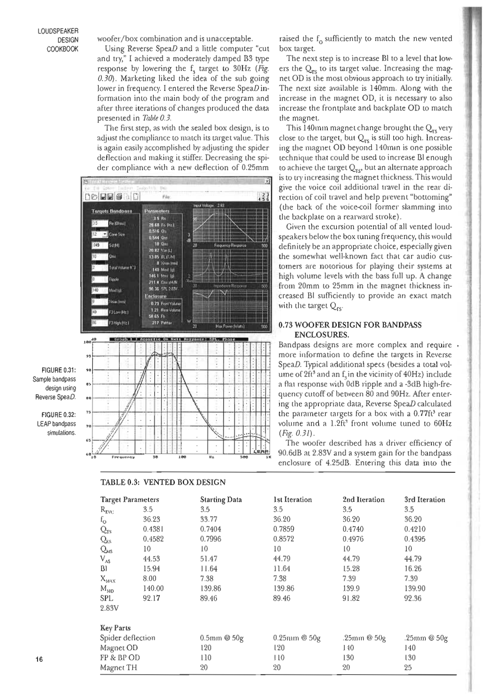

woofer/box combination and is unacceptable.

Using Reverse SpeaD and a little computer "cut and try," I achieved a moderately damped B3 type response by lowering the $f_s$ target to 30Hz (*Fig. 0.30*). Marketing liked the idea of the sub going lower in frequency. I entered the Reverse SpeaD information into the main body of the program and after three iterations of changes produced the data presented in *Table 0.3*.

The first step, as with the sealed box design, is to adjust the compliance to match its target value. This is again easily accomplished by adjusting the spider deflection and making it stiffer. Decreasing the spider compliance with a new deflection of 0.25mm raised the $f_o$ sufficiently to match the new vented box target.

The next step is to increase Bl to a level that lowers the $Q_{ts}$ to its target value. Increasing the magnet OD is the most obvious approach to try initially. The next size available is 140mm. Along with the increase in the magnet OD, it is necessary to also increase the frontplate and backplate OD to match the magnet.

This 140mm magnet change brought the $Q_{ts}$ very close to the target, but $Q_{ts}$ is still too high. Increasing the magnet OD beyond 140mm is one possible technique that could be used to increase Bl enough to achieve the target $Q_{ts}$, but an alternate approach is to try increasing the magnet thickness. This would give the voice coil additional travel in the rear direction of coil travel and help prevent "bottoming" (the back of the voice-coil former slamming into the backplate on a rearward stroke).

Given the excursion potential of all vented loudspeakers below the box tuning frequency, this would definitely be an appropriate choice, especially given the somewhat well-known fact that car audio customers are notorious for playing their systems at high volume levels with the bass full up. A change from 20mm to 25mm in the magnet thickness increased Bl sufficiently to provide an exact match with the target $Q_{ts}$.

### 0.73 WOOFER DESIGN FOR BANDPASS ENCLOSURES.

Bandpass designs are more complex and require more information to define the targets in Reverse SpeaD. Typical additional specs (besides a total volume of $2ft^3$ and an $f_b$ in the vicinity of 40Hz) include a flat response with 0dB ripple and a -3dB high-frequency cutoff of between 80 and 90Hz. After entering the appropriate data, Reverse SpeaD calculated the parameter targets for a box with a $0.77ft^3$ rear volume and a $1.2ft^3$ front volume tuned to 60Hz (*Fig. 0.31*).

The woofer described has a driver efficiency of 90.6dB at 2.83V and a system gain for the bandpass enclosure of 4.25dB. Entering this data into the main program menu results in the data displayed in *Table 0.4*, which includes the four iterations of driver part variations to achieve the final result.

**FIGURE 0.31: Sample bandpass design using Reverse SpeaD.**
**FIGURE 0.32: LEAP bandpass simulations.**

#### TABLE 0.3: VENTED BOX DESIGN

| Target Parameters | Starting Data | 1st Iteration | 2nd Iteration | 3rd Iteration |
| :--- | :--- | :--- | :--- | :--- |
| $R_{EVC}$ | 3.5 | 3.5 | 3.5 | 3.5 | 3.5 |
| $f_o$ | 36.23 | 33.77 | 36.20 | 36.20 | 36.20 |
| $Q_{ts}$ | 0.4381 | 0.7404 | 0.7859 | 0.4740 | 0.4210 |
| $Q_{es}$ | 0.4582 | 0.7996 | 0.8572 | 0.4976 | 0.4395 |
| $Q_{ms}$ | 10 | 10 | 10 | 10 | 10 |
| $V_{AS}$ | 44.53 | 51.47 | 44.79 | 44.79 | 44.79 |
| Bl | 15.94 | 11.64 | 11.64 | 15.28 | 16.26 |
| $X_{MAX}$ | 8.00 | 7.38 | 7.38 | 7.39 | 7.39 |
| $M_{md}$ | 140.00 | 139.86 | 139.86 | 139.9 | 139.90 |
| SPL 2.83V | 92.17 | 89.46 | 89.46 | 91.82 | 92.36 |

**Key Parts**
*   Spider deflection: 0.5mm @ 50g (Start), 0.25mm @ 50g (1st), .25mm @ 50g (2nd), .25mm @ 50g (3rd)
*   Magnet OD: 120 (Start), 120 (1st), 140 (2nd), 140 (3rd)
*   FP & BP OD: 110 (Start), 110 (1st), 130 (2nd), 130 (3rd)
*   Magnet TH: 20 (Start), 20 (1st), 20 (2nd), 25 (3rd)

---

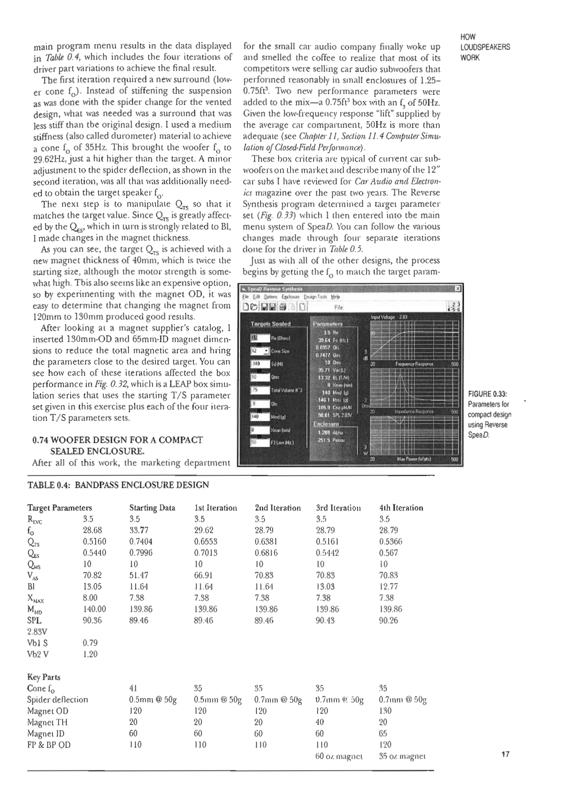

main program menu results in the data displayed in *Table 0.4*, which includes the four iterations of driver part variations to achieve the final result.

The first iteration required a new surround (lower cone $f_o$). Instead of stiffening the suspension as was done with the spider change for the vented design, what was needed was a surround that was less stiff than the original design. I used a medium stiffness (also called durometer) material to achieve a cone $f_o$ of 35Hz. This brought the woofer $f_o$ to 29.62Hz, just a hit higher than the target. A minor adjustment to the spider deflection, as shown in the second iteration, was all that was additionally needed to obtain the target speaker $f_o$.

The next step is to manipulate $Q_{ts}$ so that it matches the target value. Since $Q_{ts}$ is greatly affected by the $Q_{es}$, which in turn is strongly related to Bl, I made changes in the magnet thickness.

As you can see, the target $Q_{ts}$ is achieved with a new magnet thickness of 40mm, which is twice the starting size, although the motor strength is somewhat high. This also seems like an expensive option, so by experimenting with the magnet OD, it was easy to determine that changing the magnet from 120mm to 130mm produced good results.

After looking at a magnet supplier's catalog, I inserted 130mm-OD and 65mm-ID magnet dimensions to reduce the total magnetic area and bring the parameters close to the desired target. You can see how each of these iterations affected the box performance in *Fig. 0.32*, which is a LEAP box simulation series that uses the starting T/S parameter set given in this exercise plus each of the four iteration T/S parameters sets.

### 0.74 WOOFER DESIGN FOR A COMPACT SEALED ENCLOSURE.

After all of this work, the marketing department for the small car audio company finally woke up and smelled the coffee to realize that most of its competitors were selling car audio subwoofers that performed reasonably in small enclosures of 1.25-0.75$ft^3$. Two new performance parameters were added to the mix—a 0.75$ft^3$ box with an $f_b$ of 50Hz. Given the low-frequency response "lift" supplied by the average car compartment, 50Hz is more than adequate (see *Chapter 11, Section 11.4 Computer Simulation of Closed-Field Performance*).

These box criteria are typical of current car subwoofers on the market and describe many of the 12" car subs I have reviewed for *Car Audio and Electronics* magazine over the past two years. The Reverse Synthesis program determined a target parameter set (*Fig. 0.33*) which I then entered into the main menu system of SpeaD. You can follow the various changes made through four separate iterations done for the driver in *Table 0.5*.

Just as with all of the other designs, the process begins by getting the $f_o$ to match the target parameter. $f_o$ on this speaker was similar to the first design and required only a change to the spider deflection to hit the free-air resonance target.

**FIGURE 0.33: Parameters for compact design using Reverse SpeaD.**

#### TABLE 0.4: BANDPASS ENCLOSURE DESIGN

| Target Parameters | Starting Data | 1st Iteration | 2nd Iteration | 3rd Iteration | 4th Iteration |
| :--- | :--- | :--- | :--- | :--- | :--- |
| $R_{EVC}$ | 3.5 | 3.5 | 3.5 | 3.5 | 3.5 | 3.5 |
| $f_o$ | 28.68 | 33.77 | 29.62 | 28.79 | 28.79 | 28.79 |
| $Q_{ts}$ | 0.5160 | 0.7404 | 0.6553 | 0.6381 | 0.5161 | 0.5366 |
| $Q_{es}$ | 0.5440 | 0.7996 | 0.7013 | 0.6816 | 0.5442 | 0.567 |
| $Q_{ms}$ | 10 | 10 | 10 | 10 | 10 | 10 |
| $V_{AS}$ | 70.82 | 51.47 | 66.91 | 70.83 | 70.83 | 70.83 |
| Bl | 13.05 | 11.64 | 11.64 | 11.64 | 13.03 | 12.77 |
| $X_{MAX}$ | 8.00 | 7.38 | 7.38 | 7.38 | 7.38 | 7.38 |
| $M_{md}$ | 140.00 | 139.86 | 139.86 | 139.86 | 139.86 | 139.86 |
| SPL 2.83V | 90.36 | 89.46 | 89.46 | 89.46 | 90.43 | 90.26 |
| Vb1 S | 0.79 | | | | | |
| Vb2 V | 1.20 | | | | | |

**Key Parts**
*   Cone $f_o$: 41 (Start), 35 (1st), 35 (2nd), 35 (3rd), 35 (4th)
*   Spider deflection: 0.5mm @ 50g (Start), 0.5mm @ 50g (1st), 0.7mm @ 50g (2nd), 0.7mm @ 50g (3rd), 0.7mm @ 50g (4th)
*   Magnet OD: 120 (Start), 120 (1st), 120 (2nd), 120 (3rd), 130 (4th)
*   Magnet TH: 20 (Start), 20 (1st), 20 (2nd), 40 (3rd), 20 (4th)
*   Magnet ID: 60 (Start), 60 (1st), 60 (2nd), 60 (3rd), 65 (4th)
*   FP & BP OD: 110 (Start), 110 (1st), 110 (2nd), 110 (3rd), 120 (4th)
*   Note: 3rd Iteration uses 60 oz magnet, 4th Iteration uses 35 oz magnet.

---

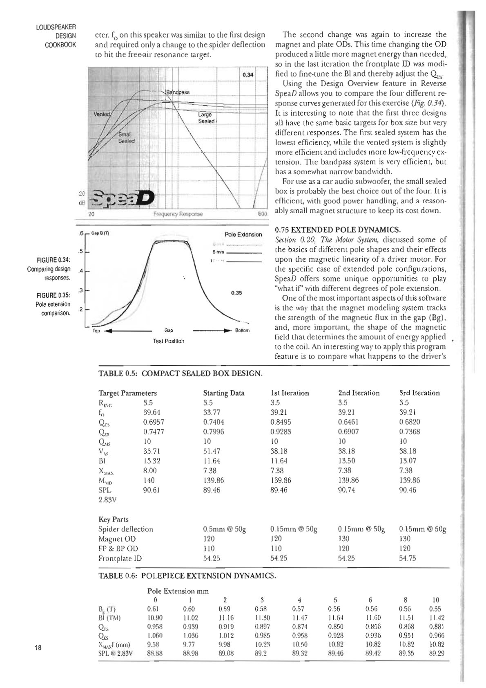

eter. $f_o$ on this speaker was similar to the first design and required only a change to the spider deflection to hit the free-air resonance target.

The second change was again to increase the magnet and plate ODs. This time changing the OD produced a little more magnet energy than needed, so in the last iteration the frontplate ID was modified to fine-tune the Bl and thereby adjust the $Q_{ts}$.

Using the Design Overview feature in Reverse SpeaD allows you to compare the four different response curves generated for this exercise (*Fig. 0.34*). It is interesting to note that the first three designs all have the same basic targets for box size but very different responses. The first sealed system has the lowest efficiency, while the vented system is slightly more efficient and includes more low-frequency extension. The bandpass system is very efficient, but has a somewhat narrow bandwidth.

For use as a car audio subwoofer, the small sealed box is probably the best choice out of the four. It is efficient, with good power handling, and a reasonably small magnet structure to keep its cost down.

### 0.75 EXTENDED POLE DYNAMICS.

*Section 0.20, The Motor System*, discussed some of the basics of different pole shapes and their effects upon the magnetic linearity of a driver motor. For the specific case of extended pole configurations, SpeaD offers some unique opportunities to play "what if" with different degrees of pole extension.

One of the most important aspects of this software is the way that the magnet modeling system tracks the strength of the magnetic flux in the gap (Bg), and, more important, the shape of the magnetic field that determines the amount of energy applied to the coil. An interesting way to apply this program feature is to compare what happens to the driver's

**FIGURE 0.34: Comparing design responses.**
**FIGURE 0.35: Pole extension comparison.**

#### TABLE 0.5: COMPACT SEALED BOX DESIGN

| Target Parameters | Starting Data | 1st Iteration | 2nd Iteration | 3rd Iteration |
| :--- | :--- | :--- | :--- | :--- |
| $R_{EVC}$ | 3.5 | 3.5 | 3.5 | 3.5 | 3.5 |
| $f_o$ | 39.64 | 33.77 | 39.21 | 39.21 | 39.21 |
| $Q_{ts}$ | 0.6957 | 0.7404 | 0.8495 | 0.6461 | 0.6820 |
| $Q_{es}$ | 0.7477 | 0.7996 | 0.9283 | 0.6907 | 0.7368 |
| $Q_{ms}$ | 10 | 10 | 10 | 10 | 10 |
| $V_{AS}$ | 35.71 | 51.47 | 38.18 | 38.18 | 38.18 |
| Bl | 13.32 | 11.64 | 11.64 | 13.50 | 13.07 |
| $X_{MAX}$ | 8.00 | 7.38 | 7.38 | 7.38 | 7.38 |
| $M_{md}$ | 140 | 139.86 | 139.86 | 139.86 | 139.86 |
| SPL 2.83V | 90.61 | 89.46 | 89.46 | 90.74 | 90.46 |

**Key Parts**
*   Spider deflection: 0.5mm @ 50g (Start), 0.15mm @ 50g (1st), 0.15mm @ 50g (2nd), 0.15mm @ 50g (3rd)
*   Magnet OD: 120 (Start), 120 (1st), 130 (2nd), 130 (3rd)
*   FP & BP OD: 110 (Start), 110 (1st), 120 (2nd), 120 (3rd)
*   Frontplate ID: 54.25 (Start), 54.25 (1st), 54.25 (2nd), 54.75 (3rd)

#### TABLE 0.6: POLEPIECE EXTENSION DYNAMICS

| Pole Extension mm | 0 | 1 | 2 | 3 | 4 | 5 | 6 | 8 | 10 |
| :--- | :--- | :--- | :--- | :--- | :--- | :--- | :--- | :--- | :--- |
| Bg (T) | 0.61 | 0.60 | 0.59 | 0.58 | 0.57 | 0.56 | 0.56 | 0.56 | 0.55 |
| Bl (TM) | 10.90 | 11.02 | 11.16 | 11.30 | 11.47 | 11.64 | 11.60 | 11.51 | 11.42 |
| $Q_{ts}$ | 0.958 | 0.939 | 0.919 | 0.897 | 0.874 | 0.850 | 0.856 | 0.868 | 0.881 |
| $Q_{es}$ | 1.060 | 1.036 | 1.012 | 0.985 | 0.958 | 0.928 | 0.936 | 0.951 | 0.966 |
| $X_{MAX}$ (mm) | 9.58 | 9.77 | 9.98 | 10.23 | 10.50 | 10.82 | 10.82 | 10.82 | 10.82 |
| SPL @ 2.83V | 88.88 | 88.98 | 89.08 | 89.2 | 89.32 | 89.46 | 89.42 | 89.35 | 89.29 |
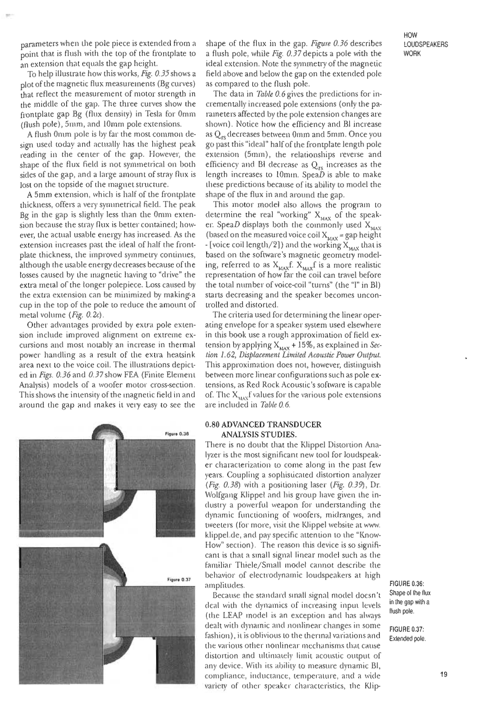

parameters when the pole piece is extended from a point that is flush with the top of the frontplate to an extension that equals the gap height.

To help illustrate how this works, *Fig. 0.35* shows a plot of the magnetic flux measurements (Bg curves) that reflect the measurement of motor strength in the middle of the gap. The three curves show the frontplate gap Bg (flux density) in Tesla for 0mm (flush pole), 5mm, and 10mm pole extensions.

A flush 0mm pole is by far the most common design used today and actually has the highest peak reading in the center of the gap. However, the shape of the flux field is not symmetrical on both sides of the gap, and a large amount of stray flux is lost on the topside of the magnet structure.

A 5mm extension, which is half of the frontplate thickness, offers a very symmetrical field. The peak Bg in the gap is slightly less than the 0mm extension because the stray flux is better contained; however, the actual usable energy has increased. As the extension increases past the ideal of half the frontplate thickness, the improved symmetry continues, although the usable energy decreases because of the losses caused by the magnetic having to "drive" the extra metal of the longer polepiece. Loss caused by the extra extension can be minimized by making a cup in the top of the pole to reduce the amount of metal volume (*Fig. 0.2c*).

Other advantages provided by extra pole extension include improved alignment on extreme excursions and most notably an increase in thermal power handling as a result of the extra heatsink area next to the voice coil. The illustrations depicted in *Figs. 0.36* and *0.37* show FEA (Finite Element Analysis) models of a woofer motor cross-section. This shows the intensity of the magnetic field in and around the gap and makes it very easy to see the shape of the flux in the gap. *Figure 0.36* describes a flush pole, while *Fig. 0.37* depicts a pole with the ideal extension. Note the symmetry of the magnetic field above and below the gap on the extended pole as compared to the flush pole.

The data in *Table 0.6* gives the predictions for incrementally increased pole extensions (only the parameters affected by the pole extension changes are shown). Notice how the efficiency and Bl increase as $Q_{ts}$ decreases between 0mm and 5mm. Once you go past this "ideal" half of the frontplate length pole extension (5mm), the relationships reverse and efficiency and Bl decrease as $Q_{ts}$ increases as the length increases to 10mm. *SpeaD* is able to make these predictions because of its ability to model the shape of the flux in and around the gap.

This motor model also allows the program to determine the real "working" $X_{MAX}$ of the speaker. *SpeaD* displays both the commonly used $X_{MAX}$ (based on the measured voice coil $X_{MAX}$ = gap height - [voice coil length/2]) and the working $X_{MAX}$ that is based on the software's magnetic geometry modeling, referred to as $X_{MAX}$f. $X_{MAX}$f is a more realistic representation of how far the coil can travel before the total number of voice-coil "turns" (the "l" in Bl) starts decreasing and the speaker becomes uncontrolled and distorted.

The criteria used for determining the linear operating envelope for a speaker system used elsewhere in this book use a rough approximation of field extension by applying $X_{MAX} + 15\%$, as explained in *Section 1.62, Displacement Limited Acoustic Power Output*. This approximation does not, however, distinguish between more linear configurations such as pole extensions, as Red Rock Acoustic's software is capable of. The $X_{MAX}$f values for the various pole extensions are included in *Table 0.6*.

### 0.80 ADVANCED TRANSDUCER ANALYSIS STUDIES.
There is no doubt that the Klippel Distortion Analyzer is the most significant new tool for loudspeaker characterization to come along in the past few years. Coupling a sophisticated distortion analyzer (*Fig. 0.38*) with a positioning laser (*Fig. 0.39*), Dr. Wolfgang Klippel and his group have given the industry a powerful weapon for understanding the dynamic functioning of woofers, midranges, and tweeters (for more, visit the Klippel website at www.klippel.de, and pay specific attention to the "Know-How" section). The reason this device is so significant is that a small signal linear model such as the familiar Thiele/Small model cannot describe the behavior of electrodynamic loudspeakers at high amplitudes.

Because the standard small signal model doesn't deal with the dynamics of increasing input levels (the LEAP model is an exception and has always dealt with dynamic and nonlinear changes in some fashion), it is oblivious to the thermal variations and the various other nonlinear mechanisms that cause distortion and ultimately limit acoustic output of any device. With its ability to measure dynamic Bl, compliance, inductance, temperature, and a wide variety of other speaker characteristics, the Klippel Analyzer was the perfect choice for a series of short studies that were designed for the 7th Edition of the *Loudspeaker Design Cookbook*. Topics that are illuminated using the Klippel DA include Bl linearity, pole extensions and linearity, shorting rings and distortion, voice coil temperature and motor mass, and voice coil temperature and pole vents.

**FIGURE 0.36:** Shape of the flux in the gap with a flush pole.

**FIGURE 0.37:** Extended pole.

HOW LOUDSPEAKERS WORK

---

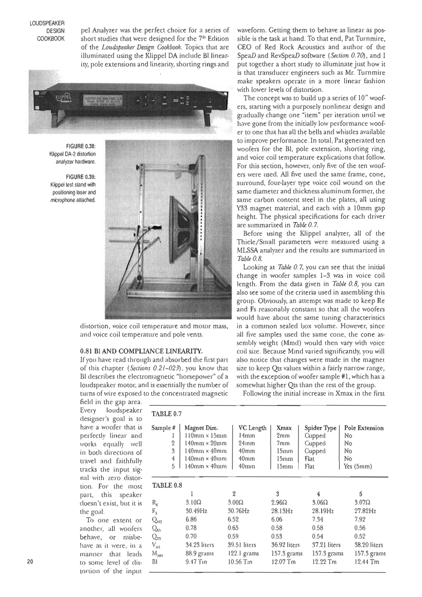

LOUDSPEAKER DESIGN COOKBOOK

**FIGURE 0.38:** Klippel DA-2 distortion analyzer hardware.

**FIGURE 0.39:** Klippel test stand with positioning laser and microphone attached.

waveform. Getting them to behave as linear as possible is the task at hand. To that end, Pat Turnmire, CEO of Red Rock Acoustics and author of the *SpeaD* and *RevSpeaD* software (*Section 0.70*), and I put together a short study to illuminate just how it is that transducer engineers such as Mr. Turnmire make speakers operate in a more linear fashion with lower levels of distortion.

The concept was to build up a series of 10" woofers, starting with a purposely nonlinear design and gradually change one "item" per iteration until we have gone from the initially low performance woofer to one that has all the bells and whistles available to improve performance. In total, Pat generated ten woofers for the Bl, pole extension, shorting ring, and voice coil temperature explications that follow. For this section, however, only five of the ten woofers were used. All five used the same frame, cone, surround, four-layer type voice coil wound on the same diameter and thickness aluminum former, the same carbon content steel in the plates, all using Y33 magnet material, and each with a 10mm gap height. The physical specifications for each driver are summarized in *Table 0.7*.

Before using the Klippel analyzer, all of the Thiele/Small parameters were measured using a MLSSA analyzer and the results are summarized in *Table 0.8*.

Looking at *Table 0.7*, you can see that the initial change in woofer samples 1-3 was in voice coil length. From the data given in *Table 0.8*, you can also see some of the criteria used in assembling this group. Obviously, an attempt was made to keep Re and Fs reasonably constant so that all the woofers would have about the same tuning characteristics in a common sealed box volume. However, since all five samples used the same cone, the cone assembly weight (Mmd) would then vary with voice coil size. Because Mmd varied significantly, you will also notice that changes were made in the magnet size to keep Qts values within a fairly narrow range, with the exception of woofer sample #1, which has a somewhat higher Qts than the rest of the group.

Following the initial increase in Xmax in the first three woofers, the next change was in the suspension system, which means that the first three drivers had cupped or elevated type spiders and samples #4 and #5 had a more linear flat type spider that lacked the asymmetrical problems generally associated with the "hinge" on a cupped spider. The last iterative change to make the motor system more linear was with the addition of a pole extension that was equal to one-half of the gap height for woofer sample #5. All the data from *Table 0.8* was entered into the LEAP 5 Enclosure Shop software and the five woofers simulated in a $2\text{ft}^3$ enclosure with 50% fiberglass fill material.

### 0.81 Bl AND COMPLIANCE LINEARITY.
If you have read through and absorbed the first part of this chapter (*Sections 0.21-023*), you know that Bl describes the electromagnetic "horsepower" of a loudspeaker motor, and is essentially the number of turns of wire exposed to the concentrated magnetic field in the gap area. Every loudspeaker designer's goal is to have a woofer that is perfectly linear and works equally well in both directions of travel and faithfully tracks the input signal with zero distortion. For the most part, this speaker doesn't exist, but it is the goal.

To one extent or another, all woofers behave, or misbehave, in a manner that leads to some level of distortion of the input

#### TABLE 0.7
| Sample # | Magnet Dim. | VC Length | Xmax | Spider Type | Pole Extension |
| :--- | :--- | :--- | :--- | :--- | :--- |
| 1 | $110\text{mm} \times 15\text{mm}$ | 14mm | 2mm | Cupped | No |
| 2 | $140\text{mm} \times 20\text{mm}$ | 24mm | 7mm | Cupped | No |
| 3 | $140\text{mm} \times 40\text{mm}$ | 40mm | 15mm | Cupped | No |
| 4 | $140\text{mm} \times 40\text{mm}$ | 40mm | 15mm | Flat | No |
| 5 | $140\text{mm} \times 40\text{mm}$ | 40mm | 15mm | Flat | Yes (5mm) |

#### TABLE 0.8
| | 1 | 2 | 3 | 4 | 5 |
| :--- | :--- | :--- | :--- | :--- | :--- |
| $R_E$ | $3.10\Omega$ | $3.00\Omega$ | $2.96\Omega$ | $3.06\Omega$ | $3.07\Omega$ |
| $F_s$ | 30.49Hz | 30.76Hz | 28.13Hz | 28.19Hz | 27.82Hz |
| $Q_{MS}$ | 6.86 | 6.52 | 6.06 | 7.34 | 7.92 |
| $Q_{ES}$ | 0.78 | 0.65 | 0.58 | 0.58 | 0.56 |
| $Q_{TS}$ | 0.70 | 0.59 | 0.53 | 0.54 | 0.52 |
| $V_{AS}$ | 34.23 liters | 39.51 liters | 36.92 liters | 37.21 liters | 38.20 liters |
| $M_{MD}$ | 88.9 grams | 122.1 grams | 157.3 grams | 157.3 grams | 157.3 grams |
| Bl | 9.47 Tm | 10.56 Tm | 12.07 Tm | 12.22 Tm | 12.44 Tm |

---

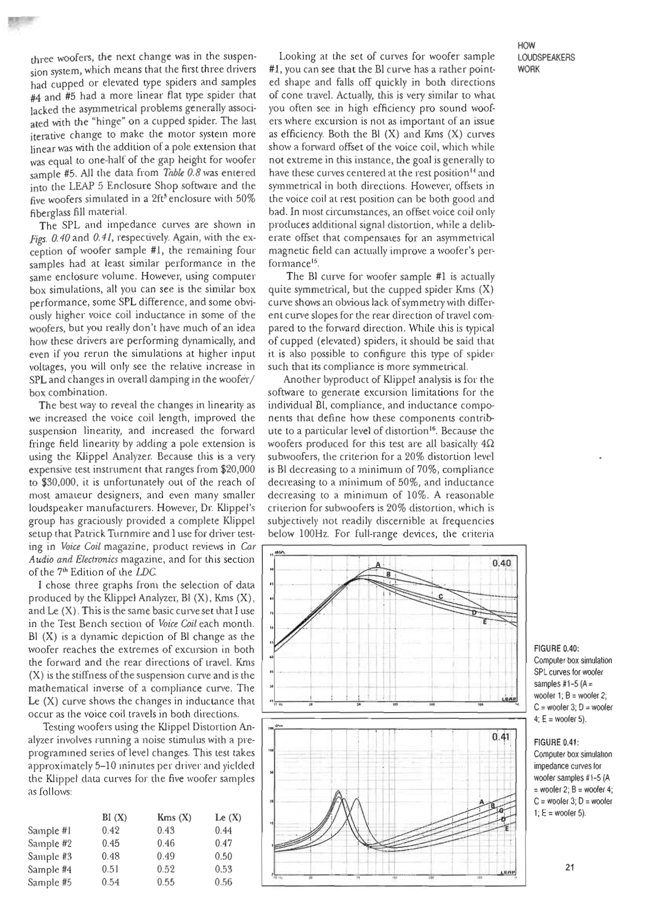

The SPL and impedance curves are shown in *Figs. 0.40* and *0.41*, respectively. Again, with the exception of woofer sample #1, the remaining four samples had at least similar performance in the same enclosure volume. However, using computer box simulations, all you can see is the similar box performance, some SPL difference, and some obviously higher voice coil inductance in some of the woofers, but you really don't have much of an idea how these drivers are performing dynamically, and even if you rerun the simulations at higher input voltages, you will only see the relative increase in SPL and changes in overall damping in the woofer/box combination.

The best way to reveal the changes in linearity as we increased the voice coil length, improved the suspension linearity, and increased the forward fringe field linearity by adding a pole extension is using the Klippel Analyzer. Because this is a very expensive test instrument that ranges from $20,000 to $30,000, it is unfortunately out of the reach of most amateur designers, and even many smaller loudspeaker manufacturers. However, Dr. Klippel's group has graciously provided a complete Klippel setup that Patrick Turnmire and I use for driver testing in *Voice Coil* magazine, product reviews in *Car Audio and Electronics* magazine, and for this section of the 7th Edition of the *LDC*.

I chose three graphs from the selection of data produced by the Klippel Analyzer; Bl (X), Kms (X), and Le (X). This is the same basic curve set that I use in the Test Bench section of *Voice Coil* each month. Bl (X) is a dynamic depiction of Bl change as the woofer reaches the extremes of excursion in both the forward and the rear directions of travel. Kms (X) is the stiffness of the suspension curve and is the mathematical inverse of a compliance curve. The Le (X) curve shows the changes in inductance that occur as the voice coil travels in both directions.

Testing woofers using the Klippel Distortion Analyzer involves running a noise stimulus with a pre-programmed series of level changes. This test takes approximately 5-10 minutes per driver and yielded the Klippel data curves for the five woofer samples as follows:

| | Bl (X) | Kms (X) | Le (X) |
| :--- | :--- | :--- | :--- |
| Sample #1 | 0.42 | 0.43 | 0.44 |
| Sample #2 | 0.45 | 0.46 | 0.47 |
| Sample #3 | 0.48 | 0.49 | 0.50 |
| Sample #4 | 0.51 | 0.52 | 0.53 |
| Sample #5 | 0.54 | 0.55 | 0.56 |

Looking at the set of curves for woofer sample #1, you can see that the Bl curve has a rather pointed shape and falls off quickly in both directions of cone travel. Actually, this is very similar to what you often see in high efficiency pro sound woofers where excursion is not as important of an issue as efficiency. Both the Bl (X) and Kms (X) curves show a forward offset of the voice coil, which while not extreme in this instance, the goal is generally to have these curves centered at the rest position" and symmetrical in both directions. However, offsets in the voice coil at rest position can be both good and bad. In most circumstances, an offset voice coil only produces additional signal distortion, while a deliberate offset that compensates for an asymmetrical magnetic field can actually improve a woofer's performance.

The Bl curve for woofer sample #1 is actually quite symmetrical, but the cupped spider Kms (X) curve shows an obvious lack of symmetry with different curve slopes for the rear direction of travel compared to the forward direction. While this is typical of cupped (elevated) spiders, it should be said that it is also possible to configure this type of spider such that its compliance is more symmetrical.

Another byproduct of Klippel analysis is for the software to generate excursion limitations for the individual Bl, compliance, and inductance components that define how these components contribute to a particular level of distortion. Because the woofers produced for this test are all basically $4\Omega$ subwoofers, the criterion for a 20% distortion level is Bl decreasing to a minimum of 70%, compliance decreasing to a minimum of 50%, and inductance decreasing to a minimum of 10%. A reasonable criterion for subwoofers is 20% distortion, which is subjectively not readily discernible at frequencies below 100Hz. For full-range devices, the criteria

**FIGURE 0.40:** Computer box simulation SPL curves for woofer samples #1-5 (A = woofer 1; B = woofer 2; C = woofer 3; D = woofer 4; E = woofer 5).

**FIGURE 0.41:** Computer box simulation impedance curves for woofer samples #1-5 (A = woofer 2; B = woofer 4; C = woofer 3; D = woofer 1; E = woofer 5).

HOW LOUDSPEAKERS WORK
# Loudspeaker Design Cookbook - Part 6

## Page 22

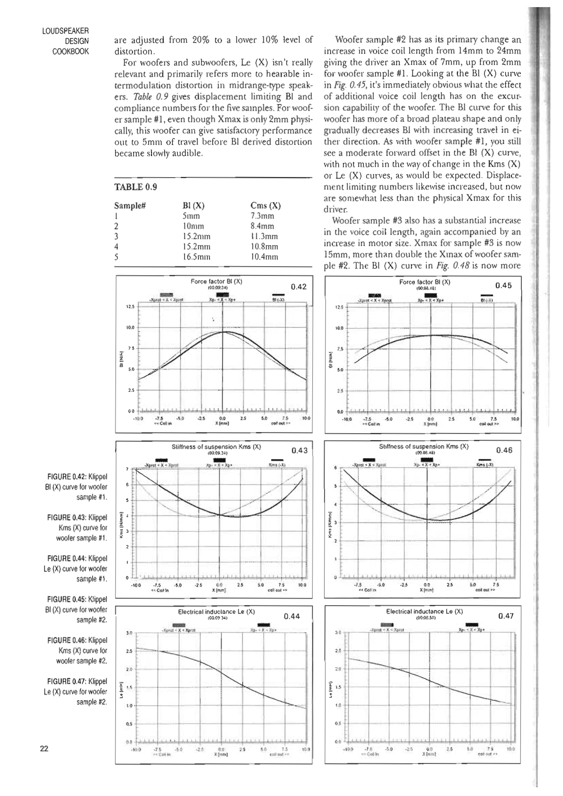

are adjusted from 20% to a lower 10% level of distortion.

For woofers and subwoofers, Le (X) isn't really relevant and primarily refers more to hearable intermodulation distortion in midrange-type speakers. *Table 0.9* gives displacement limiting Bl and compliance numbers for the five samples. For woofer sample #1, even though Xmax is only 2mm physically, this woofer can give satisfactory performance out to 5mm of travel before Bl derived distortion became slowly audible.

### TABLE 0.9

| Sample# | Bl (X) | Cms (X) |
| :--- | :--- | :--- |
| 1 | 5mm | 7.3mm |
| 2 | 10mm | 8.4mm |
| 3 | 15.2mm | 11.3mm |
| 4 | 15.2mm | 10.8mm |
| 5 | 16.5mm | 10.4mm |

Woofer sample #2 has as its primary change an increase in voice coil length from 14mm to 24mm giving the driver an Xmax of 7mm, up from 2mm for woofer sample #1. Looking at the Bl (X) curve in *Fig. 0.45*, it's immediately obvious what the effect of additional voice coil length has on the excursion capability of the woofer. The Bl curve for this woofer has more of a broad plateau shape and only gradually decreases Bl with increasing travel in either direction. As with woofer sample #1, you still see a moderate forward offset in the Bl (X) curve, with not much in the way of change in the Kms (X) or Le (X) curves, as would be expected. Displacement limiting numbers likewise increased, but now are somewhat less than the physical Xmax for this driver.

Woofer sample #3 also has a substantial increase in the voice coil length, again accompanied by an increase in motor size. Xmax for sample #3 is now 15mm, more than double the Xmax of woofer sample #2. The Bl (X) curve in *Fig. 0.48* is now more

---

**FIGURE 0.42: Klippel Bl (X) curve for woofer sample #1.** (Graph shows a peak at approx 10.5 N/A, centered around -1.0mm)
**FIGURE 0.43: Klippel Kms (X) curve for woofer sample #1.** (Graph shows a parabolic shape with a minimum at approx 4.0 N/mm)
**FIGURE 0.44: Klippel Le (X) curve for woofer sample #1.** (Graph shows a descending curve from approx 2.2 mH to 0.8 mH)
**FIGURE 0.45: Klippel Bl (X) curve for woofer sample #2.** (Graph shows a broader peak at approx 8.5 N/A)
**FIGURE 0.46: Klippel Kms (X) curve for woofer sample #2.** (Graph shows a parabolic shape with a minimum at approx 3.0 N/mm)
**FIGURE 0.47: Klippel Le (X) curve for woofer sample #2.** (Graph shows a descending curve from approx 2.2 mH to 0.8 mH)

## Page 23

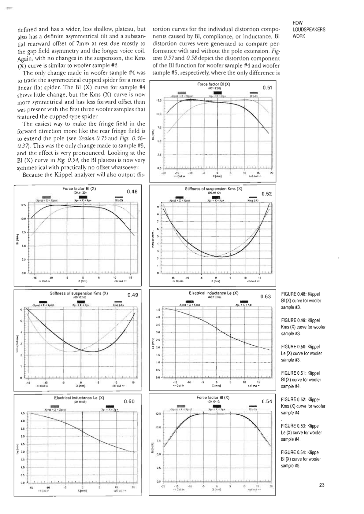

defined and has a wider, less shallow, plateau, but also has a definite asymmetrical tilt and a substantial rearward offset of 7mm at rest due mostly to the gap field asymmetry and the longer voice coil. Again, with no changes in the suspension, the Kms (X) curve is similar to woofer sample #2.

The only change made in woofer sample #4 was to trade the asymmetrical cupped spider for a more linear flat spider. The Bl (X) curve for sample #4 shows little change, but the Kms (X) curve is now more symmetrical and has less forward offset than was present with the first three woofer samples that featured the cupped-type spider.

The easiest way to make the fringe field in the forward direction more like the rear fringe field is to extend the pole (see *Section 0.75 and Figs. 0.36-0.37*). This was the only change made to sample #5, and the effect is very pronounced. Looking at the Bl (X) curve in *Fig. 0.54*, the Bl plateau is now very symmetrical with practically no offset whatsoever.

Because the Klippel analyzer will also output distortion curves for the individual distortion components caused by Bl, compliance, or inductance, Bl distortion curves were generated to compare performance with and without the pole extension. *Figures 0.57 and 0.58* depict the distortion component of the Bl function for woofer sample #4 and woofer sample #5, respectively, where the only difference is

---

**FIGURE 0.48: Klippel Bl (X) curve for woofer sample #3.** (Graph shows a broad plateau at approx 11.5 N/A with a rearward offset)
**FIGURE 0.49: Klippel Kms (X) curve for woofer sample #3.** (Graph shows a parabolic shape with a minimum at approx 2.5 N/mm)
**FIGURE 0.50: Klippel Le (X) curve for woofer sample #3.** (Graph shows a descending curve from approx 4.5 mH to 2.0 mH)
**FIGURE 0.51: Klippel Bl (X) curve for woofer sample #4.** (Graph similar to 0.48)
**FIGURE 0.52: Klippel Kms (X) curve for woofer sample #4.** (Graph shows a more symmetrical parabolic shape)
**FIGURE 0.53: Klippel Le (X) curve for woofer sample #4.** (Graph similar to 0.50)
**FIGURE 0.54: Klippel Bl (X) curve for woofer sample #5.** (Graph shows a very symmetrical plateau at approx 11.5 N/A)

## Page 24

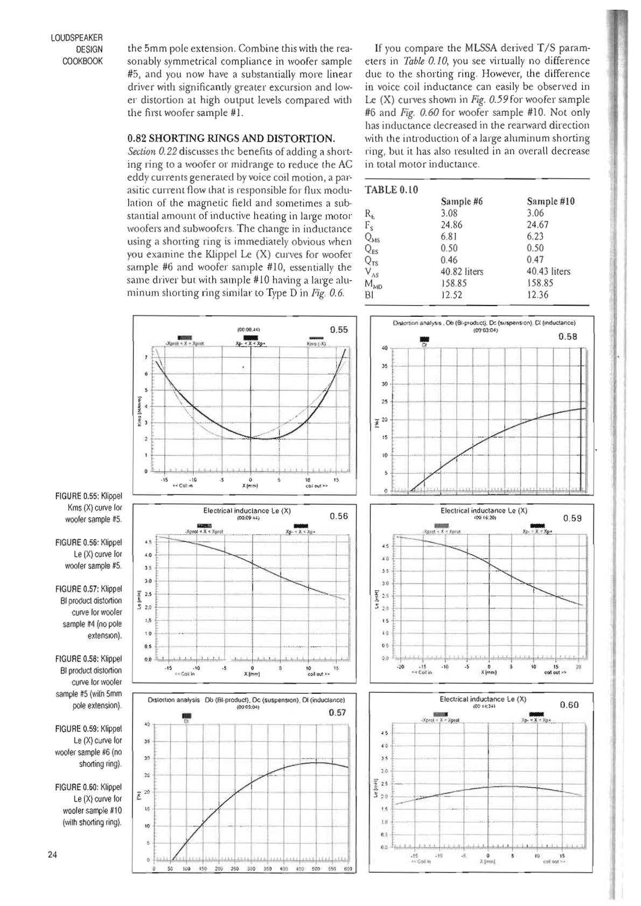

the 5mm pole extension. Combine this with the reasonably symmetrical compliance in woofer sample #5, and you now have a substantially more linear driver with significantly greater excursion and lower distortion at high output levels compared with the first woofer sample #1.

### 0.82 SHORTING RINGS AND DISTORTION

Section 0.22 discusses the benefits of adding a shorting ring to a woofer or midrange to reduce the AC eddy currents generated by voice coil motion, a parasitic current flow that is responsible for flux modulation of the magnetic field and sometimes a substantial amount of inductive heating in large motor woofers and subwoofers. The change in inductance using a shorting ring is immediately obvious when you examine the Klippel Le (X) curves for woofer sample #6 and woofer sample #10, essentially the same driver but with sample #10 having a large aluminum shorting ring similar to Type D in *Fig. 0.6*.

If you compare the MLSSA derived T/S parameters in *Table 0.10*, you see virtually no difference due to the shorting ring. However, the difference in voice coil inductance can easily be observed in Le (X) curves shown in *Fig. 0.59* for woofer sample #6 and *Fig. 0.60* for woofer sample #10. Not only has inductance decreased in the rearward direction with the introduction of a large aluminum shorting ring, but it has also resulted in an overall decrease in total motor inductance.

### TABLE 0.10

| | Sample #6 | Sample #10 |
| :--- | :--- | :--- |
| $R_e$ | 3.08 | 3.06 |
| $F_s$ | 24.86 | 24.67 |
| $Q_{ms}$ | 6.81 | 6.23 |
| $Q_{es}$ | 0.50 | 0.50 |
| $Q_{ts}$ | 0.46 | 0.47 |
| $V_{as}$ | 40.82 liters | 40.43 liters |
| $M_{md}$ | 158.85 | 158.85 |
| $Bl$ | 12.52 | 12.36 |

---

**FIGURE 0.55: Klippel Kms (X) curve for woofer sample #5.**
**FIGURE 0.56: Klippel Le (X) curve for woofer sample #5.**
**FIGURE 0.57: Klippel Bl product distortion curve for woofer sample #4 (no pole extension).** (Note: Text says #5 with 5mm pole extension in caption but text context implies comparison)
**FIGURE 0.58: Klippel Bl product distortion curve for woofer sample #5 (with 5mm pole extension).**
**FIGURE 0.59: Klippel Le (X) curve for woofer sample #6 (no shorting ring).**
**FIGURE 0.60: Klippel Le (X) curve for woofer sample #10 (with shorting ring).**
