# CHAPTER ONE: CLOSED-BOX LOW-FREQUENCY SYSTEMS

## 1.10 DEFINITION.
The closed-box is the simplest of all loudspeaker designs, consisting of an enclosed volume of air and the loudspeaker or driver. Its electrical and pneumatic circuits are analogous to a second-order high-pass filter with the response controlled by the resonance and the associated damping. There are two basic types of closed-box systems: the infinite baffle (IB) and the air suspension (AS).

The IB enclosure is made large so the compliance of the air within the enclosure (its pneumatic "spring" quality) is greater than the compliance of the driver suspension. A closed-box loudspeaker becomes an acoustic suspension speaker when the compliance of the air volume inside the box is less than the compliance of the woofer by a factor of three or more.¹,² This design combination of a loose woofer surround and a small box was popularized in the 1950s by Acoustic Research, and is still frequently used by loudspeaker manufacturers.

Because of its highly controllable response shape and transient characteristics, and because of the relative ease of achieving correct box parameters, the closed-box design is probably the best for home construction, especially if you are a beginner.

## 1.15 DEFINITION OF TERMS.
- $f_3$: minus three decibel half-power frequency (designates the beginning of low end rolloff).
- $f_s$: resonance frequency of driver.
- $f_c$: resonance frequency of the closed-box system.
- $Q$: ratio of reactance to resistance (series circuit) or resistance to reactance (parallel circuit).
- $Q_{ts}$: total Q of driver (woofer) at $f_s$, considering all driver resistances.
- $Q_{tc}$: total Q of speaker system at $f_c$, including all system resistances.
- $V_{as}$: volume of air having the same acoustic compliance as the driver suspension.
- $V_{ab}$: volume of air having the same acoustic compliance as the enclosure.
- $X_{max}$: peak linear displacement of driver cone.
- $S_d$: effective surface area of a driver cone.
- $V_d$: peak displacement volume of driver cone.
- $V_b$: net internal volume of enclosure.
- $\alpha$: compliance ratio.
- $\eta_0$: reference efficiency.
- $C_{as}$: acoustic compliance of the driver suspension.
- $C_{ab}$: acoustic compliance of the air in the enclosure.

## 1.20 HISTORY.
Infinite baffle closed-box designs were popular from the very beginning until the early 1950s. However, after the air suspension design was patented in 1949 by Harry Olson and his associate J. Preston, things began to change. This change was largely brought about by the work of an early proponent of AS design, Edgar Villchur. In 1954,¹¹ he began a series of articles in *Audio* magazine that established the AS as the ultimate speaker design. It was during this same period that Acoustic Research introduced the classic AS designed speaker, the AR-3. Henry Kloss, the co-founder of AR (with Villchur), also went on to find two other successful companies which continued to popularize the AS design, namely KLH and Advent.

In 1972, Richard Small published the most definitive work on closed-box design to date.³·⁴ The following presentation on closed-box design relies upon this monumental work of clarity and simplicity.

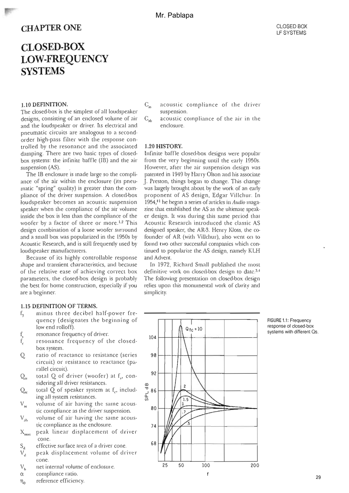

### FIGURE 1.1: Frequency response of closed-box systems with different Qs.
(Graph showing SPL dB vs frequency f, with curves for $Q_{tc} = 10, 2, 1.5, 1, .7, .5$)

## 1.30 DRIVER "Q" AND ENCLOSURE RESPONSE.
The whole point of fitting a woofer to a particular box volume is to control the response characteristics of the combination. The objective method is to measure and align the Q factor. Q is a composite term, used, in this case, to describe resonant magnification in speaker boxes. It represents the degree to which the electrical, mechanical, and pneumatic circuits of the woofer/box combination interact to control resonance. *Figure 1.1*⁵,⁶ illustrates the relationship between different values of Q and frequency response.

Several observations can be made from this family of response curves depicted in *Fig. 1.1*. First, closed-boxes exhibit a fairly shallow rolloff of about 12dB/octave. Compared to vented and passive-radiator designs with 24dB/octave rolloff slopes, a closed-box with the same $f_3$ will yield more low bass and have better transient stability.

Second, certain values of $Q_{tc}$ have specific response characteristics, which can be categorized as follows:

- $Q_{tc} = 0.5$: Critically Damped—transient perfect
- $Q_{tc} = \frac{1}{\sqrt{3}} = 0.577$: Bessel response ($D_2$)—max flat delay
- $Q_{tc} = \frac{1}{\sqrt{2}} = 0.707$: Butterworth response ($B_2$)—max flat amplitude response with minimum cutoff
- $Q_{tc} \geq \frac{1}{\sqrt{2}}$: Chebyshev (elliptical—$C_2$) Equal Ripple response—max power handling and max efficiency, somewhat degraded transients.

Although these particular $Q_{tc}$s are just points on a continuum, we can generalize about their subjective sound quality. High Qs in the vicinity of 1 tend to have a warm, if somewhat robust, quality that audio marketing people describe as "saleable." Lower Q values around 0.8 sound more detailed (due in part to improved transients) and, by comparison, somewhat shallow. $Q_{tc} = 0.5$ is usually regarded as excessively taut and overdamped. Some authorities, however, still consider this value (0.5–0.6) to be optimal.⁷ Occasionally, a quality loudspeaker, such as the Rogers LS3/5A, is designed with a very high value of Q (1.2). In this case, it was to give the minimonitor more apparent bass in a mobile sound-van situation. $Q_{tc}$ greater than 1.2 or so, however, should be regarded as undesirable.

*Table 1.0* illustrates the relationship between $Q_{tc}$ and a peak in frequency response above a flat magnitude. The frequency of this peak, $f_{gmax}$, is given as a ratio with the box resonance, $f_c$. Also included is the ratio $f_{xmax}$, which gives the frequency of maximum cone displacement.

### TABLE 1.0
| $Q_{tc}$ | Peak dB | $f_{gmax}/f_c$ | $f_{xmax}/f_c$ |
| :---: | :---: | :---: | :---: |
| 0.5 | 0 | — | 0 |
| 0.577 | 0 | — | 0 |
| 0.707 | 0 | — | 0 |
| 0.8 | 0.213 | 2.138 | 0.468 |
| 0.9 | 0.687 | 1.616 | 0.619 |
| 1.0 | 1.249 | 1.414 | 0.707 |
| 1.1 | 1.833 | 1.305 | 0.766 |
| 1.2 | 2.412 | 1.238 | 0.808 |
| 1.3 | 2.974 | 1.192 | 0.839 |
| 1.4 | 3.515 | 1.159 | 0.863 |
| 1.5 | 4.033 | 1.134 | 0.882 |

where:
$$\text{Peak dB} = 20 \log_{10} \sqrt{\frac{Q_{tc}^4}{Q_{tc}^2 - 0.25}}$$
$$f_{gmax} = \frac{1}{\sqrt{1 - \frac{1}{2Q_{tc}^2}}}$$
$$f_{xmax} = \sqrt{1 - \frac{1}{2Q_{tc}^2}}$$

The results of a survey of US, British, and European closed-box systems, done in 1969 by Professor Richard Small⁴, revealed that most AS speakers fall into one of two categories:
1. cutoff frequency below 50Hz, $Q_{tc}$ up to 1.1; size greater than $1.4\text{ft}^3$
2. cutoff frequency above 50Hz; $Q_{tc}$ from 1.2–2.0; size less than $2\text{ft}^3$.

Category 1 boxes tend to produce good low bass for orchestral and organ music, while category 2 boxes had "demonstrably stronger bass" with pop electric music.

## 1.35 ALTERNATE METHODS OF ANALYZING BOX "Q."
Along with the changes in the peak height, $f_{xmax}$ and $f_{gmax}$, several other factors describe box Q. As the mechanical damping on the driver changes, and the impulse response degrades (as the bass goes from "tight" to "tubby"), the whole spectrum of changes occurs. These are summarized in *Table 1.1*.

### TABLE 1.1
| $Q_{tc}$ | dB Peak | Phase Angle | Slope dB/oct. | $f_3$ | $V_b$ $\text{ft}^3$ |
| :---: | :---: | :---: | :---: | :---: | :---: |
| 0.7 | 0 | 90° | 10.60 | 35Hz | 2.6 |
| 0.9 | 0.69 | 97° | 11.95 | 39Hz | 1.6 |
| 1.0 | 1.25 | 100° | 12.08 | 43Hz | 1.18 |
| 1.1 | 1.83 | 103° | 12.82 | 46Hz | 0.92 |
| 1.2 | 2.41 | 106° | 13.19 | 50Hz | 0.74 |
| 1.5 | 4.0 | 110° | 13.96 | 64Hz | 0.420 |

the phase angle at the -3dB frequency, cone excursion curves, the shape and magnitude of the group delay curve, the shape of the impedance curve, and the cone velocity and volume current. The math needed to calculate this type of information makes for great mental exercise, but using one of the CAE (Computer Aided Engineering) programs available for loudspeaker design is not only a great deal easier and faster, but provides information that is much too laborious, if not entirely impossible for hand-calculation methods.

LEAP 4.0 (Loudspeaker Enclosure Analysis Program by LinearX Systems) was selected for computer simulations and is used throughout this book. At the time of publication, LEAP 4.0 is the most flexible and powerful tool available for professional design and the only program which can readily import and export data from computer-based analyzers like the DRA Labs MLSSA FFT and the Audio Precision System 1.

The program was used to model a series of closed boxes with a $Q_{tc}$ range of 0.7 through 1.5, and the results used to illustrate these concepts. A 10" driver (the Audio Concepts AC-10) with parameters suitable for infinite baffle type enclosures was used for the simulation. No series resistance was included, and the box was modeled to include 50% fiberglass fill (50% fill generally corresponds to having the back and four sides of the box lined with 3" thick 1 lb/$\text{ft}^3$ fiberglass). Enclosure volumes were calculated to produce the appropriate amount of peaking for each Q value and the other data read from the graphs generated by the program are shown in *Table 1.1*.

From the information given in *Table 1.1*, and illustrated in the simulated SPL and acoustic phase curves in *Fig. 1.2*, it is obvious that as Q increases, the -3dB phase angle, rolloff slope and -3dB frequency also increase. "Phase," as it applies to loudspeakers, is a function of the slope of the magnitude response. If there is no more phase shift than what is dictated by the magnitude response, the device is called minimum phase, which is what loudspeakers are generally considered to be. Phase is measured by determining the time difference between the input signal from the signal source and the output signal occurring at the cone surface. The more time delay, the greater the measured phase angle at that point. The family of phase curves in *Fig. 1.2* shows a primary change in the region of the response where the slope of the rolloff is changing.

### FIGURE 1.2
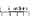
(Graph showing Acoustic On Axis Response: SPL, Phase for $Q_{tc} = .707, .9, 1.0, 1.1, 1.2$)

### FIGURE 1.3
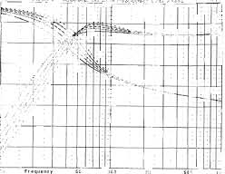
(Graph showing Transducer Excursion (Peak), Group Delay for different $Q_{tc}$ values)

### FIGURE 1.4
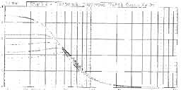
(Graph showing Transducer Excursion (Peak), Group Delay)

### FIGURE 1.5
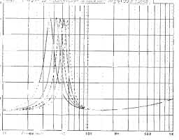
(Graph showing Transducer Impedance: Magnitude Phase)

### FIGURE 1.6
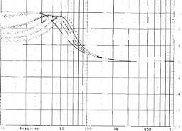
(Graph showing Transducer Velocity, Volume Current [RMS])

### TABLE 1.2: Closed-Box $Q_{tc} = 1.0$
| | Driver 1 | Driver 2 |
| :--- | :--- | :--- |
| $f_s$ | 31.5Hz | 38Hz |
| $Q_{ts}$ | 0.45 | 0.54 |
| $V_{as}$ | $2.97\text{ft}^3$ | $1.92\text{ft}^3$ |
| $V_b$ | $0.75\text{ft}^3$ | $0.79\text{ft}^3$ |
| $f_c$ | 69.9Hz | 70.4Hz |

$V_b$ should be within 10%, which in this case, it is.

the region of the response where the slope of the rolloff is changing.

*Figure 1.3* depicts the change in cone excursion with changes in box Q. As the box size for a given woofer increases, the amount of excursion required also increases, and the maximum level at which the driver produces acceptable levels of distortion decreases. Looking at these curves, the tradeoff between better damping and power handling is readily apparent.

Another indication of damping changes (Q changes) comes from the shape and absolute level of the enclosure group delay curve. Group delay is calculated from the phase response of the driver/enclosure combination. By definition⁸, group delay is the slope of the phase response (specifically, the negative derivative of the phase slope). It describes the relative delay of the spectral components of a waveform. Mathematically:

$$\text{Group Delay} = \frac{-(\text{phase at } f_2 - \text{phase at } f_1)}{(f_2 - f_1)}$$

A flat group delay curve indicates that all frequencies are arriving simultaneously, while a peak in group delay shows some frequencies arriving later. Better damping quality is associated with simultaneous arrival. *Figure 1.4* depicts the group delay curves for the various $Q_{tc}$s. Notice that as Q increases, the shape of the curve goes from almost flat at $Q_{tc} = 0.7$ (a...

### TABLE 1.3: $Q_{tc} = 0.5$
**Second-Order, Critically Damped**
| $Q_{ts}$ | $\alpha$ | $f_c/f_s$ |
| :--- | :--- | :--- |
| 0.1000 | 24.0000 | 5.0000 |
| 0.1200 | 16.3611 | 4.1667 |
| 0.1300 | 13.7929 | 3.8462 |
| 0.1400 | 11.7551 | 3.5714 |
| 0.1500 | 10.1111 | 3.3333 |
| 0.1600 | 8.7656 | 3.1250 |
| 0.1700 | 7.6505 | 2.9412 |
| 0.1800 | 6.7161 | 2.7778 |
| 0.1900 | 5.9252 | 2.6316 |
| 0.2000 | 5.2500 | 2.5000 |
| 0.2100 | 4.6689 | 2.3810 |
| 0.2200 | 4.1653 | 2.2727 |
| 0.2300 | 3.7259 | 2.1739 |
| 0.2400 | 3.3403 | 2.0833 |
| 0.2500 | 3.0000 | 2.0000 |
| 0.2600 | 2.6982 | 1.9231 |
| 0.2700 | 2.4294 | 1.8519 |
| 0.2800 | 2.1888 | 1.7857 |
| 0.2900 | 1.9727 | 1.7241 |
| 0.3000 | 1.7778 | 1.6667 |
| 0.3100 | 1.6015 | 1.6129 |
| 0.3200 | 1.4414 | 1.5625 |
| 0.3300 | 1.2957 | 1.5152 |
| 0.3400 | 1.1626 | 1.4706 |
| 0.3500 | 1.0408 | 1.4286 |
| 0.3600 | 0.9290 | 1.3889 |
| 0.3700 | 0.8262 | 1.3514 |
| 0.3800 | 0.7313 | 1.3158 |
| 0.3900 | 0.6437 | 1.2821 |
| 0.4000 | 0.5625 | 1.2500 |
| 0.4100 | 0.4872 | 1.2195 |
| 0.4200 | 0.4172 | 1.1905 |
| 0.4300 | 0.3521 | 1.1628 |
| 0.4400 | 0.2913 | 1.1364 |
| 0.4500 | 0.2346 | 1.1111 |
| 0.4600 | 0.1815 | 1.0870 |
| 0.4700 | 0.1317 | 1.0638 |
| 0.4800 | 0.0851 | 1.0417 |
| 0.4900 | 0.0412 | 1.0204 |

### TABLE 1.4: $Q_{tc} = 0.577$
**Second-Order Bessel [$D_2$] Max Flat Delay Response**
| $Q_{ts}$ | $\alpha$ | $f_c/f_s$ |
| :--- | :--- | :--- |
| 0.1000 | 32.2929 | 5.7700 |
| 0.1100 | 26.5148 | 5.2455 |
| 0.1200 | 22.1201 | 4.8083 |
| 0.1300 | 18.6700 | 4.4385 |
| 0.1400 | 15.9862 | 4.1214 |
| 0.1500 | 13.3797 | 3.8467 |
| 0.1600 | 12.0050 | 3.6063 |
| 0.1700 | 10.5200 | 3.3941 |
| 0.1800 | 9.2756 | 3.2056 |
| 0.1900 | 8.2224 | 3.0368 |
| 0.2000 | 7.3232 | 2.8850 |
| 0.2100 | 6.5494 | 2.7476 |
| 0.2200 | 5.8787 | 2.6227 |
| 0.2300 | 5.2936 | 2.5087 |
| 0.2400 | 4.7800 | 2.4042 |
| 0.2500 | 4.3269 | 2.3080 |
| 0.2600 | 3.9250 | 2.2192 |
| 0.2700 | 3.5669 | 2.1370 |
| 0.2800 | 3.2465 | 2.0607 |
| 0.2900 | 2.9587 | 1.9897 |
| 0.3000 | 2.6992 | 1.9233 |
| 0.3100 | 2.4644 | 1.8613 |
| 0.3200 | 2.2513 | 1.8031 |
| 0.3300 | 2.0572 | 1.7485 |
| 0.3400 | 1.8800 | 1.6971 |
| 0.3500 | 1.7178 | 1.6486 |
| 0.3600 | 1.5689 | 1.6028 |
| 0.3700 | 1.4319 | 1.5595 |
| 0.3800 | 1.3056 | 1.5184 |
| 0.3900 | 1.1889 | 1.4795 |
| 0.4000 | 1.0808 | 1.4425 |
| 0.4100 | 0.9805 | 1.4073 |
| 0.4200 | 0.8874 | 1.3738 |
| 0.4300 | 0.8006 | 1.3419 |
| 0.4400 | 0.7197 | 1.3114 |
| 0.4500 | 0.6441 | 1.2822 |
| 0.4600 | 0.5734 | 1.2543 |
| 0.4700 | 0.5071 | 1.2277 |
| 0.4800 | 0.4450 | 1.2021 |
| 0.4900 | 0.3866 | 1.1776 |
| 0.5000 | 0.3317 | 1.1540 |
| 0.5100 | 0.2800 | 1.1314 |
| 0.5200 | 0.2312 | 1.1096 |
| 0.5300 | 0.1852 | 1.0887 |
| 0.5400 | 0.1417 | 1.0685 |
| 0.5500 | 0.1006 | 1.0491 |
| 0.5600 | 0.0616 | 1.0304 |
| 0.5700 | 0.0247 | 1.0123 |

$Q_{tc} = 0.5$ would have a flat group delay) to developing a sharp knee at $Q_{tc} = 1.2$.

The shape of the impedance "hump" at resonance also changes with changes in Q. As $Q_{tc}$ increases, the shape gets more narrow and sharp. *Figure 1.5* shows the comparison between the impedance curves of the same Q set. Notice also that the height of the impedance peak is decreasing with increasing $Q_{tc}$.

*Figure 1.6* illustrates the cone velocity and volume current curves. Cone velocity curves give the relationship between frequency and driver acceleration, and are expressed in meters/seconds. Volume current curves represent a similar concept, except that the relationship is between frequency and the amount of air (current) displaced as the driver accelerates and is given in cubic meters/seconds. Notice that the shape of these curves, like the impedance curve, gets more narrow and sharp as Q increases. The frequency of maximum acceleration occurs approximately at the box resonance frequency $f_c$.

## 1.40 WOOFER SELECTION AND ENCLOSURE CONSTRUCTION.
Woofers intended for use in closed-box systems are characterized by a low free-air resonance ($f_s$), relatively high cone mass, and long voice coils. This description fits many of the raw drivers currently available to the experimenter.

### TABLE 1.5: $Q_{tc} = 0.707$
**Second-Order Butterworth [$B_2$] Max Flat Amplitude Response**
| $Q_{ts}$ | $\alpha$ | $f_c/f_s$ |
| :--- | :--- | :--- |
| 0.1500 | 21.2155 | 4.7133 |
| 0.1600 | 18.5254 | 4.4188 |
| 0.1700 | 16.2958 | 4.1588 |
| 0.1800 | 14.4274 | 3.9278 |
| 0.1900 | 12.8462 | 3.7210 |
| 0.2000 | 11.4962 | 3.5350 |
| 0.2100 | 10.3344 | 3.3667 |
| 0.2200 | 9.3316 | 3.2136 |
| 0.2300 | 8.4489 | 3.0739 |
| 0.2400 | 7.6779 | 2.9458 |
| 0.2500 | 6.9976 | 2.8280 |
| 0.2600 | 6.3942 | 2.7192 |
| 0.2700 | 5.8566 | 2.6185 |
| 0.2800 | 5.3756 | 2.5250 |
| 0.2900 | 4.9435 | 2.4379 |
| 0.3000 | 4.5539 | 2.3567 |
| 0.3100 | 4.2013 | 2.2806 |
| 0.3200 | 3.8813 | 2.2094 |
| 0.3300 | 3.5900 | 2.1424 |
| 0.3400 | 3.3240 | 2.0794 |
| 0.3500 | 3.0804 | 2.0200 |
| 0.3600 | 2.8569 | 1.9639 |
| 0.3700 | 2.6512 | 1.9108 |
| 0.3800 | 2.4616 | 1.8605 |
| 0.3900 | 2.2863 | 1.8128 |
| 0.4000 | 2.1241 | 1.7675 |
| 0.4100 | 1.9735 | 1.7244 |
| 0.4200 | 1.8336 | 1.6833 |
| 0.4300 | 1.7033 | 1.6442 |
| 0.4400 | 1.5819 | 1.6068 |
| 0.4500 | 1.4684 | 1.5711 |
| 0.4600 | 1.3622 | 1.5370 |
| 0.4700 | 1.2628 | 1.5043 |
| 0.4800 | 1.1695 | 1.4729 |
| 0.4900 | 1.0818 | 1.4429 |
| 0.5000 | 0.9994 | 1.4140 |
| 0.5100 | 0.9218 | 1.3863 |
| 0.5200 | 0.8486 | 1.3596 |
| 0.5300 | 0.7795 | 1.3340 |
| 0.5400 | 0.7142 | 1.3093 |
| 0.5500 | 0.6524 | 1.2855 |
| 0.5600 | 0.5939 | 1.2625 |
| 0.5700 | 0.5385 | 1.2404 |
| 0.5800 | 0.4859 | 1.2190 |
| 0.5900 | 0.4359 | 1.1983 |
| 0.6000 | 0.3885 | 1.1783 |

### TABLE 1.6: $Q_{tc} = 0.8$
**Second-Order Chebyshev [$C_2$] Equal Ripple Response**
| $Q_{ts}$ | $\alpha$ | $f_c/f_s$ |
| :--- | :--- | :--- |
| 0.2000 | 15.0000 | 4.0000 |
| 0.2100 | 13.5125 | 3.8095 |
| 0.2200 | 12.2231 | 3.6364 |
| 0.2300 | 11.0983 | 3.4783 |
| 0.2400 | 10.1111 | 3.3333 |
| 0.2500 | 9.2400 | 3.2000 |
| 0.2600 | 8.4675 | 3.0769 |
| 0.2700 | 7.7791 | 2.9630 |
| 0.2800 | 7.1633 | 2.8571 |
| 0.2900 | 6.6100 | 2.7586 |
| 0.3000 | 6.1111 | 2.6667 |
| 0.3100 | 5.6597 | 2.5806 |
| 0.3200 | 5.2500 | 2.5000 |
| 0.3300 | 4.8770 | 2.4242 |
| 0.3400 | 4.5363 | 2.3529 |
| 0.3500 | 4.2245 | 2.2857 |
| 0.3600 | 3.9383 | 2.2222 |
| 0.3700 | 3.6749 | 2.1622 |
| 0.3800 | 3.4321 | 2.1053 |
| 0.3900 | 3.2078 | 2.0513 |
| 0.4000 | 3.0000 | 2.0000 |
| 0.4100 | 2.8073 | 1.9512 |
| 0.4200 | 2.6281 | 1.9048 |
| 0.4300 | 2.4613 | 1.8605 |
| 0.4400 | 2.3058 | 1.8182 |
| 0.4500 | 2.1605 | 1.7778 |
| 0.4600 | 2.0246 | 1.7391 |
| 0.4700 | 1.8972 | 1.7021 |
| 0.4800 | 1.7778 | 1.6667 |
| 0.4900 | 1.6656 | 1.6327 |
| 0.5000 | 1.5600 | 1.6000 |
| 0.5100 | 1.4606 | 1.5686 |
| 0.5200 | 1.3669 | 1.5385 |
| 0.5300 | 1.2784 | 1.5094 |
| 0.5400 | 1.1948 | 1.4815 |
| 0.5500 | 1.1157 | 1.4545 |
| 0.5600 | 1.0408 | 1.4286 |
| 0.5700 | 0.9698 | 1.4035 |
| 0.5800 | 0.9025 | 1.3793 |
| 0.5900 | 0.8386 | 1.3559 |
| 0.6000 | 0.7778 | 1.3333 |

In terms of driver $Q_{ts}$, closed-box loudspeakers generally require woofers with a fairly high $Q_{ts}$ of greater than 0.3. This implies using drivers with moderate-sized magnet structures, although excessively small magnet (underdamped) drivers should be avoided.⁹,¹⁰ R. Small suggested a good rule-of-thumb which he called Efficiency Bandwidth Product (EBP).¹¹

EBP is quantified by:
$$\text{EBP} = \frac{\text{Resonance Frequency}}{\text{Driver Electrical Q}} = \frac{f_s}{Q_{es}}$$

EBPs in the vicinity of 50 or less indicates a sealed enclosure would be more suitable, while EBPs of about 100 suggest a vented enclosure.¹²

### TABLE 1.7: $Q_{tc} = 0.9$
**Second-Order Chebyshev [$C_2$] Equal Ripple Response**
| $Q_{ts}$ | $\alpha$ | $f_c/f_s$ |
| :--- | :--- | :--- |
| 0.2000 | 19.2500 | 4.5000 |
| 0.2100 | 17.3673 | 4.2857 |
| 0.2200 | 15.7355 | 4.0909 |
| 0.2300 | 14.3119 | 3.9130 |
| 0.2400 | 13.0625 | 3.7500 |
| 0.2500 | 11.9600 | 3.6000 |
| 0.2600 | 10.9822 | 3.4615 |
| 0.2700 | 10.1111 | 3.3333 |
| 0.2800 | 9.3316 | 3.2143 |
| 0.2900 | 8.6314 | 3.1034 |
| 0.3000 | 8.0000 | 3.0000 |
| 0.3100 | 7.4287 | 2.9032 |
| 0.3200 | 6.9102 | 2.8125 |
| 0.3300 | 6.4380 | 2.7273 |
| 0.3400 | 6.0069 | 2.6471 |
| 0.3500 | 5.6122 | 2.5714 |
| 0.3600 | 5.2500 | 2.5000 |
| 0.3700 | 4.9167 | 2.4324 |
| 0.3800 | 4.6094 | 2.3684 |
| 0.3900 | 4.3254 | 2.3077 |
| 0.4000 | 4.0625 | 2.2500 |
| 0.4100 | 3.8186 | 2.1951 |
| 0.4200 | 3.5918 | 2.1429 |
| 0.4300 | 3.3807 | 2.0930 |
| 0.4400 | 3.1839 | 2.0455 |
| 0.4500 | 3.0000 | 2.0000 |
| 0.4600 | 2.8280 | 1.9565 |
| 0.4700 | 2.6668 | 1.9149 |
| 0.4800 | 2.5156 | 1.8750 |
| 0.4900 | 2.3736 | 1.8367 |
| 0.5000 | 2.2400 | 1.8000 |
| 0.5100 | 2.1142 | 1.7647 |
| 0.5200 | 1.9956 | 1.7308 |
| 0.5300 | 1.8839 | 1.6981 |
| 0.5400 | 1.7778 | 1.6667 |
| 0.5500 | 1.6777 | 1.6364 |
| 0.5600 | 1.5829 | 1.6071 |
| 0.5700 | 1.4931 | 1.5789 |
| 0.5800 | 1.4078 | 1.5517 |
| 0.5900 | 1.3269 | 1.5254 |
| 0.6000 | 1.2500 | 1.5000 |

### TABLE 1.8: $Q_{tc} = 1.0$
**Second-Order Chebyshev [$C_2$] Equal Ripple Response**
| $Q_{ts}$ | $\alpha$ | $f_c/f_s$ |
| :--- | :--- | :--- |
| 0.2500 | 15.0000 | 4.0000 |
| 0.2600 | 13.7929 | 3.8462 |
| 0.2700 | 12.7174 | 3.7037 |
| 0.2800 | 11.7551 | 3.5714 |
| 0.2900 | 10.8906 | 3.4483 |
| 0.3000 | 10.1111 | 3.3333 |
| 0.3100 | 9.4058 | 3.2258 |
| 0.3200 | 8.7656 | 3.1250 |
| 0.3300 | 8.1827 | 3.0303 |
| 0.3400 | 7.6505 | 2.9412 |
| 0.3500 | 7.1633 | 2.8571 |
| 0.3600 | 6.7160 | 2.7778 |
| 0.3700 | 6.3046 | 2.7027 |
| 0.3800 | 5.9252 | 2.6316 |
| 0.3900 | 5.5746 | 2.5641 |
| 0.4000 | 5.2500 | 2.5000 |
| 0.4100 | 4.9488 | 2.4390 |
| 0.4200 | 4.6689 | 2.3810 |
| 0.4300 | 4.4083 | 2.3256 |
| 0.4400 | 4.1653 | 2.2727 |
| 0.4500 | 3.9383 | 2.2222 |
| 0.4600 | 3.7259 | 2.1739 |
| 0.4700 | 3.5269 | 2.1277 |
| 0.4800 | 3.3403 | 2.0833 |
| 0.4900 | 3.1649 | 2.0408 |
| 0.5000 | 3.0000 | 2.0000 |
| 0.5100 | 2.8447 | 1.9608 |
| 0.5200 | 2.6982 | 1.9231 |
| 0.5300 | 2.5600 | 1.8868 |
| 0.5400 | 2.4294 | 1.8519 |
| 0.5500 | 2.3058 | 1.8182 |
| 0.5600 | 2.1888 | 1.7857 |
| 0.5700 | 2.0779 | 1.7544 |
| 0.5800 | 1.9727 | 1.7241 |
| 0.5900 | 1.8727 | 1.6949 |
| 0.6000 | 1.7778 | 1.6667 |

The other important criterion is the amount of voice coil overhang. Because sealed box woofers must excurse farther than their vented counterparts, they generally require longer voice coils. In absolute terms, this means at least 2–4mm for small diameter woofers (6–8") and 5–8mm for larger diameter woofers (10–12"). If the manufacturer does not specify the amount of voice coil overhang ($X_{max}$), it is possible to check it yourself. Hold the driver near a strong light and look through the spider. Most spiders are transparent enough to allow a view of the coil (*Fig. 1.7*).

Enclosures for closed-box speakers should be air-tight. A good way to ensure an air-tight box, regardless of box construction method (butt joint, mitered, etc.), is to apply silicone adhesive to the inside of all enclosure joints. Care should also be taken to keep air from leaking past connection terminals. If you use a commercially available connector "cup," make certain it has a gasket seal. If the cup does not have a gasket, use silicone to seal any...

potential air leaks. Air leakage caused by a speaker's lossy surround or porous dust cap should probably be ignored, since attempts at correction can create as many problems as they solve. Lossy pleated cloth surrounds are generally not appropriate for closed boxes and should not be used at all. Porous dust caps can be responsible for air leakage, but usually have been employed to enhance voice coil cooling. Sealing such dust caps could cause premature driver failure and nonlinear changes in driver Q.

## 1.50 BOX SIZE DETERMINATION AND RELEVANT PARAMETERS.
Box size determination for a closed-box speaker is a fairly straightforward process. The following driver parameters are required:

1. $f_s$ driver free-air resonance
2. $Q_{ts}$ total Q of the driver
3. $V_{as}$ volume of air equal to driver compliance
4. $X_{max}$ amount of voice coil overhang in millimeters
5. $S_d$ effective driver radiating area in square meters
6. $V_d$ displacement volume = $S_d (X_{max})$ in cubic meters

Parameters 4, 5, and 6 can be supplied by the manufacturer. You should recalculate parameters 1, 2, and 3 using the procedures described in *Chapter 8, Loudspeaker Testing*. Not only is the manufacturer's data subject to production line changes, which you may or may not know about, but you must account for the various series resistances that can have a critical effect on your final results. These include amplifier source resistance, the connecting cable (between the amp and speaker), and series crossover resistances.

The best way to choose a box size and associat-

### TABLE 1.9: $Q_{tc} = 1.1$
**Second-Order Chebyshev [$C_2$] Equal Ripple Response**
| $Q_{ts}$ | $\alpha$ | $f_c/f_s$ |
| :--- | :--- | :--- |
| 0.2500 | 18.3600 | 4.4000 |
| 0.2600 | 16.8994 | 4.2308 |
| 0.2700 | 15.5981 | 4.0741 |
| 0.2800 | 14.4337 | 3.9286 |
| 0.2900 | 13.3876 | 3.7931 |
| 0.3000 | 12.4444 | 3.6667 |
| 0.3100 | 11.5911 | 3.5484 |
| 0.3200 | 10.8164 | 3.4375 |
| 0.3300 | 10.1111 | 3.3333 |
| 0.3400 | 9.4671 | 3.2353 |
| 0.3500 | 8.8776 | 3.1429 |
| 0.3600 | 8.3364 | 3.0556 |
| 0.3700 | 7.8386 | 2.9730 |
| 0.3800 | 7.3795 | 2.8947 |
| 0.3900 | 6.9556 | 2.8205 |
| 0.4000 | 6.5625 | 2.7500 |
| 0.4100 | 6.1981 | 2.6829 |
| 0.4200 | 5.8594 | 2.6190 |
| 0.4300 | 5.5441 | 2.5581 |
| 0.4400 | 5.2500 | 2.5000 |
| 0.4500 | 4.9753 | 2.4444 |
| 0.4600 | 4.7183 | 2.3913 |
| 0.4700 | 4.4776 | 2.3404 |
| 0.4800 | 4.2517 | 2.2917 |
| 0.4900 | 4.0396 | 2.2449 |
| 0.5000 | 3.8400 | 2.2000 |
| 0.5100 | 3.6521 | 2.1569 |
| 0.5200 | 3.4749 | 2.1154 |
| 0.5300 | 3.3076 | 2.0755 |
| 0.5400 | 3.1495 | 2.0370 |
| 0.5500 | 3.0000 | 2.0000 |
| 0.5600 | 2.8584 | 1.9643 |
| 0.5700 | 2.7242 | 1.9298 |
| 0.5800 | 2.5969 | 1.8966 |
| 0.5900 | 2.4760 | 1.8644 |
| 0.6000 | 2.3611 | 1.8333 |

### TABLE 1.10: $Q_{tc} = 1.2$
**Second-Order Chebyshev [$C_2$] Equal Ripple Response**
| $Q_{ts}$ | $\alpha$ | $f_c/f_s$ |
| :--- | :--- | :--- |
| 0.2500 | 22.0400 | 4.8000 |
| 0.2600 | 20.3018 | 4.6154 |
| 0.2700 | 18.7531 | 4.4444 |
| 0.2800 | 17.3673 | 4.2857 |
| 0.2900 | 16.1225 | 4.1379 |
| 0.3000 | 15.0000 | 4.0000 |
| 0.3100 | 13.9844 | 3.8710 |
| 0.3200 | 13.0625 | 3.7500 |
| 0.3300 | 12.2231 | 3.6364 |
| 0.3400 | 11.4567 | 3.5294 |
| 0.3500 | 10.7551 | 3.4286 |
| 0.3600 | 10.1111 | 3.3333 |
| 0.3700 | 9.5186 | 3.2432 |
| 0.3800 | 8.9723 | 3.1579 |
| 0.3900 | 8.4675 | 3.0769 |
| 0.4000 | 8.0000 | 3.0000 |
| 0.4100 | 7.5663 | 2.9268 |
| 0.4200 | 7.1633 | 2.8571 |
| 0.4300 | 6.7880 | 2.7907 |
| 0.4400 | 6.4380 | 2.7273 |
| 0.4500 | 6.1111 | 2.6667 |
| 0.4600 | 5.8053 | 2.6087 |
| 0.4700 | 5.5188 | 2.5532 |
| 0.4800 | 5.2500 | 2.5000 |
| 0.4900 | 4.9975 | 2.4490 |
| 0.5000 | 4.7600 | 2.4000 |
| 0.5100 | 4.5363 | 2.3529 |
| 0.5200 | 4.3254 | 2.3077 |
| 0.5300 | 4.1264 | 2.2642 |
| 0.5400 | 3.9383 | 2.2222 |
| 0.5500 | 3.7603 | 2.1818 |
| 0.5600 | 3.5918 | 2.1429 |
| 0.5700 | 3.4321 | 2.1053 |
| 0.5800 | 3.2806 | 2.0690 |
| 0.5900 | 3.1367 | 2.0339 |
| 0.6000 | 3.0000 | 2.0000 |
| 0.6100 | 2.8699 | 1.9672 |
| 0.6200 | 2.7461 | 1.9355 |
| 0.6300 | 2.6281 | 1.9048 |
| 0.6400 | 2.5156 | 1.8750 |
| 0.6500 | 2.4083 | 1.8462 |

ed response is to generate a design table which specifies data for $Q_{tc}$ from 0.5 through 1.1, and then consider the various possibilities. Use *Tables 1.3 through 1.12*, or the design equations which follow, to find the values of $\alpha$ (alpha) and $f_c$, the resonance of the driver in the box. The $f_3$, -3dB cutoff point can be taken from *Table 1.12*.

### CLOSED-BOX DESIGN EQUATIONS
$$\alpha = \left( \frac{Q_{tc}}{Q_{ts}} \right)^2 - 1$$
$$f_c = \frac{Q_{tc}}{Q_{ts}} \times f_s$$

### TABLE 1.11: $Q_{tc} = 1.5$
**Second-Order Chebyshev [$C_2$] Equal Ripple Response**
| $Q_{ts}$ | $\alpha$ | $f_c/f_s$ |
| :--- | :--- | :--- |
| 0.3000 | 24.0000 | 5.0000 |
| 0.3100 | 22.4131 | 4.8387 |
| 0.3200 | 20.9727 | 4.6875 |
| 0.3300 | 19.6612 | 4.5455 |
| 0.3400 | 18.4637 | 4.4118 |
| 0.3500 | 17.3673 | 4.2857 |
| 0.3600 | 16.3611 | 4.1667 |
| 0.3700 | 15.4354 | 4.0541 |
| 0.3800 | 14.5817 | 3.9474 |
| 0.3900 | 13.7929 | 3.8462 |
| 0.4000 | 13.0625 | 3.7500 |
| 0.4100 | 12.3849 | 3.6849 |
| 0.4200 | 11.7551 | 3.5714 |
| 0.4300 | 11.1687 | 3.4884 |
| 0.4400 | 10.6219 | 3.4091 |
| 0.4500 | 10.1111 | 3.3333 |
| 0.4600 | 9.6333 | 3.2609 |
| 0.4700 | 9.1856 | 3.1915 |
| 0.4800 | 8.7656 | 3.1250 |
| 0.4900 | 8.3711 | 3.0612 |
| 0.5000 | 8.0000 | 3.0000 |
| 0.5100 | 7.6505 | 2.9412 |
| 0.5200 | 7.3210 | 2.8846 |
| 0.5300 | 7.0100 | 2.8302 |
| 0.5400 | 6.7160 | 2.7778 |
| 0.5500 | 6.4380 | 2.7273 |
| 0.5600 | 6.1747 | 2.6786 |
| 0.5700 | 5.9252 | 2.6316 |
| 0.5800 | 5.6885 | 2.5862 |
| 0.5900 | 5.4637 | 2.5424 |
| 0.6000 | 5.2500 | 2.5000 |
| 0.6100 | 5.0468 | 2.4590 |
| 0.6200 | 4.8533 | 2.4194 |
| 0.6300 | 4.6689 | 2.3810 |
| 0.6400 | 4.4932 | 2.3438 |
| 0.6500 | 4.3254 | 2.3077 |
| 0.6600 | 4.1653 | 2.2727 |
| 0.6700 | 4.0123 | 2.2388 |
| 0.6800 | 3.8659 | 2.1739 |
| 0.6900 | 3.7259 | 2.1739 |
| 0.7000 | 3.5918 | 2.1429 |

### TABLE 1.12: -3dB Rolloff Point $f_3$
| $Q_{tc}$ | $f_3/f_c$ |
| :--- | :--- |
| 0.500 | 1.5538 |
| 0.577 | 1.2725 |
| 0.707 | 1.0000 |
| 0.800 | 0.8972 |
| 0.900 | 0.8295 |
| 1.000 | 0.7862 |
| 1.100 | 0.7567 |
| 1.200 | 0.7358 |
| 1.500 | 0.6993 |

$$f_3 = \left[ \frac{\left( \frac{1}{Q_{tc}^2} - 2 \right) + \sqrt{\left( \frac{1}{Q_{tc}^2} - 2 \right)^2 + 4}}{2} \right]^{1/2} \times f_c$$

Then, using the design tables:
$$\text{Box Volume } V_b = \frac{V_{as}}{\alpha}$$
$$-3\text{dB Point } f_3 = (f_3/f_c) \times f_c$$
$$\text{Box Resonance } f_c = \left( \frac{f_c}{f_s} \right) \times f_s$$

Remember that air suspension operating systems exist between values of $\alpha$ from 3–10. Values of $\alpha$ less than that venture into the realm of the infinite baffle.¹ Also, for bookshelf sized speakers, $f_c = 50\text{Hz}$ or less is a reasonable figure for a closed-box system.¹²

## 1.51 $Q_{ts}$, $f_s$, and $V_{as}$ VARIANCES.
For a given production run of identical drivers (same cone, voice coil, surround, dust cap, magnet, gap and so on), values of $Q_{ts}$, $f_s$, and $V_{as}$ can exhibit considerable variation. Consequently, if the measured values for a small sample (usually two for most of us) are quite different, don't be overly alarmed. Although individual driver parameters can have a wide range of values, the ratios of $f_s/Q_{es}$ and the products of $V_{as} f_s^2$ are fairly constant. Thus, the final and essential results will also tend to be constant. Consider the data for two identical drivers (*Table 1.2*).

## 1.60 ADDITIONAL PARAMETERS.
Three other factors are useful in evaluating the prospective performance of a closed-box system: the reference efficiency, the displacement limited acoustic power output, and the electrical input power required to produce the displacement limited output.

## 1.61 REFERENCE EFFICIENCY ($\eta_0$).
Reference efficiency is, primarily, dependent upon the driver parameters and *not* upon the...

enclosure. It is often expressed as a percent, or more commonly, as a sound pressure level (SPL). Basically, $\eta_0$ is most useful for comparing the efficiency of drivers in a multi-driver system. As such, it can be used to determine the amount of attenuation needed for mid and high frequency drivers (for reasons of practicality, woofers are seldom, if ever, attenuated to match other drivers in a multiway speaker).

Free-air reference efficiency can be determined by:
$$\eta_0 = \frac{K(f_s^3 V_{as})}{Q_{es}}$$

where:
- $K = 9.64 \times 10^{-10}$ for $V_{as}$ in liters
- $K = 9.64 \times 10^{-7}$ for $V_{as}$ in cubic meters
- $K = 2.70 \times 10^{-8}$ for $V_{as}$ in cubic feet

For this calculation, $V_{as}$ should be measured on a baffle or enclosure the same size as the speaker cabinet. This equation gives $\eta_0$ as a decimal equivalent. To convert $\eta_0$ to:
- Percentage: $\% = \eta_0 \times 100$
- SPL, 1W/1m: $dB = 112 + 10 \log_{10} \eta_0$

$\eta_0$ can vary from low values around 0.35% to higher values up to 1.5%. *Table 1.13* lists efficiency data for well-known drivers, which will give a perspective to the situation.

For comparison purposes, $\eta_0$ in a sealed enclosure (unfilled) can be determined by:
$$\eta_{0fc} = \frac{K f_c^3 V_{as} V_b}{Q_{tc}(V_{as} + V_b)}$$

## 1.62 DISPLACEMENT LIMITED ACOUSTIC POWER OUTPUT ($P_{ar}$).
$P_{ar}$ is the maximum output which can be produced for a driver working within its linear operating range, without appreciable levels of distortion. You can determine the linear operating range of voice coil outside (overhangs) the magnetic circuit (gap) (*Fig. 1.7*). To calculate this length, designated $X_{max}$, subtract the magnetic gap height from the total voice coil length, and then divide by two. Setting maximum linear excursion to $X_{max} + 15\%$ is rather conservative, and a somewhat greater excursion, and hence higher output levels, can be allowed if you consider such factors as the relative insensitivity of the human ear to low frequency distortion.¹³

$P_{ar}$ can be calculated in terms of RMS sine wave power by:
$$P_{ar(cw)} = K_p f_3^4 V_d^2$$

$K_p$ is a power rating constant which varies with box $Q_{tc}$.

*Table 1.14* gives values of $K_p$ for different values of $Q_{tc}$.

$V_d$ is the volume of air displaced by the cone traveling through its maximum excursion limits, and is expressed in cubic meters. Thus, $V_d = S_d \times X_{max}$. $S_d$, the effective radiation area of the driver cone, is listed for different diameter cones in *Table 1.15*. $S_d$ is calculated by:
$$S_d = \frac{3.1416 \times D^2}{4}$$

Where D is the diameter of the cone plus one-third of the surround at both ends of the measurement.

$P_{ar(cw)}$ is included in this discussion because it gives a relative comparison of output for various values of $Q_{tc}$. This coincides with the fact that maximum power handling occurs at $Q_{tc} = 1.1$ and then decreases with decreasing values of $Q_{tc}$. The frequency at which $X_{max}$ occurs, however, is below $f_3$ for all $Q_{tc}$s lower than 1.1. Since most of the program material is above $f_3$, it is practical to...

### FIGURE 1.7: Voice coil "overhang."
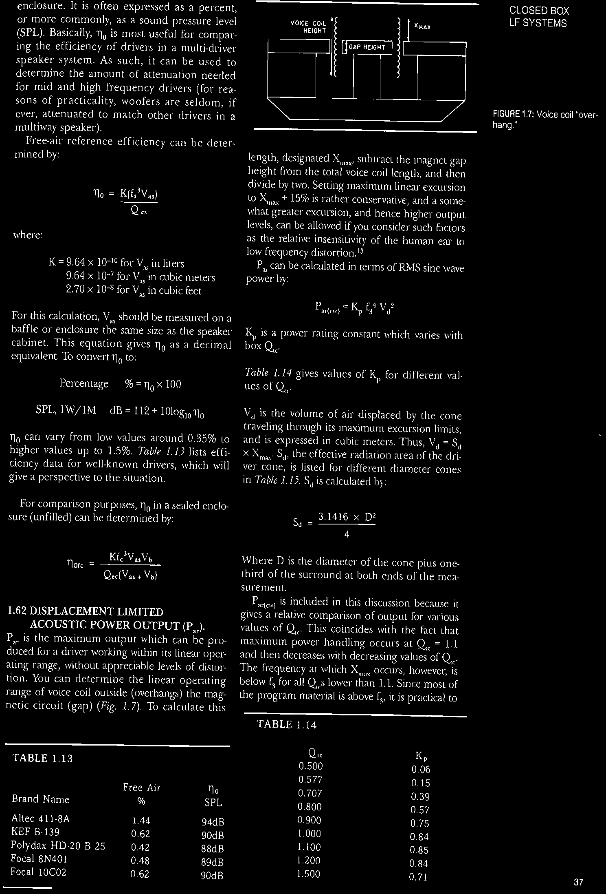

### TABLE 1.13
| Brand Name | Free Air % | $\eta_0$ SPL |
| :--- | :---: | :---: |
| Altec 411-8A | 1.44 | 94dB |
| KEF B-139 | 0.62 | 90dB |
| Polydax HD-20 B 25 | 0.42 | 88dB |
| Focal 8N401 | 0.48 | 89dB |
| Focal 10C02 | 0.62 | 90dB |

### TABLE 1.14
| $Q_{tc}$ | $K_p$ |
| :---: | :---: |
| 0.500 | 0.06 |
| 0.577 | 0.15 |
| 0.707 | 0.39 |
| 0.800 | 0.57 |
| 0.900 | 0.75 |
| 1.000 | 0.84 |
| 1.100 | 0.85 |
| 1.200 | 0.84 |
| 1.500 | 0.71 |

take $P_{ar}$ at the maximum value. Therefore, $P_{ar(p)}$, in watts, for program material equals:
$$P_{ar(p)} = 0.85 f_3^4 V_d^2$$

and
$$\text{SPL 1W 1M} = 112 + 10 \log_{10} P_{ar(p)}$$

## 1.63 ELECTRICAL INPUT MAXIMUM ($P_{er}$).
$P_{er}$ is the input power required to produce $P_{ar}$. $P_{er}$ is determined by:
$$P_{er} = \frac{P_{ar(cw)}}{\eta_0}$$

where:
- $P_{er}$ in watts
- $P_{ar}$ in watts
- $\eta_0$ as a decimal

You can compare $P_{er}$ with the thermal limited power-handling capacity given by the manufacturer. Caution is advised if the thermal rating of the driver is less than $P_{er}$.

### TABLE 1.15
| Advertised Dia. (") | $S_d$ $M^2$ |
| :---: | :---: |
| 5 | 0.0089 |
| 7 | 0.0158 |
| 8 | 0.0215 |
| 10 | 0.0330 |
| 12 | 0.0450 |
| 15 | 0.0855 |

## 1.70 EXAMPLE DESIGN CHARTS.
*Tables 1.16 and 1.17* give examples of two drivers suitable for closed-box construction. Remember that, when calculating total box size, it is important to over-volume the enclosure to compensate for anything which will detract from its target volume. This includes:
- midrange cavities
- woofer basket and magnet structures
- fibrous damping material (about 10% of measure volume)
- crossover
- solid damping material—braces, felt and so on.

Last, always be sure to include all series resistances in the calculation of $Q_{ts}$ (*Chapter 8*). Examples of closed-box construction articles can be found in *Speaker Builder*: "A Ceramic Speaker Enclosure," by David Weems, 6/88, p. 37; "A Small Two-Way System," by Fred Thompson, 2/90, p. 24; and "A Modular Three-Way Active System," by Fernando Ricart, 4/90, p. 36.

## 1.71 MINIMUM CUT-OFF FREQUENCY.
The popular notion persists that cut-off frequency for sealed enclosures decreases with increasing box volume. This is true, however, only for $Q_{tc}$ greater than, or equal to 0.707. For values of $Q_{tc}$ less than 0.707, increasing volume causes an increase in cut-off frequency.¹⁴ It is obvious that the tradeoffs for the use of one of the so-called over-damped alignments will be a less than optimal $f_3$. *Table 1.18* illustrates the ratio of $f_3/f_s$ for different box $Q_{tc}$ with various driver $Q_{ts}$.

In all cases, $f_3/f_s$ increases for values of $Q_{tc}$ lower than 0.707. Looking at the design in *Tables 1.16 and 1.17*, as would be expected, both drivers show an increase in cut-off frequency, $f_3$, for increasing box volume past $Q_{tc} = 0.707$.

### TABLE 1.16: 8" WOOFER EXAMPLE
$Q_{ts} = 0.45$, $Q_{es} = 0.53$, $Q_{ms} = 3.0$, $f_s = 31.5$, $X_{max} = 3.5\text{mm}$, $S_d (\text{m}^2) = 2.15 \times 10^{-2}$, $V_d (\text{m}^3) = 7.525 \times 10^{-5}$, $V_{as} = 2.97\text{ft}^3$

| $Q_{tc}$ | $\alpha$ | $V_b$ $\text{ft}^3$ | $f_c$ Hz | $f_3$ Hz | $f_3/f_c$ ratio | SPL dB | $P_{ar(p)}$ watts | $V_d (\text{m}^3)$ | $\eta_0$ SPL | $P_{er}$ watts |
| :---: | :---: | :---: | :---: | :---: | :---: | :---: | :---: | :---: | :---: | :---: |
| 0.5 | 0.23 | 12.70 | 35 | 54 | 1.5538 | 87 | 0.033 | 98 | 0.47 | 89 | 0.70 |
| 0.7 | 1.42 | 2.02 | 50 | 50 | 1.0000 | 87 | 0.014 | 98 | 0.47 | 89 | 2.98 |
| 0.8 | 2.16 | 1.38 | 56 | 49 | 0.8753 | 87 | 0.020 | 95 | 0.47 | 89 | 4.26 |
| 0.9 | 3.00 | 0.99 | 62 | 52 | 0.8386 | 87 | 0.032 | 97 | 0.47 | 89 | 6.81 |
| 1.0 | 3.94 | 0.75 | 70 | 55 | 0.7857 | 87 | 0.044 | 98 | 0.47 | 89 | 9.36 |

### TABLE 1.17: 10" WOOFER EXAMPLE
$Q_{ts} = 0.446$, $Q_{es} = 0.51$, $Q_{ms} = 3.63$, $f_s = 27.2$, $X_{max} = 5.25\text{mm}$, $S_d (\text{m}^2) = 3.40 \times 10^{-2}$, $V_d (\text{m}^3) = 1.79 \times 10^{-4}$, $V_{as} = 5.79\text{ft}^3$

| $Q_{tc}$ | $\alpha$ | $V_b$ $\text{ft}^3$ | $f_c$ Hz | $f_3$ Hz | $f_3/f_c$ ratio | SPL dB | $P_{ar(p)}$ watts | $V_d (\text{m}^3)$ | $\eta_0$ SPL | $P_{er}$ watts |
| :---: | :---: | :---: | :---: | :---: | :---: | :---: | :---: | :---: | :---: | :---: |
| 0.5 | 0.25 | 24.80 | 34 | 43 | 1.5538 | 90 | 0.016 | 106 | 0.62 | 90 | 2.58 |
| 0.7 | 1.46 | 4.10 | 43 | 43 | 1.0000 | 90 | 0.038 | 106 | 0.62 | 90 | 6.13 |
| 0.8 | 2.22 | 2.60 | 44 | 49 | 0.8753 | 90 | 0.067 | 100 | 0.62 | 90 | 10.81 |
| 0.9 | 3.07 | 1.88 | 46 | 55 | 0.8386 | 90 | 0.103 | 102 | 0.62 | 90 | 16.61 |
| 1.0 | 4.03 | 1.47 | 48 | 60 | 0.7857 | 90 | 0.139 | 103 | 0.62 | 90 | 22.42 |

1.16 and 1.17, as would be expected, both drivers show an increase in cut-off frequency, $f_3$, for increasing box volume past $Q_{tc} = 0.707$.

## 1.72 DYNAMIC CHANGES IN FREQUENCY RESPONSE.
Although calculated large signal parameters such as $P_{ar}$ and $P_{er}$ give you some idea of a driver's excursion potential, these numbers do not adequately describe dynamic changes which occur in a loudspeaker as input power and operating temperature increase. When the Thiele/Small calculation methods are applied to design a loudspeaker enclosure, sealed or vented, the speaker will exhibit the predicted response only at a small signal level. The loudspeaker can be expected to perform in accordance with the design tables and formula calculations at 1W power input, but beyond that, as power increases and voice coil temperature increases the characteristics of the driver/box combination will undergo constant dynamic change.

Loudspeakers generally operate over a thermal range that extends from room temperature, about 25°C, to somewhere in the vicinity of 250°C, where adhesives begin to break down and failure occurs. Driver power ratings should somehow correlate the rating with the level where the driver will be driven into approaching thermal failure. If a speaker is rated at 200W, it should be able to maintain a temperature somewhat below 250°C over a period of time. As a function of input power, dividing the maximum temperature, 250°C, by the speaker power rating gives a rough estimate of the temperature increase per watt of power increase (providing the manufacturer has somehow related the power rating to thermal failure, which is not always the case). A driver rated 150W, for instance, would increase its temperature about 1.667°C for each additional watt of power used to drive the speaker.

As voice coil temperatures increase, voice coil resistance increases, and the overall damping of the driver decreases. The effect is illustrated in *Fig. 1.8*. This computer simulation shows the different SPL curves for a box/driver combination with a calculated $Q_{tc} = 0.7$ at five increasing power levels starting at 1W (1, 5, 10, 20, and 40W). The results are summarized in *Table 1.19*.

The increasing phase angle (at -3dB) and slope indicates a decrease in overall damping and is expressed by the equivalent $Q_{tc}$ number.

### TABLE 1.18: $f_3/f_s$ ($Q_{tc}$ vs. $Q_{ts}$)
| $Q_{tc}$ | $Q_{ts}$: 0.20 | $Q_{ts}$: 0.30 | $Q_{ts}$: 0.40 | $Q_{ts}$: 0.50 |
| :---: | :---: | :---: | :---: | :---: |
| 1.5 | 5.2 | 3.5 | 2.6 | 2.1 |
| 1.2 | 4.4 | 2.9 | 2.2 | 1.8 |
| 1.1 | 4.2 | 2.8 | 2.1 | 1.7 |
| 1.0 | 3.9 | 2.6 | 2.0 | 1.6 |
| $Q_{tc}$ 0.9 | 3.7 | 2.5 | 1.9 | 1.5 |
| 0.8 | 3.6 | 2.4 | 1.8 | 1.4 |
| 0.71 | 3.5 | 2.4 | 1.8 | 1.4 |
| 0.58 | 3.7 | 2.5 | 1.9 | 2.0 |
| 0.50 | 3.9 | 2.6 | 2.0 | — |

Changes in damping are also reflected in changes in cone excursion, *Fig. 1.9*, group delay, *Fig. 1.10*, impedance, *Fig. 1.11*, and transducer cone velocity, *Fig. 1.12*. The cone excursion and group delay curves look reminiscent of those in *Figs. 1.3* and *1.4* for different Qs and box volumes. Notice, however, that the impedance peak at $f_c$ remains at about the same frequency and width, although the overall impedance level is constantly increasing with temperature. The peak in cone velocity also remains at the same frequency, and does not change with increasing input power.

When using hand-calculator methods to design, it is not possible to anticipate these dynamic deviations. The best advice is to err on the side of lower Q when other factors allow. As a perspective, several successful commercial designs have small signal $Q_{ts}$ as low as 0.5.

## 1.80 ENCLOSURE FILLING.
All the above box volume calculations were based on an unfilled enclosure or, at most, an enclosure with no more than a 1" lining of...

### TABLE 1.19: DYNAMIC CHANGES IN DRIVER RESPONSE AT MULTIPLE POWER LEVELS
| V | Power | Temp. | -3dB Phase Angle | Slope dB/oct. | Equiv. $Q_{tc}$ | $f_3$ Hz |
| :---: | :---: | :---: | :---: | :---: | :---: | :---: |
| 2.83 | 1 | 29.2° | 90° | 10.60 | 0.7 | 35 |
| 6.35 | 5 | 46° | 93° | 10.87 | 0.8 | 34 |
| 8.95 | 10 | 66.7° | 95° | 11.18 | 0.85 | 34 |
| 12.68 | 20 | 108.7° | 100° | 11.74 | 1.0 | 32 |
| 17.89 | 40 | 191.7° | 106° | 12.71 | 1.2 | 31 |

fiberglass to damp standing waves. This is as it should be, since a properly designed enclosure will be able to attain its design goal without any additional manipulation. In the real world, however, the "art" of box stuffing can be an invaluable tool to alter box response in order to achieve certain parameters of size and Q that can't be had any other way.

Beside the obvious advantage of increased suppression of the internal reflections that can produce strong colorations in the sound quality,¹⁵ stuffing a box has the following effects on box parameters:

**A. Compliance Increase.** Use of low density, high specific heat material (fiberglass, Dacron and long fiber wool) will cause an increase in the acoustic compliance of the enclosure ($C_{ab}$). This is equivalent to increasing the box size and can amount to as much as a theoretical 40%. Practical equivalent volume increases of 15%–25% are quite attainable.

**B. Efficiency Increase.** Proper selection of the amount, type of material, and the location of the material within the enclosure can cause an increase in efficiency by as much as 15%.

**C. Mass Changes.** Filling material has the potential of changing the total moving mass of the system. This phenomenon is generally thought to be related to the restriction of air flow directly behind the driver. The increase in effective mass will cause a decrease in efficiency, but not as great as the increase in efficiency caused by compliance changes. Since a decrease in efficiency is undesirable, there are two techniques which will limit these effects. One, used in the Advent loudspeaker, is to use a brace directly behind the woofer to keep damping material (in this case, foam) away from the rear of the driver. The second is to use a non-compressed, low density material in the area immediately behind the driver basket as a sort of buffer between the higher density material and the driver.¹⁶

**D. Damping Losses.** If you pack filling material relatively densely, and close to the rear of the driver basket, frictional losses can be substantial.

The quantity of fill material required to change the pneumatic action of the enclosure from adiabatic to isothermal (which is what the above criteria describe) has been suggested by several authors,¹⁷,¹⁸,¹⁹ but not really well-defined for the specific use of the most commonly used fill material, fiberglass. However, the effects of fiberglass damping material can be easily observed by computer simulation.

This simulation was set up using the parameters of the same 10" speaker used in previous simulations. A somewhat small box volume, $1.75\text{ft}^3$, was selected since it has a sufficiently high $Q_{tc}$ and renders the influence of the fill material readily observable. The simulation was then programmed to calculate the response of the $1.75\text{ft}^3$ box with various amounts of fiberglass fill material. The amounts, shown in *Table 1.20*, were of standard 1 lb/$\text{ft}^3$ R19 household type fiberglass. The density of this type of material is somewhat hard to calculate since it expands and compresses depending on how it is handled. The 1 lb/$\text{ft}^3$ measurement was made with the material unrolled and removed from its paper backing with a thickness of roughly 3". The table shows the changes in $f_3$ and the phase angle for different fill percentages. *Figure 1.13* shows the changes in magnitude response and *Fig. 1.14* depicts the changes in the box impedance. As can be seen, a decrease in the $f_3$ rolloff frequency is accompanied by a decrease in $Q_{tc}$. The amount of...

### FIGURE 1.9
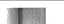
(Graph showing Transducer Excursion [Peak], Group Delay)

### FIGURE 1.10
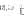
(Graph showing Transducer Excursion [Peak], Group Delay)

### FIGURE 1.11
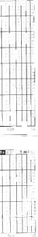
(Graph showing Transducer Impedance: Magnitude Phase)

### FIGURE 1.12
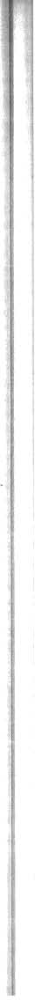
(Graph showing Transducer Velocity, Volume Current [RMS])

change will not be exactly the same for every speaker and will depend somewhat on the compliance ratio of the box and driver.

## 1.81 DESIGN ROUTINE FOR ENCLOSURE FILLING.
The best way to determine the effects of stuffing on a particular project are to add material to the enclosure and then measure the changes in $Q_{tc}$ at the terminals. Use the same procedure outlined for determining free-air Q as described in *Chapter 8, Loudspeaker Testing*. Small and Margolis²⁰ offered a hand-calculation method of approximating the effects of 100% fill of low-to-medium-density fiberglass material prior to building the enclosure. Routine 1 gives the approximation for the change in $Q_{tc}$ keeping the volume constant, while Routine 2 gives the change in volume keeping $Q_{tc}$ constant.

### Routine 1—New $Q_{tc}$ if box size remains the same:
| Equations | Example (10" driver from *Table 1.17*) |
| :--- | :--- |
| $V_{ab} = 1.2 V_b$ | $V_{ab} = 4.92$ |
| $\alpha = \frac{V_{as}}{V_{ab}}$ | $\alpha = 1.177$ |
| $L = \sqrt{\alpha + 1}$ | $L = 1.475$ |
| $Q'_{tc} = L Q_{ts}$ | $Q'_{tc} = 0.658$ |
| $Q_{tc} = \left( \frac{1}{Q'_{tc}} + .2 \right)^{-1}$ | $Q_{tc} = 0.58$ |

### Routine 2—New box volume, $V_b$, if $Q_{tc}$ remains the same:
| Equations | Example (10" driver from *Table 1.17*) |
| :--- | :--- |
| $Q_{tc} = \left( \frac{1}{Q_{tc}} - .2 \right)^{-1}$ | $Q'_{tc} = 1.098$ |
| $L = \frac{Q'_{tc}}{Q_{ts}}$ | $L = 2.461$ |
| $\alpha = L^2 - 1$ | $\alpha = 5.056$ |
| $V_{ab} = \frac{V_{as}}{\alpha}$ | $V_{ab} = 1.145$ |
| $V_b = \frac{V_{ab}}{1.2}$ | $V_b = 0.95\text{ft}^3$ |

## 1.82 EMPIRICAL COMPARISON OF BOX STUFFING MATERIALS.
The calculator method described above can give you a rough idea of Q or box size tradeoffs, but the end result can vary considerably. Not only can the measured $f_s$ and $Q_{tc}$ change depending upon density and distribution within the enclosure, but a number of materials other than fiberglass, such as Dacron and acoustic foam, as well as combinations of these materials, can be used to effect changes in box responses.

Over the years, amateurs and professionals have used a wide variety of fill materials to alter box response. These are accompanied by an equally wide variety of claims as to the best choice in terms of subjective performance. Since computer simulation and hand-calculator routines are limited to standard types of fiberglass, the following information can be used as a guideline when attempting to determine the effects of these different combinations of materials.

The test methods were fairly straightforward, although the results are subject to interpretation. Six materials were used, Dacron, Acousti-Stuf® (a Dacron-like material with crimped fibers purportedly giving the product the same sonic qualities as long fiber wool—available from Mahogany Sound), 1 lb/$\text{ft}^3$ density fiberglass (standard household type R19), 2 lb/$\text{ft}^3$ fiberglass, 4 lb/$\text{ft}^3$ fiberglass, and acoustic foam (the acoustic foam was the type supplied by Audio Concepts, but is otherwise similar to a number of other "egg crate" style foams on the market). These materials were tested with 50% fill (lining the box) and 100% fill in the test enclosure. Six other 50/50 combinations were tested (the first material listed was used to line the box, the second to fill it the rest of the way to 100%): 2 lb/1 lb fiberglass, 2 lb/Acousta-Stuf, 4 lb/1 lb fiberglass, 4 lb/Acousta-Stuf, AC foam/1 lb fiberglass, and AC foam/Acousta-Stuf.

The material was placed in a $0.95\text{ft}^3$ standard rectangular test enclosure, constructed from 0.75" particle board. The box was air tight and employed a closed cell foam gasket for the 8" driver. Each material, quantity and combination were sequentially placed in the enclosure and two measurements performed on each category.

The first measurement was a swept sine wave impedance curve made using an Audio Precision System 1 analyzer. The System 1 was set up for the voltage divider impedance of the analyzer's generator set at $600\Omega$ to provide the series resistance. The computer ASCII data files were then imported into LEAP 4.0 and converted to true impedance readings (impedance calculated with a large series resistance is similar, but not exactly the same as the driver impedance function). The data was then loaded into the LEAP automated Speaker Parameter Measurement module and the box $Q_{tc}$ parameters calculated.

The second measurement performed was a near-field frequency response using the DRA...

### TABLE 1.20
| % Fill | $f_3$ | Phase | $Q_{tc}$ |
| :---: | :---: | :---: | :---: |
| 0 | 39.94 | 98.92° | 1.19 |
| 50 | 38.31 | 96.42° | 0.89 |
| 100 | 37.37 | 93.38° | 0.73 |

### FIGURE 1.13
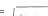
(Graph showing Acoustic On Axis Response: SPL Phase for 0, 50, 100% stuffing)

### FIGURE 1.14
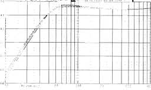
(Graph showing Transducer Impedance: Magnitude Phase for 0, 50, 100% stuffing)

Labs MLSSA FFT analyzer and an ACO Pacific 7012 precision measurement microphone. The MLSSA was set up for a 2048 point acquisition length and a 20kHz bandwidth. A 2048 point FFT was performed on the impulse response and the results printed. The data was exported from the MLSSA software and imported back into LEAP 4.0 to obtain PostScript printouts. The response of the driver with each category of fill material was displayed along with the response of the driver in the enclosure with no fill material for comparison.

The results of this series of tests, shown in *Table 1.21*, summarize the measurements. The

### TABLE 1.21: COMPARISON OF BOX STUFFING MATERIALS
| | $Z_0$ | $f_0$ | $Q_m$ | $Q_e$ | $Q_{tc}$ | $f_3$ |
| :--- | :---: | :---: | :---: | :---: | :---: | :---: |
| Empty Box | 38.96 | 84.54 | 7.74 | 1.45 | 1.22 | 61.91 |
| **50%** | | | | | | |
| Fill Dacron | 34.46 | 83.21 | 6.51 | 1.16 | 1.16 | 61.86 |
| Acousta-Stuf | 33.53 | 82.08 | 6.23 | 1.40 | 1.14 | 61.36 |
| 1lb/$\text{ft}^3$ Fiberglass | 27.77 | 79.51 | 4.93 | 1.40 | 1.09 | 60.37 |
| 2lb/$\text{ft}^3$ Fiberglass | 30.27 | 78.75 | 5.42 | 1.39 | 1.10 | 61.37 |
| 4lb/$\text{ft}^3$ Fiberglass | 31.52 | 82.06 | 5.78 | 1.40 | 1.13 | 61.52 |
| Acoustic Foam | 33.44 | 80.23 | 6.19 | 1.40 | 1.14 | 59.98 |
| **100%** | | | | | | |
| Fill Dacron | 29.77 | 81.77 | 5.39 | 1.40 | 1.11 | 61.68 |
| Acousta-Stuf | 23.82 | 80.09 | 3.97 | 1.38 | 1.02 | 62.42 |
| 1lb/$\text{ft}^3$ Fiberglass | 19.87 | 76.79 | 3.20 | 1.44 | 0.99 | 60.64 |
| 2lb/$\text{ft}^3$ Fiberglass | 15.80 | 79.37 | 2.27 | 1.44 | 0.88 | 66.71 |
| 4lb/$\text{ft}^3$ Fiberglass | 16.71 | 78.66 | 2.37 | 1.42 | 0.89 | 65.67 |
| Acoustic Foam | 17.35 | 75.91 | 2.44 | 1.35 | 0.87 | 64.26 |
| **50/50 Combinations** | | | | | | |
| 2lb/1lb Fiberglass | 14.78 | 78.12 | 1.80 | 1.28 | 0.75 | 73.91 |
| 2lb FG/Acousta-Stuf | 20.97 | 77.17 | 3.22 | 1.35 | 0.95 | 62.17 |
| | 14.67 | 75.86 | 1.79 | 1.29 | 0.75 | 71.76 |
| 4lb FG/Acousta-Stuf | 21.96 | 79.11 | 3.49 | 1.33 | 0.96 | 63.40 |
| Foam/1lb Fiberglass | 18.11 | 73.55 | 2.58 | 1.33 | 0.88 | 61.83 |
| Foam/Acousta-Stuf | 24.28 | 76.91 | 4.04 | 1.37 | 1.02 | 59.94 |

to 100%): 2 lb/1 lb fiberglass, 2 lb/Acousta-Stuf, 4 lb/1 lb fiberglass, 4 lb/Acousta-Stuf, AC foam/1 lb fiberglass, and AC foam/Acousta-Stuf.

The material was placed in a $0.95\text{ft}^3$ standard rectangular test enclosure, constructed from 0.75" particle board. The box was air tight and employed a closed cell foam gasket for the 8" driver. Each material, quantity and combination were sequentially placed in the enclosure and two measurements performed on each category.

The first measurement was a swept sine wave impedance curve made using an Audio Precision System 1 analyzer. The System 1 was set up for the voltage divider impedance of the analyzer's generator set at $600\Omega$ to provide the series resistance. The computer ASCII data files were then imported into LEAP 4.0 and converted to true impedance readings (impedance calculated with a large series resistance is similar, but not exactly the same as the driver impedance function). The data was then loaded into the LEAP automated Speaker Parameter Measurement module and the box $Q_{tc}$ parameters calculated.

The second measurement performed was a near-field frequency response using the DRA...

### FIGURE 1.15A
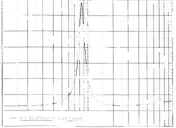
(Graph showing Transducer Impedance: Magnitude Phase for No Stuffing)

### FIGURE 1.15B
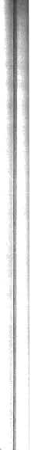
(Graph showing Acoustic On Axis Response: SPL Phase for Enclosure with no fill material)

Labs MLSSA FFT analyzer and an ACO Pacific 7012 precision measurement microphone. The MLSSA was set up for a 2048 point acquisition length and a 20kHz bandwidth. A 2048 point FFT was performed on the impulse response and the results printed. The data was exported from the MLSSA software and imported back into LEAP 4.0 to obtain PostScript printouts. The response of the driver with each category of fill material was displayed along with the response of the driver in the enclosure with no fill material for comparison.

The results of this series of tests, shown in *Table 1.21*, summarize the measurements. The

### FIGURE 1.16A
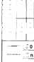
(Graph showing Transducer Impedance: Magnitude Phase for 50% Dacron)

### FIGURE 1.16B
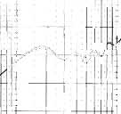
(Graph showing Acoustic On Axis Response: SPL Phase for 50% Dacron)

### FIGURE 1.17A
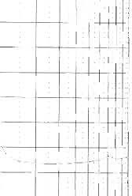
(Graph showing Transducer Impedance: Magnitude Phase for 50% Acousta-Stuf)

### FIGURE 1.17B
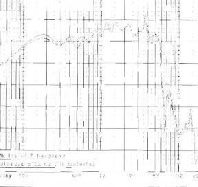
(Graph showing Acoustic On Axis Response: SPL Phase for 50% Acousta-Stuf)

### FIGURE 1.18A
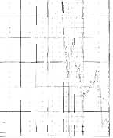
(Graph showing Transducer Impedance: Magnitude Phase for 50% 1lb/cf Fiberglass (R19))

### FIGURE 1.18B
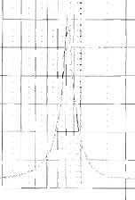
(Graph showing Acoustic On Axis Response: SPL Phase for 50% 1lb/cf Fiberglass)

table is grouped into three sections, 50% fill, 100% fill, and 100% fill of 50/50 combinations. The height of the impedance peak, $Z_0$, changed from $38.96\Omega$ with an empty enclosure to a low of $14.67\Omega$ for the 4 lb/1 lb fiberglass combination. The box resonance frequency, $f_0$, ranged from 84.54Hz in the empty enclosure to 75.16Hz, with the 4 lb/1 lb combination. Mechanical Q, $Q_{mc}$, exhibited wide variation, from 7.74 for the empty box, to 1.79, again with the 4 lb/1 lb combination. Electrical Q, $Q_{ec}$, for the most part remained unchanged for the homogeneous 50% and 100% fill tests, but did show some variation with the different combinations of materials. $Q_{tc}$ changed from 1.22 with no stuffing to a low of 0.75 for both the fiberglass 50/50 combinations. The -3dB down point, $f_3$, is dependent on both $Q_{tc}$ and the box resonance, $f_0$, and seems independent of the other trends.

It would appear that the old standby of 100% fill of standard R19 fiberglass is still a reasonable choice for moderate damping and a low $f_3$. However several of the other materials deserve serious consideration. Both of the fiberglass 50/50 combinations yielded low Q values, with only slightly higher $f_3$ frequencies. The foam/fiberglass combination also looks attractive with reasonable damping and a lower -3dB point.

The graph pairs in *Figs. 1.15–1.33* illustrate both the impedance curve and the associated near field (about 6" from the dust cap) frequency response for the various combinations listed in *Table 1.21*. The impedance graphs in *Figs. 1.24–1.28, 1.30, and 1.32* have been scaled to $20\Omega$ to make them easier to read. All other impedance plots are scaled to $40\Omega$. The solid line in the MLSSA frequency response result is the curve of the material, while the dotted line represents the curve of the box with no fill material.

The response changes due to different fill percentages are interesting. For the 50% fill group, Dacron didn't seem to do very much in the way of box mode suppression. In order to have more of an effect, this material would have to be packed with a greater density. Comparing the 50% fill group to the 100% fill group, clearly increased amount of material improved the suppression of box modes. Both the fiberglass 50/50 combinations yielded low Q values, with...

### FIGURE 1.19A
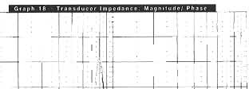
(Graph showing Transducer Impedance: Magnitude Phase for 50% 2lb/cf Fiberglass)

### FIGURE 1.19B
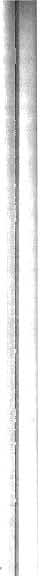
(Graph showing Acoustic On Axis Response: SPL Phase for 50% 2lb/cf Fiberglass)

### FIGURE 1.20A
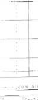
(Graph showing Transducer Impedance: Magnitude Phase for 50% 4lb/cf Fiberglass)

### FIGURE 1.20B
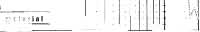
(Graph showing Acoustic On Axis Response: SPL Phase for 50% 4lb/cf Fiberglass)

other 100% fill group. Using 100% fill to suppress internal box modes is just as important as changing $f_s$ and $Q_{tc}$.

## 1.90 MULTIPLE WOOFER FORMATS.
Using two or more woofers in a low-frequency cabinet can give you a number of different advantages over single woofer designs. The three basic configurations are: standard, push/pull, and compound.

## 1.91 STANDARD CONFIGURATION.
This is defined as two or more identical woofers having the same enclosure and mounted as close together as possible. For a two woofer situation the following applies:

A. $f_s$ driver resonance for two drivers will be the same as that of a single driver.
B. $Q_{ts}$ will be the same as that for a single driver.
C. $V_{as}$ (and the associated box volume, $V_b$) will be twice that of a single driver.
D. Combined impedance will be half of a single unit when connected in parallel, and twice the value of a single unit when connected in series.
E. Sensitivity will increase +3dB for a parallel connection and -3dB for a series connection compared to a single driver.
F. Cone excursion will be half that of a single woofer enclosure.

Using four identical woofers in a series parallel configuration will also have 6dB efficiency gain over the single woofer, the same gain as the two-woofer combination. Doubling the cone area over the two-woofer design adds 3dB of acoustic efficiency, but putting two parallel sets of woofers in series decreases gain by -3dB, for a net change of zero when compared to the output of the two woofer box.

*Figure 1.34* depicts the 1W SPL comparison of the computer simulation for single-, ...

### FIGURE 1.21A
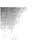
(Graph showing Transducer Impedance: Magnitude Phase for 50% Acoustic Foam (AC))

### FIGURE 1.21B
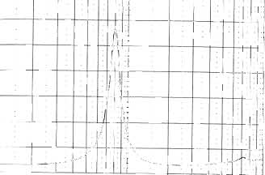
(Graph showing Acoustic On Axis Response: SPL Phase for 50% Acoustic Foam)

### FIGURE 1.22A
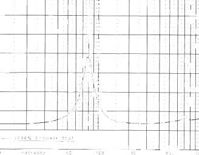
(Graph showing Transducer Impedance: Magnitude Phase for 100% Dacron)

### FIGURE 1.22B
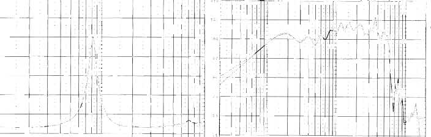
(Graph showing Acoustic On Axis Response: SPL Phase for 100% Dacron)

### FIGURE 1.23A
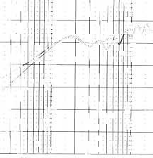
(Graph showing Transducer Impedance: Magnitude Phase for 100% Acousta-Stuf)

### FIGURE 1.23B
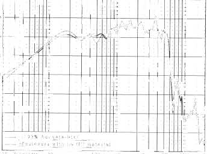
(Graph showing Acoustic On Axis Response: SPL Phase for 100% Acousta-Stuf)

compared to a single driver.
F. Cone excursion will be half that of a single woofer enclosure.

Using four identical woofers in a series parallel configuration will also have 6dB efficiency gain over the single woofer, the same gain as the two-woofer combination. Doubling the cone area over the two-woofer design adds 3dB of acoustic efficiency, but putting two parallel sets of woofers in series decreases gain by -3dB, for a net change of zero when compared to the output of the two woofer box.

*Figure 1.34* depicts the 1W SPL comparison of the computer simulation for single-, ...

be twice that of a single driver.
D. Combined impedance will be half of a single unit when connected in parallel, and twice the value of a single unit when connected in series.
E. Sensitivity will increase +3dB for a parallel connection and -3dB for a series connection compared to a single driver.

### FIGURE 1.24A
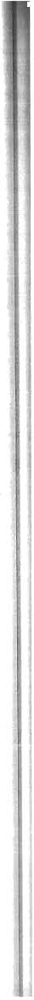
(Graph showing Transducer Impedance: Magnitude Phase for 100% 1lb/cf Fiberglass (R19))

### FIGURE 1.24B
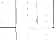
(Graph showing Acoustic On Axis Response: SPL Phase for 100% 1lb/cf Fiberglass)

### FIGURE 1.25A
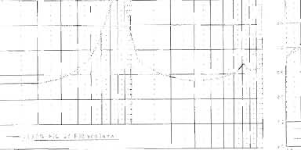
(Graph showing Transducer Impedance: Magnitude Phase for 100% 2lb/cf Fiberglass)

### FIGURE 1.25B
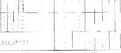
(Graph showing Acoustic On Axis Response: SPL Phase for 100% 2lb/cf Fiberglass)

### FIGURE 1.26A
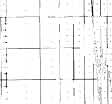
(Graph showing Transducer Impedance: Magnitude Phase for 100% 4lb/cf Fiberglass)

### FIGURE 1.26B
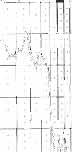
(Graph showing Acoustic On Axis Response: SPL Phase for 100% 4lb/cf Fiberglass)

compared to a single driver.
F. Cone excursion will be half that of a single woofer enclosure.

Using four identical woofers in a series parallel configuration will also have 6dB efficiency gain over the single woofer, the same gain as the two-woofer combination. Doubling the cone area over the two-woofer design adds 3dB of acoustic efficiency, but putting two parallel sets of woofers in series decreases gain by -3dB, for a net change of zero when compared to the output of the two woofer box.

*Figure 1.34* depicts the 1W SPL comparison of the computer simulation for single-, ...

### FIGURE 1.27A
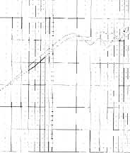
(Graph showing Transducer Impedance: Magnitude Phase for 100% 2lb cf Acoustic Foam (AC))

### FIGURE 1.27B
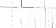
(Graph showing Acoustic On Axis Response: SPL Phase for 100% Acoustic Foam)

### FIGURE 1.28A
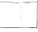
(Graph showing Transducer Impedance: Magnitude Phase for 50% 2lb/cf FG + 50% 1lb/cf FG)

### FIGURE 1.28B
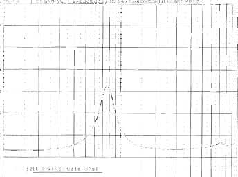
(Graph showing Acoustic On Axis Response: SPL Phase for 50% 2lb/cf FG + 50% 1lb/cf FG)

### FIGURE 1.29A
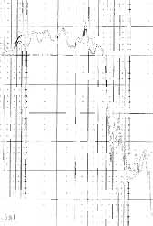
(Graph showing Transducer Impedance: Magnitude Phase for 50% 2lb FG + 50% Acousta-Stuf)

### FIGURE 1.29B
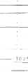
(Graph showing Acoustic On Axis Response: SPL Phase for 50% 2lb FG + 50% Acousta-Stuf)

woofer, two-woofer, and four-woofer box designs. Notice the changes in the midband response of the four-driver combination over the two-driver one. When multiple drivers are closely grouped together, changes in the combined radiation impedance can cause substantial midband deviation. As expected, the gain for the two- and four-woofer designs is 6dB greater than the single driver. Looking at cone excursion and group delay curves in *Fig. 1.35*, the excursion of the two- and one-driver designs is identical for the same drive voltage, while the group delay is identical for the four-woofer design for the same drive voltage, while the group delay is identical for all three systems. The impedance curves in *Fig. 1.36* show the two- woofer box with half the impedance of one speaker. The single-driver and four-woofer box have similar impedance curves, except the impedance peak is lower for the four-woofer box, resulting from the difference in multiple driver radiation impedance. The advantage of multiple driver combinations is more obvious at higher power levels. *Figure 1.37* illustrates the SPL comparison for the same three box designs, one, two, and four drivers, but this time all are at the same 100dB level. The voltage input to get this SPL is 12.68V for a single driver and 6.35V for the two- and four-driver combinations. The overall midband level of the single woofer has now dropped by about 1.5dB and the rolloff slope is somewhat steeper, indicating damping changes caused by increased resistance due to voice coil heating. The -3dB phase angle for all three designs was 90° at the 2.83V 1W level, but the single driver has now changed to 100° (an equivalent Q of 1.0), the two-driver box to 93°, and no change in the four-driver phase angle (still 90°). Looking at the group delay curves in *Fig. 1.38*, the shape of the curve is about the same for the two- and four-driver combinations, while the "knee" of the single-driver design is clearly sharper. Cone excursion curves are as expected. Excursion for the two-woofer design is half that of the single driver, and excursion for the four-woofer design is half that of the two-woofer design. The impedance curve in *Fig. 1.39* shows the voice coil heating in the single driver has caused an increase in resistance of about $1.7\Omega$ across the bandwidth.

### FIGURE 1.30A
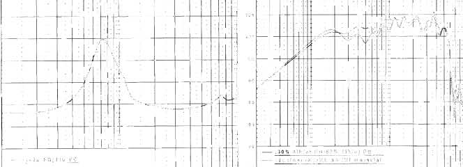
(Graph showing Transducer Impedance: Magnitude Phase for 50% 4lb FG + 50% 1lb FG)

### FIGURE 1.30B
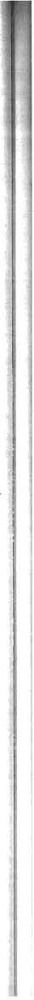
(Graph showing Acoustic On Axis Response: SPL Phase for 50% 4lb FG + 50% 1lb FG)

### FIGURE 1.31A
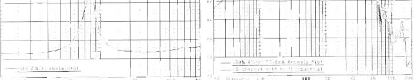
(Graph showing Transducer Impedance: Magnitude Phase for 50% AC Foam + 50% 1lb FG)

### FIGURE 1.31B
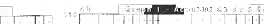
(Graph showing Acoustic On Axis Response: SPL Phase for 50% AC Foam + 50% 1lb FG)

## 1.92 PUSH/PULL CONFIGURATION.
This occurs when two woofers are mounted on the box either back-to-back or front-to-front, and then driven electrically out of phase (*Fig. 1.40*). This type of setup will cause odd-order nonlinearities to cancel and result in substantially reduced driver distortion. All of the above-listed characteristics (A-E) apply to push/pull driver arrangements. In addition, the push/pull woofer arrangement can be used with vented, passive radiator systems, as well as sealed boxes. Two construction articles which used this configuration appeared in *Speaker Builder*: "Tenth Row Center," by H. Hirsch, 2/84, p. 11; and "The Curvilinear Vertical Array," by S. Ellis, 2/85, p. 7.

## 1.93 COMPOUND WOOFER SYSTEMS.
This design was first described by Olson in the early 1950s. The compound or Isobarik (constant pressure) system has several spectacular advantages over the other dual-woofer configurations. For the type of physical and electrical setup shown in *Fig. 1.41*, the following will apply:

A. $Q_{ts}$ will be the same as a single driver.
B. $f_s$ will be the same as a single driver.
C. $V_{as}$ (and the associated box volume $V_b$) will be half that of a single driver.
D. Impedance will be half that of a single driver (assuming a parallel connection).
E. When configured in push/pull, the setup will have all the advantages listed in *Section 1.92*.
F. Sensitivity of the compound pair will be the same as that of a single driver (sensitivity will go up 3dB due to the $4\Omega$ load, but will decrease by 3dB due to the doubling cone mass).

The major advantage of a constant pressure format is an enclosure volume that is half that of a single driver, making it an ideal choice for subwoofer applications.

The following construction details should be observed:
A. Your box size should be calculated as a closed-box system, using the single driver $Q_{ts}$ and $V_{as}/2$.
B. Construct the short tunnel depicted in *Fig. 1.41*. It can be made square, out of lumber, or cylindrical, made from Sonotube (cardboard tubing used to build concrete pillars). Its length...

### FIGURE 1.32A
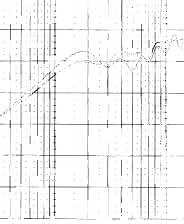
(Graph showing Transducer Impedance: Magnitude Phase for AC Foam / 1lb FG)

### FIGURE 1.32B
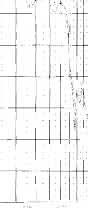
(Graph showing Acoustic On Axis Response: SPL Phase for 50% Foam 50% 1lb/cf Fiberglass)

### FIGURE 1.33A
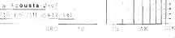
(Graph showing Transducer Impedance: Magnitude Phase for AC Foam / Acousta-Stuf)

### FIGURE 1.33B

(Graph showing Acoustic On Axis Response: SPL Phase for 50% Foam 50% Acousta-Stuf)

is not critical, but make sure the rear woofer cone never contacts the magnet structure of the front woofer. The tunnel should be airtight and, except for some sort of acoustical absorbent (such as felt) on the tunnel walls, should not contain damping material.

Again, you'll find two interesting construction articles printed in *Speaker Builder*: "Constructing a Sontek Subwoofer," by P. Todd, 2/85, p. 20; and "The Wonder of Symmetrical Isobarik," by Bill Schwefel, 5/90, p. 10.

## 1.100 ELECTRONICALLY ASSISTED CLOSED-BOX SYSTEMS.
A method sometimes suggested for altering the low end response of a closed-box system involves the use of some sort of active filter boost. Three published papers by Leach,²¹,²² Staggs,²³ and Greiner and Schoessow²⁴ describe different approaches to either lowering the cut-off frequency or enhancing the transient response of a loudspeaker. *Table 1.22* summarizes the parameters for the three filters.

Illustrating the problems created by boosting the low end output of a closed-box speaker can be accomplished using computer simulation. The computer simulation in this example duplicates the method described by Marshall Leach in his June 1981 *JAES* article, "Active Equalization of Closed Box Loudspeaker Systems." The box/driver combination had a $Q_{tc}$ of 0.7 with an $f_3$ of 35Hz. The boost filter comprised a fourth-order response with about 8dB of gain at 24Hz. The transfer function of the filter is shown in *Fig. 1.42*. *Fig. 1.43* gives the SPL comparison of the design with and without the filter at a 1W level. The closed box with the boost filter now has an $f_3$ of 24Hz, 11Hz lower than the unfiltered loudspeaker, but with a high order rolloff of 38.5dB/octave. This appears on the surface like a good choice until the cone excursion and group delay curves in *Fig. 1.44* are examined. Excursion (the lower set of curves) has more than doubled, while the damping change looks fairly radical with a very sharp "knee" in the group delay curve. The real story is told at a 20W power level. Although the SPL comparison in *Fig. 1.45* reveals only the changes expected at a higher power level, the cone excursion and group delay curves of the boosted design shown in *Fig. 1.46* are totally unacceptable. Excursion has increased to nearly 19mm, which is difficult since the driver has an $X_{max}$ of only 7mm. While it can be argued that the peak is confined to a fairly narrow...

### FIGURE 1.34

(Graph showing 1W SPL comparison for single, two, and four driver systems)

### FIGURE 1.35

(Graph showing Transducer Excursion [Peak], Group Delay for 1, 2, and 4 driver systems at 2.83V)

### FIGURE 1.36

(Graph showing Transducer Impedance: Magnitude Phase for 1, 2, and 4 driver systems)

### FIGURE 1.37

(Graph showing 100dB SPL comparison for 1, 2, and 4 driver systems)

### FIGURE 1.38

(Graph showing Transducer Excursion [Peak], Group Delay for 1, 2, and 4 driver systems at SPL 100dB)

### TABLE 1.22: ACTIVE EQ FOR CLOSED BOXES
| | $Q_{tc}$ | new $Q_{tc}$ | Boost | Result |
| :--- | :---: | :---: | :---: | :---: |
| A. | $B_2$—0.707 | $B_4$—0.707 | 8dB | 1 octave |
| B. | $C_2$—1.1 | $D_3$—0.577 | 5dB | imp trans. |
| C. | $B_2$—0.707 | $B_2$—0.707 | 10dB | 1 octave |

fairly narrow frequency span at a frequency which has little program material, you could expect the cannon shots on the 1812 or some low synthesizer notes to send the voice coil completely out of the gap and likely crashing into the front plate on its return path causing catastrophic failure.

I have made no attempt to duplicate the design methodology presented for these filter systems. They are mentioned, however, as a possible alternative to previously discussed systems. The major drawback of the filters described above is the substantial increase in amplifier power required at lower frequencies. Such techniques for altering response, when used in conjunction with wide dynamic range sources such as CD players, become even more undesirable. If you want a lower cut-off frequency or improved transients, probably your best solution is to select an appropriate unassisted design in the first place.

## 1.200 MASS LOADING TECHNIQUES.
Modifying speakers by adding mass is an old technique which has been employed for years in the loudspeaker industry. This section describes two mass loaded configurations, simple mass loading and mass loading used to create a passively assisted speaker.

## 1.210 SIMPLE MASS LOADING MODIFICATIONS.
Adding mass to a speaker cone causes several of the operational parameters to change. *Table 1.23* summarizes the parameter modification in a 10" woofer caused by increasing cone mass by 75%. Data is given for both woofer and enclosure operating parameter changes.

From the data in *Table 1.23*, it is apparent that as mass increases, Q goes up, $f_s$ goes down, and driver efficiency goes down. Likewise, as mass is added, the box Q increases as does the -3dB phase angle, and the $f_c$ and SPL go down. *Figure 1.47* illustrates the simulated SPL comparison of the woofer in the enclosure with and without the added mass. The cone excursion and group delay curves in *Fig. 1.48* confirm the decrease in damping, while the impedance curves in *Fig. 1.49* depict the lower $f_c$ and the higher Q of the mass added combination. This tradeoff set seems fairly reasonable, even looking at the effects of increasing power to the 20W level. *Figure 1.50* shows the expected changes in SPL, but the increase in cone excursion shown in *Fig. 1.51* could be excessive. This particular driver has an $X_{max}$ of 7mm. Figuring that third harmonic distortion increases to 3% at $X_{max}$ +15%, or 8mm, the unchanged driver/box combination is still operating appropriately. The mass-loaded version is at about 9.5mm, which, though not really excessive, is starting to show more stress. A good solution would be to use two mass-loaded woofers instead of one, which would lower Q and excursion at higher operating levels and increase efficiency to an acceptable level. One caution, however: the additional mass can be sufficient to...

### FIGURE 1.39

(Graph showing Transducer Impedance: Magnitude Phase for a driver system with varying power levels)

### FIGURE 1.40

(Diagram of Push/pull woofer mounting configurations)

### FIGURE 1.41

(Diagram of Compound woofer mounting)

cause cones to sag over time. If the sag is excessive, it can lead to misaligned voice coils and cause premature driver failure.

## 1.220 PASSIVELY ASSISTED MASS-LOADED SPEAKERS.
Passively assisted speakers do not necessarily require mass loading, but since that is one method of achieving the necessary parameters for the methodology being described in this section, it is included as a type of mass loading technique. Passively assisted speakers grew out of the original Thiele work with fifth-order passively assisted vented alignments. Benson²⁵ and Von Recklinghausen²⁶ first introduced the idea of extending the low end response of sealed enclosures by combining the transfer function of the box/driver combination with a passive high-pass filter. This was followed by Geddes’ and Clark’s presentation at the 79th AES Convention in 1985.²⁷ They suggested that such designs would be appealing for configurations where active equalization was not practical, such as with satellite speakers used with subwoofers. It was also suggested that car audio applications would also likely be desirable because of the limited amplifier voltage available for active EQ (since active EQ plays a big role in car audio, the latter seems invalid). Bringing it into the practical world of real life speaker building, Tom Nousaine described an interesting application in *Speaker Builder* 1989.²⁸

The basic criterion for this type of passively assisted design requires that the woofer have a $Q_{ms}$ between 7 and 10. The design described in Geddes’ and Clark’s paper used a JBL 128H 12" woofer which has a high Q because it used a nonconductive voice coil former. Since most home hi-fi drivers use conductive formers and have $Q_{ms}$ numbers in the vicinity of 3 to 5, the added mass is used to boost the $Q_{ms}$ to an acceptable level.

To use this methodology, select a woofer with a fairly high $Q_{ms}$ value of about 4.5 and add enough mass to increase the mechanical Q to about 7 or 8. The 12" woofer used in the Nousaine article required increasing the mass by 80% (about the same as the previous mass loaded example). The unassisted box Q should be set to about 1.1. As with the previous example, using a two driver combination will be more satisfactory in terms of excursion and efficiency.

The series high-pass filter is a single capacitor. The value of the capacitor is calculated by:
$$C = \frac{0.234}{R_e \times f_s}$$

*Table 1.24* gives the driver and box values for the same driver, added mass and box dimensions used in Tom Nousaine’s SB article (using a Precision TA305F 12" woofer).

The capacitor required for this design was calculated to be about $1,750\mu\text{F}$, which could be had from a single large motor starting capacitor or several paralleled nonpolar electrolytics.

The computer 1W SPL simulation for the driver in the enclosure without added mass, ...

### TABLE 1.23: Q AND $Q_{tc}$ CHANGES WITH ADDED MASS
| | Mmd. | $Q_{ms}$ | $Q_{es}$ | $Q_{ts}$ | SPL Hz | dB |
| :--- | :---: | :---: | :---: | :---: | :---: | :---: |
| 47g | 15 | 2.86 | 0.5 | 0.43 | 22.5 | 87 |
| 80g | 35 | 3.67 | 0.65 | 0.55 | 17.5 | 82.7 |

### FIGURE 1.42

(Graph showing Active Filter Transfer Function: Magnitude Phase)

### FIGURE 1.43

(Graph showing Acoustic On Axis Response: SPL Phase)

### FIGURE 1.44

(Graph showing Transducer Excursion [Peak], Group Delay)

### FIGURE 1.45

(Graph showing Acoustic On Axis Response: SPL Phase, with filter)

### FIGURE 1.46

(Graph showing Transducer Excursion [Peak], Group Delay, with filter)

### TABLE 1.24: PASSIVELY ASSISTED MASS LOADED DESIGN
| | Mmd. | $Q_{ms}$ | $Q_{ts}$ | SPL | $f_3$ | Slope | SPL | $f_3$ |
| :--- | :---: | :---: | :---: | :---: | :---: | :---: | :---: | :---: |
| w/o mass | 72g | 5.8 | 0.32 | 91dB | 24Hz | 0.7 | 11.03 | 95dB | 54Hz |
| w/mass | 129g | 7.6 | 0.42 | 87dB | 19Hz | 1.1 | 12.34 | 90dB | 38Hz |
| plus cap | | | | | | | 21.6 | 90dB | 28Hz |

would get this kind of picture-perfect performance graph from a T/S computer program, and, indeed, they would be almost indistinguishable. Once this woofer and vented box combination is placed in the 110ft car compartment, the result is radically different from the free-field response. The frequency response graph depicted in *Fig. 11.7* (a computed average of several mike locations in and around the driver seat) shows the response in the car, sometimes referred to as the car's transfer function (minus the driver response), and has perhaps 7 or 8dB additional lift in the 40-50Hz region and an enormous 20dB boost at 20Hz. When you consider the amplifier headroom and dynamic range required to provide 20dB of boost at 20Hz electronically, this is nothing short of spectacular.
From these three experimental measurements, we can conclude that the car volume changes only the driver SPL. While it means the predicted $f_3$, and response shape obtained from a T/S design workup is totally out the window, you can still rely on the other aspects, such as damping and cone excursion, as accurate.

### FIGURE 1.47

(Graph showing Acoustic On Axis Response: SPL, Phase for passively assisted mass loaded speaker)

### FIGURE 1.48

(Graph showing Transducer Excursion [Peak], Group Delay for passively assisted mass loaded speaker)

### FIGURE 1.49

(Graph showing Transducer Impedance: Magnitude Phase for passively assisted mass loaded speaker)

### FIGURE 1.50

(Graph showing Acoustic On Axis Response: SPL, Phase for 20W input)

### FIGURE 1.51

(Graph showing Transducer Excursion [Peak], Group Delay for 20W input)

## 1.300 SEALED REAR CHAMBER BANDPASS ENCLOSURES.
## 1.310 DEFINITION.
A sealed rear chamber bandpass enclosure is basically a closed-box system with the addition of an acoustic filter in series with the front radiation of the driver. Because of the additional filter element, the possibilities for tradeoffs on bandwidth and efficiency are greater than with a simple sealed type enclosure.

## 1.315 ADDITIONAL TERMS.
- $f_v$: tuning frequency of front chamber vent
- $f_1$: $f_3$ of low frequency rolloff
- $f_2$: $f_3$ of high frequency rolloff
- $L_v$: vent length in inches (centimeters)
- $Q_{bp}$: Q of bandpass rear chamber
- $R_v$: vent radius in inches (centimeters)
- $S$: passband ripple (variation in magnitude response)
- $V_1$: volume of the front (acoustic filter) chamber
- $V_2$: volume of the rear chamber
- $V_{t}$: total volume of both chambers

## 1.320 HISTORY.
The bandpass enclosure, despite its current fad-like popularity, is not a new design concept. The original patent was filed in 1934 by Andre d'Alton²⁹ (patent no. 1,969,704) followed by another filed in 1952 by then MIT grad student Henry Lang. Renewed interest probably was fired by Laurie Fincham's paper delivered at the 1979 63rd AES Convention titled "A Bandpass Enclosure" (AES preprint no. 1512). In 1982 two French designers, Augris and Santens, published a hand-calculator design system for sealed rear chamber bandpass speakers in the French publication *L'Audiophile*³⁰. Not long after that, Bose was granted a patent on vented front and rear chamber bandpass enclosures in October, 1985 (patent no. 4,549,631), which was later to become the Acoustimass three piece speaker system. Earl Geddes kept things going with his presentation at the 81st AES Convention, November 1986, titled "Bandpass Loudspeaker Enclosure" (preprint no. 2383). The paper was revised and published in the *JAES* May, 1989. The real explosion of popularity among amateurs and manufacturers probably came, however, after Jean Margerand republished Augris and Santens methodology in *Speaker Builder* 6/88.

### TABLE 1.25
| $S_d$ m² | $f_v$ | $Q_{bp}$ | $f_1$ factor | $f_2$ factor | Sensitivity |
| :---: | :---: | :---: | :---: | :---: | :---: |
| 0.0089 | 15 | 2.86 | 0.5 | 0.43 | -8dB |
| 0.0158 | 20 | 3.67 | 0.65 | 0.55 | -7dB |
| 0.0215 | 25 | 4.34 | 0.75 | 0.67 | -6dB |
| 0.0330 | 30 | 5.00 | 0.85 | 0.75 | -5dB |
| 0.0450 | 35 | 5.50 | 0.95 | 0.83 | -4dB |

Santens, published a hand-calculator design system for sealed rear chamber bandpass speakers in the French publication *L'Audiophile*³⁰. Not long after that, Bose was granted a patent on vented front and rear chamber bandpass enclosures in October, 1985 (patent no. 4,549,631), which was later to become the Acoustimass three piece speaker system. Earl Geddes kept things going with his presentation at the 81st AES Convention, November 1986, titled "Bandpass Loudspeaker Enclosure" (preprint no. 2383). The paper was revised and published in the *JAES* May, 1989. The real explosion of popularity among amateurs and manufacturers probably came, however, after Jean Margerand republished Augris and Santens methodology in *Speaker Builder* 6/88.

## 1.330 WOOFER SELECTION.
Woofer selection for sealed rear chamber bandpass enclosures is somewhat the same as for standard nonfiltered closed boxes. With bandpass enclosures, because of the increased tradeoff flexibility, the ratio of $f_c/Q_{tc}$ is important. Low ratios, which mean the higher $Q_{tc}$s usually employed in closed box systems, generally yield lower $f_3$ rolloffs.

## 1.340 BOX SIZE DETERMINATION.
The methodology described for box size determination is taken from the *SB 6/88* article, but somewhat simplified. Three design tables are used for deriving enclosure parameters. Each table represents a different level of damping, "S," which is expressed as ripple within the passband. This ripple factor, S, describes the SPL variation in the box magnitude response between the two -3dB frequencies, $f_1$, the low frequency rolloff, and $f_2$, the high frequency rolloff. *Table 1.25* has S = 0.7 which indicates 0 ripple and the best transient performance. *Table 1.26* has S = 0.6 which allows for 0.35dB ripple (hardly significant) with somewhat degraded transient performance. *Table 1.27* has S = 0.5 which allows for 1.25dB ripple, and has transient performance somewhat degraded from S = 0.6. "S" is also a general indicator of overall bandwidth, which is widest at S = 0.5, and the most narrow at S = 0.7.

The recommended procedure is to start with *Table 1.25*, S = 0.7, and by trial and error determine whether or not the driver selected will provide the desired $f_1$ and $f_2$ frequencies at the sensitivity level required. The high and low frequency rolloff $f_1$ points are found by multiplying the driver $f_s/Q_{ts}$ ratio by the $f_1$ and $f_2$ factors from the tables. This can be done for different levels of sensitivity, until a satisfactory compromise between $f_1/f_2$ frequencies and sensitivity is determined.

$V_1$, the volume of the front enclosure, can be calculated once one of the tables has been selected, as it is independent of all factors, except "S." $V_2$ is calculated by:
$$V_2 = (2S \times Q_{tc}) \times V_{as}$$

As you scan the tables, be aware that the higher the $Q_{bp}$ value, the higher the sensitivity and the nar-

### FIGURE 1.56

(Graph showing Transducer Excursion [Peak], Group Delay)

### FIGURE 1.57

(Graph showing Acoustic On Axis Response: SPL, Phase)

### FIGURE 1.58

(Graph showing Acoustic On Axis Response: SPL, Phase)

rower the bandwidth. Conversely, the lower the $Q_{bp}$ value, the lower the sensitivity and the wider the bandwidth, as you can see in *Fig. 1.57*.

Next, $V_1$ can then be calculated from:
$$V_1 = V_b - \frac{V_{as}}{(Q_{bp}/Q_{ts})^2 - 1}$$

The vent tuning frequency for the front chamber filter is found by:
$$f_v = Q_{bp} \times (f_s/Q_{ts})$$

Once the tuning frequency has been determined, the vent length in inches for $V_1$ in cubic inches and vent radius R in inches is given by:

### TABLE 1.25: $S = 0.7$ Ripple = 0dB
| $Q_{bp}$ | $f_1$ factor | $f_2$ factor | Sensitivity |
| :---: | :---: | :---: | :---: |
| 0.4507 | 0.2167 | 0.9373 | -8dB |
| 0.4774 | 0.2378 | 0.9584 | -7dB |
| 0.5057 | 0.2606 | 0.9812 | -6dB |
| 0.5356 | 0.2852 | 1.0058 | -5dB |
| 0.5674 | 0.3118 | 1.0324 | -4dB |
| 0.6010 | 0.3404 | 1.0610 | -3dB |
| 0.6366 | 0.3712 | 1.0918 | -2dB |
| 0.6743 | 0.4043 | 1.1248 | -1dB |
| 0.7143 | 0.4397 | 1.1603 | 0dB |
| 0.7566 | 0.4777 | 1.1983 | 1dB |
| 0.8014 | 0.5184 | 1.2390 | 2dB |
| 0.8489 | 0.5619 | 1.2825 | 3dB |
| 0.8772 | 0.6084 | 1.3290 | 4dB |
| 0.9525 | 0.6581 | 1.3787 | 5dB |
| 1.0090 | 0.7111 | 1.4317 | 6dB |
| 1.0687 | 0.7675 | 1.4881 | 7dB |
| 1.1321 | 0.8277 | 1.5483 | 8dB |

### TABLE 1.26: $S = 0.6$ Ripple = 0.35dB
| $Q_{bp}$ | $f_1$ factor | $f_2$ factor | Sensitivity |
| :---: | :---: | :---: | :---: |
| 0.5258 | 0.2326 | 1.1886 | -8dB |
| 0.5570 | 0.2560 | 1.2119 | -7dB |
| 0.5900 | 0.2813 | 1.2373 | -6dB |
| 0.6249 | 0.3088 | 1.2648 | -5dB |
| 0.6619 | 0.3385 | 1.2945 | -4dB |
| 0.7012 | 0.3706 | 1.3266 | -3dB |
| 0.7427 | 0.4052 | 1.3612 | -2dB |
| 0.7867 | 0.4425 | 1.3986 | -1dB |
| 0.8333 | 0.4827 | 1.4387 | 0dB |
| 0.8827 | 0.5258 | 1.4818 | 1dB |
| 0.9350 | 0.5721 | 1.5281 | 2dB |
| 0.9904 | 0.6217 | 1.5778 | 3dB |
| 1.0491 | 0.6749 | 1.6309 | 4dB |
| 1.1113 | 0.7317 | 1.6877 | 5dB |
| 1.1771 | 0.7925 | 1.7485 | 6dB |
| 1.2469 | 0.8573 | 1.8134 | 7dB |
| 1.3207 | 0.9266 | 1.8826 | 8dB |

### FIGURE 1.59

(Graph showing Transducer Excursion [Peak], Group Delay)

### FIGURE 1.60

(Graph showing Acoustic On Axis Response: SPL, Phase)

### FIGURE 1.61

(Graph showing Transducer Impedance: Magnitude Phase)

1. $L_v = \frac{1.463 \times 10^7 R_v^2}{f_v^2 V_1}$ for $L_v$ in inches, $V_1$ in cubic feet, and $R_v$ in inches.
2. For $L_v$ in centimeters, with $V_1$ in liters, and vent radius in centimeters use: $L_v = \frac{9.425 \times 10^4 R_v^2}{f_v^2 V_1} - 1.595 R_v$.

Vent diameter should be made as large as practically possible for the depth of the enclosure to avoid excessive port nonlinearity. Shelf ports, discussed in *Chapter 2, Vented Box Low Frequency Systems*, generally will achieve the maximum port cross sectional area possible for a given enclosure depth. Longer tube vents require an elbow joint.

## 1.360 EXAMPLE DESIGN CHARTS AND COMPUTER SIMULATION.
*Table 1.28* gives an example of a sealed rear chamber bandpass design using an 8" woofer. The data from the design tables was entered into LEAP 4.0 to generate a computer simulation. Compared to the calculator design charts, the modeling in the LEAP program is considerably more sophisticated. LEAP considers non-linear $Bl$, compliance, and port losses, as well as a variety of frequency dependent parameters. The general Thiele/Small model (which is the basis for all the calculator design charts in this book) relies upon generalized constants and does not account for the frequency dependent nature of losses or deal with driver nonlinearity. However, at a small signal (1W) level the calculator methods are usually fairly accurate and more than reliable enough for design work. The results shown in *Table 1.28* bear this out, since LEAP's predictions for $f_1$ and $f_2$ are within 1Hz of the predictions from the design tables.

The 1W SPL and phase is depicted in *Fig. 1.58*, showing the typical bandpass shape. The -3dB point is a respectable 42Hz, which is good compared to the roughly 55Hz -3dB point this woofer would produce in a 0.7$\text{ft}^3$ sealed enclosure. The rolloff slope is about 15dB/octave on the low end, steep for a second-order rolloff, and 17.8dB/octave on the high end of the response. Much of the literature, however, seems to imply by omission that bandpass enclosures are good low-pass filters. This is not true. *Figure 1.59* shows the same enclosure from 20-20kHz with the LEAP port standing wave model turned on. This simulation was done without any front chamber damping to emphasize the effect. This is a good approximation of the response anomalies caused by the pipe resonances (pipe resonances are discussed in detail in *Chapter 2*) and standing waves transmitted out the port, but *Fig. 1.60* shows the real thing. This is the measure frequency response of a 10" woofer in a sealed chamber bandpass enclosure (the front chamber of this design was lined with 1" fiberglass). The measurement was taken near-field with the DRA MLSSA FFT analyzer and an ACO Pacific 7012 precision measurement microphone and the data then imported into LEAP 4.0. This problem is not trivial and it is difficult to use bandpass enclosures...

### FIGURE 1.62

(Graph showing Transducer Excursion [Peak], Group Delay)

### FIGURE 1.63

(Graph showing Acoustic On Axis Response: SPL, Phase)

### FIGURE 1.64

(Graph showing Acoustic On Axis Response: SPL, Phase)

without additional filtering unless you accept the upper frequency output.
Several techniques can be employed to minimize the box standing wave modes being transmitted through the port. The first item is to line all inside walls in the front chamber with fiberglass or some other damping material. Stretching a length of material, such as the pressed cloth type used in automobiles, across the inside of the enclosure between the port and the driver can likewise be effective. Using an inside panel fastened at an angle between the port and driver to alter standing wave modes would also be somewhat effective. Pipe vents directly over the driver, as in many designs, are more offensive than shelf ports. Many designers do not try to use the enclosure without a filter and usually resort to an electronic filter or simple first-order filter and a conjugate circuit (impedance equalizer), which will require some retuning of the port frequency. Another method of adding first-order high-pass and low-pass filters to a bandpass enclosure accompanied by box retuning was described by Joe D'Appolito in a paper he presented at the 91st AES Convention.³¹ This methodology was incorporated into the TopBox computer software and is readily available.³²·³³ All of these methods will involve a certain amount of trial and error.

*Figure 1.61* shows the group delay and cone excursion. The group delay indicates a damping picture much like a vented enclosure. Although the low end rolloff may be second-order like a closed box, the transient performance is degraded by comparison. The impedance is given in *Fig. 1.62* and the cone velocity in *Fig. 1.63*. The appearance of both graphs is similar to a vented enclosure with maximum driver acceleration happening at the resonance frequencies. Increasing the power input to 20W, the magnitude response becomes somewhat peaked at upper end as seen in *Fig. 1.64*. Cone excursion, shown in *Fig. 1.65*, goes to about 6.4mm, which is not bad at this SPL (102dB), since $X_{max} + 15\%$ is 6mm. This design's total box volume is about $1.2\text{ft}^3$, which is large for a single 8" speaker. Bandpass designs can be used with compound loading to create more compact variations.

## 1.370 BANDPASS ENCLOSURE VARIATIONS.
There are several possible variations of sealed rear chamber bandpass enclosures. The diagrams in *Fig. 1.66* depict five different possibilities: A. Single driver bandpass; B. Dual driver push/pull bandpass; C. Push/pull compound bandpass; D. Triple chamber bandpass; E. Push/pull triple chamber bandpass. The multiple driver configuration B uses the combined volumes of two drivers. The center chamber of the triple bandpass is equal to the combined...

### TABLE 1.28: 8" Woofer Bandpass Example $S = 0.7$
| Driver | $f_s$ | $Q_{ts}$ | $V_{as}$ | $Q_{tc}$ |
| :---: | :---: | :---: | :---: | :---: |
| | 32 | 0.328 | $2.49\text{ft}^3$ | 0.56 |

| Enclosure | Calculated | Simulated |
| :--- | :---: | :---: |
| $f_1$ | 0.53 | 0.66 |
| $f_2$ | 0.53 | 0.66 |
| $V_1$ | 71Hz | 71Hz |
| $V_2$ | 43.5Hz | 42Hz |
| $Q_{bp}$ | 115Hz | 114Hz |
| $L_v$ | $9.75"$ | $9.75"$ |
| $D_v$ | $4"$ | $4"$ |

### FIGURE 1.65

(Graph showing Transducer Excursion [Peak], Group Delay)

### FIGURE 1.66

(Diagram showing various bandpass enclosure configurations)

front volumes of each driver and tuned to that frequency. The drivers in B, C, and D are connected electrically out of phase for either a parallel or series wiring arrangement. A construction article describing a push/pull triple chamber bandpass enclosure for car audio is described in "Symmetrical Loading for Auto Subwoofers" by Matthew Honnert, *Speaker Builder* 6/90, p. 20.

## 1.400 APERIODIC CLOSED-BOX LOUDSPEAKERS.
The aperiodic speaker design is a variation of the closed box format, and is more like a special extension of the damping techniques described in *Section 1.82*. An aperiodic speaker is a closed box which uses a device known as a Variovent. The Variovent, sold by Scan Speak and Dynaudio, provides a flow resistant path out of the enclosure, converting the sealed box into a resistively leaky closed box. The device mounts in a 4" diameter hole, resembling a vent, and consists of a plastic holder which sandwiches a 1" thick piece of high density fiberglass material. The fiberglass provides the resistance leakage and does not function as a vent. The Variovent tends to damp the impedance of a closed box in the same way as adding 100% of high density fill material. Both techniques increase the effective size of the enclosure. The history of the aperiodic design goes back to the 1960s Dynaco A-25 series. The highly successful A-25 was produced by Scan Speak and used a Variovent.

The application of a Variovent is uncomplicated. You simply cut a mounting hole in the rear of the enclosure, and line the enclosure with fiberglass, leaving a path from the woofer to the Variovent. One Variovent is recommended for enclosures to 50 liters, two for volumes up to 80 liters, and three for volumes over 80 liters.

In order to place the enclosure damping capabilities of the Variovent in a useful perspective, a Dynaudio Variovent was measured and then compared to the damping effects of some damping materials described in *Section 1.82*. The same test procedures, woofer and test box were assembled using the Audio Precision System 1 to measure the impedance of the driver/box combination. Tests were done with the Variovent installed in the box without additional fiberglass and with the prescribed amount of fiberglass (approximately 50% fill).

The System 1.DAT files were then imported into LEAP 4.0, converted to true impedance and graphed and displayed in *Fig. 1.67*. Three curves are depicted, the box without fiberglass or Variovent, the box with Variovent and no fiberglass, and the box with both Variovent and fiberglass.

The LEAP Automatic Speaker Parameter Measurement utility was used to calculate box parameters. *Table 1.29* compares the measured effects of the Variovent with and without fiberglass along with the data from *Table 1.21* for 50% fill of 1 lb/$\text{ft}^3$ fiberglass (R19) and a 50/50 blend of 4 lb/$\text{ft}^3$ fiberglass and Acousta-Stuf. The...

### TABLE 1.29
| | $f_0$ | $Q_m$ | $R_e$ | $Q_{tc}$ | $f_3$ |
| :--- | :---: | :---: | :---: | :---: | :---: |
| Variovent w/o Fiberglass | 25.74 | 86.62 | 4.53 | 1.42 | 1.08 | 66.00 |
| Variovent with Fiberglass | 20.22 | 81.65 | 3.17 | 1.39 | 0.96 | 65.30 |
| 1lb/$\text{ft}^3$ Fiberglass | 27.77 | 79.51 | 4.93 | 1.40 | 1.09 | 60.37 |
| 4lb Fiberglass/Acousta-Stuf | 21.96 | 79.11 | 3.49 | 1.33 | 0.96 | 63.40 |

### FIGURE 1.67

(Graph showing Transducer Impedance: Magnitude Phase for Variovent with and without fiberglass)

### FIGURE 1.68

(Graph showing Transducer Impedance: Magnitude Phase for Variovent with and without fiberglass)

effects of the Variovent are very nearly the same as the 50/50 4 lb/$\text{ft}^3$ fiberglass/Acousta-Stuf combination. From this information, it is obvious that the Variovent would certainly be a viable alternative to some of the other stuffing formats. The frequency response was not measured, since it would be about the same as that of the 50% fill R19 example in *Section 1.82*.

### REFERENCES
1. D. B. Weems, "Closed-Box Speaker System Design," *Popular Electronics*, June-July 1973.
2. E.M. Villchur, "Revolutionary Loudspeaker and Enclosure," *Audio*, October 1954.
3. R. Small, "Direct Radiator Loudspeaker System Analysis," *JAES*, June 1972.
4. R. Small, "Closed-Box Loudspeaker System, Part 1," *JAES*, Jan./Feb. 1973.
5. V. Brociner, "Speaker Size and Performance in Small Cabinets," *Audio*, March 1970.
6. L. Beranek, *Acoustics*, McGraw-Hill, 1954, p. 226.
7. M. Colloms, *High Performance Loudspeakers*, Pentech Press, 1978, 1985.
8. Dr. Richard C. Cabot, "Audio Tests and Measurements," *Audio Engineering Handbook*, edited by K. Blair Benson, ©1988 by McGraw-Hill Inc.
9. J. Ashley and T. Saponas, "Wisdom and Witchcraft of Old Wives Tales and Woofer Baffles," *JAES*, October 1970.
10. H. D. Harwood, "Some Factors in Loudspeaker Quality," *Wireless World*, May 1975.
11. R. Small, "Suitability of Low-Frequency Drivers for Horn Loaded Loudspeaker Systems," AES preprint No. 1251.
12. H. J. J. Hoge, "Switched on Bass," *Audio*, August 1976.
13. M. Gander, "Moving Coil Loudspeaker Topology as an Indicator of Linear Excursion Capability," *JAES*, January 1981.
14. K. P. Zacharia, "On the Syntheses of Closed-Box Systems Using Available Drivers," *JAES*, November 1973.
15. D. B. Weems, "Ten Speaker Enclosure Fallacies," *Popular Electronics*, June 1976.
16. W. D'Ascenzo, "The AR-1 Rejuvenated," *Speaker Builder*, 2/82.
17. L. M. Chase, "The Thermo-Acoustic Properties of Fibrous Materials," *IEEE Transactions on Acoustics, Speech, and Signal Processing*, August 1974.
18. W. M. Leach, "Electroacoustic-Analogous Circuit Models for Filled Enclosures," *JAES*, July/August 1989.
19. A. Carrion-Isbert, "A New Method of Designing Closed Box Loudspeaker Systems Under the Influence of Enclosure Filling Material," 75th AFS Convention, preprint No. 2058.
20. Small and Margolis, "Personal Calculator Program," *JAES*, June 1981.
21. W. M. Leach, "Active Equalizer of Closed-Box Loudspeaker Systems," *JAES*, June 1981.
22. W. M. Leach, "A Generalized Active Equalizer for Closed-Box Loudspeaker Systems, Part I—Isolated Filters Driving Second Order (Closed-Box) Systems," *JAES*, July/August 1979.
23. V. Staggs, "Transient Response Equalization of Sealed-Box Loudspeakers," *JAES*, December 1982.
24. Greiner and Schoessow, "Electronic Equalization of Closed-Box Loudspeakers," *JAES*, March 1983.
25. J. E. Benson, "An Introduction to the Design of Filtered Loudspeaker Systems, Part I—Isolated Filters Driving Second Order (Closed-Box) Systems," *JAES*, July/August 1979.
26. D. R. Von Recklinghausen, "Low-Frequency Range Extension of Loudspeakers," *JAES*, June 1985.
27. Geddes and Clark, "Passively Assisted Loudspeakers," 79th AES Convention, preprint No. 2291.
28. Tom Nousaine, "A Passively Assisted Woofer System," *Speaker Builder*, 2/89, p. 16.
29. Voice Coil, August 1990.
30. Augris and Santens, "Optimization des enceintes a charge symetrique," *L'Audiophile*, No. 23, 1982.
31. J. A. D'Appolito, "Designing Symmetric Response Bandpass Loudspeakers," 91st AES Convention, preprint No. 3205.
32. V. Dickason, "New Design Software: TopBox," *Voice Coil*, June 1992.
33. V. Dickason, "TopBox Speaker Enclosure Program," *Audio*, June 1994.

### FOOTNOTES
1. Audio, Oct. 1954, July 1955, Oct. 1957; also *JAES*, July 1957.
2. This criterion suggests optimal operating parameters. A closed box is, however, possible with any value of $Q_{tc}$.
3. The front-to-front variation is primarily suitable for subwoofer application with a low-pass crosspoint of 100Hz or less.
4. Oddly enough this paper focused on the use of passive radiators instead of vents. When KEF finally produced a bandpass speaker, the KEF 104-2 series, the speaker used vents and not radiators.

