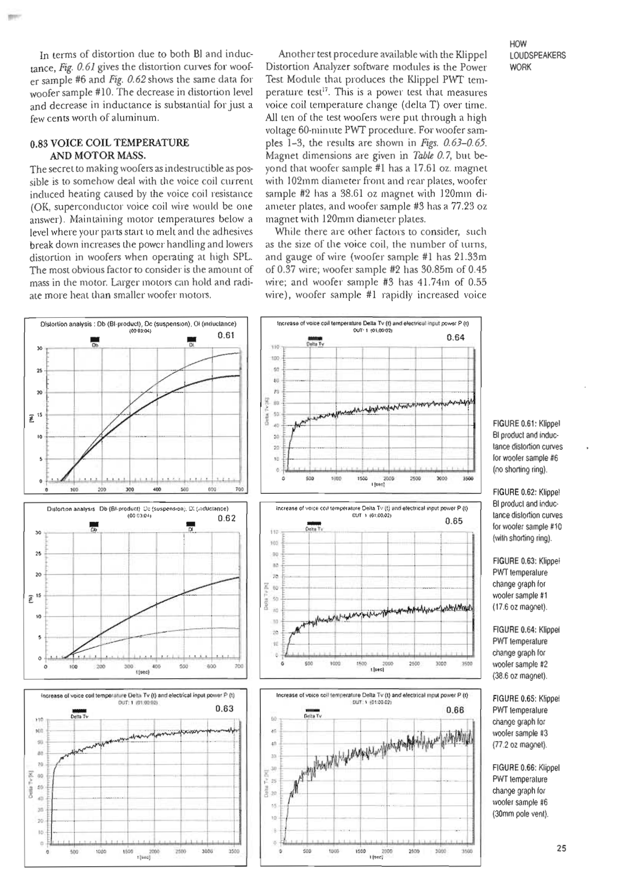
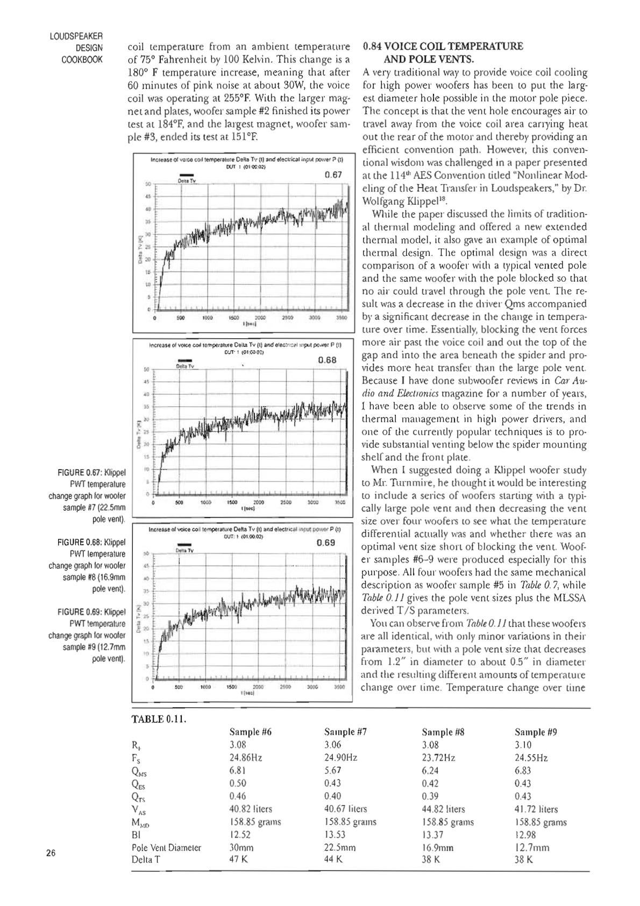
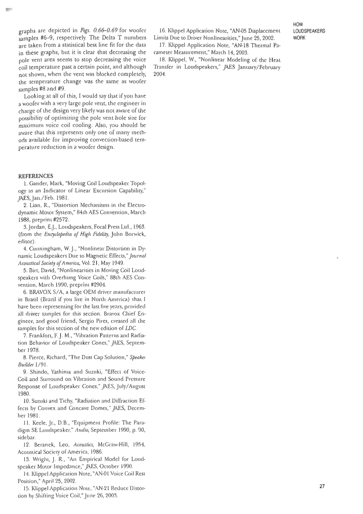

# Loudspeaker Design Cookbook - Part 7

## Page 25

In terms of distortion due to both Bl and inductance, *Fig. 0.61* gives the distortion curves for woofer sample #6 and *Fig. 0.62* shows the same data for woofer sample #10. The decrease in distortion level and decrease in inductance is substantial for just a few cents worth of aluminum.

### 0.83 VOICE COIL TEMPERATURE AND MOTOR MASS.
The secret to making woofers as indestructible as possible is to somehow deal with the voice coil current induced heating caused by the voice coil resistance (OK, superconductor voice coil wire would be one answer). Maintaining motor temperatures below a level where your parts start to melt and the adhesives break down increases the power handling and lowers distortion in woofers when operating at high SPL. The most obvious factor to consider is the amount of mass in the motor. Larger motors can hold and radiate more heat than smaller woofer motors.

Another test procedure available with the Klippel Distortion Analyzer software modules is the Power Test Module that produces the Klippel PWT temperature test17. This is a power test that measures voice coil temperature change (delta T) over time. All ten of the test woofers were put through a high voltage 60-minute PWT procedure. For woofer samples 1-3, the results are shown in *Figs. 0.63-0.65*. Magnet dimensions are given in *Table 0.7*, but beyond that woofer sample #1 has a 17.61 oz. magnet with 102mm diameter front and rear plates, woofer sample #2 has a 38.61 oz magnet with 120mm diameter plates, and woofer sample #3 has a 77.23 oz magnet with 120mm diameter plates.

While there are other factors to consider, such as as the size of the voice coil, the number of turns, and gauge of wire (woofer sample #1 has 21.33m of 0.37 wire; woofer sample #2 has 30.85m of 0.45 wire; and woofer sample #3 has 41.74m of 0.55 wire), woofer sample #1 rapidly increased voice coil temperature from an ambient temperature of 75° Fahrenheit by 100 Kelvin. This change is a 180° F temperature increase, meaning that after 60 minutes of pink noise at about 30W, the voice coil was operating at 255°F. With the larger magnet and plates, woofer sample #2 finished its power test at 184°F, and the largest magnet, woofer sample #3, ended its test at 151°F.

**FIGURE 0.61**: Klippel Bl product and inductance distortion curves for woofer sample #6 (no shorting ring).
**FIGURE 0.62**: Klippel Bl product and inductance distortion curves for woofer sample #10 (with shorting ring).
**FIGURE 0.63**: Klippel PWT temperature change graph for woofer sample #1 (17.6 oz magnet).
**FIGURE 0.64**: Klippel PWT temperature change graph for woofer sample #2 (38.6 oz magnet).
**FIGURE 0.65**: Klippel PWT temperature change graph for woofer sample #3 (77.2 oz magnet).
**FIGURE 0.66**: Klippel PWT temperature change graph for woofer sample #6 (30mm pole vent).

---

## Page 26

### 0.84 VOICE COIL TEMPERATURE AND POLE VENTS.
A very traditional way to provide voice coil cooling for high power woofers has been to put the largest diameter hole possible in the motor pole piece. The concept is that the vent hole encourages air to travel away from the voice coil area carrying heat out the rear of the motor and thereby providing an efficient convention path. However, this conventional wisdom was challenged in a paper presented at the 114th AES Convention titled "Nonlinear Modeling of the Heat Transfer in Loudspeakers," by Dr. Wolfgang Klippel18.

While the paper discussed the limits of traditional thermal modeling and offered a new extended thermal model, it also gave an example of optimal thermal design. The optimal design was a direct comparison of a woofer with a typical vented pole and the same woofer with the pole blocked so that no air could travel through the pole vent. The result was a decrease in the driver Qms accompanied by a significant decrease in the change in temperature over time. Essentially, blocking the vent forces more air past the voice coil and out the top of the gap and into the area beneath the spider and provides more heat transfer than the large pole vent. Because I have done subwoofer reviews in *Car Audio and Electronics* magazine for a number of years, I have been able to observe some of the trends in thermal management in high power drivers, and one of the currently popular techniques is to provide substantial venting below the spider mounting shelf and the front plate.

When I suggested doing a Klippel woofer study to Mr. Turnmire, he thought it would be interesting to include a series of woofers starting with a typically large pole vent and then decreasing the vent size over four woofers to see what the temperature differential actually was and whether there was an optimal vent size short of blocking the vent. Woofer samples #6-9 were produced especially for this purpose. All four woofers had the same mechanical description as woofer sample #5 in *Table 0.7*, while *Table 0.11* gives the pole vent sizes plus the MLSSA derived T/S parameters.

You can observe from *Table 0.11* that these woofers are all identical, with only minor variations in their parameters, but with a pole vent size that decreases from 1.2" in diameter to about 0.5" in diameter and the resulting different amounts of temperature change over time.

#### TABLE 0.11.

| Parameter | Sample #6 | Sample #7 | Sample #8 | Sample #9 |
| :--- | :--- | :--- | :--- | :--- |
| Re | 3.08 | 3.06 | 3.08 | 3.10 |
| Fs | 24.86Hz | 24.90Hz | 23.72Hz | 24.55Hz |
| QMS | 6.81 | 5.67 | 6.24 | 6.83 |
| QES | 0.50 | 0.43 | 0.42 | 0.43 |
| QTS | 0.46 | 0.40 | 0.39 | 0.43 |
| VAS | 40.82 liters | 40.67 liters | 44.82 liters | 41.72 liters |
| MMD | 158.85 grams | 158.85 grams | 158.85 grams | 158.85 grams |
| Bl | 12.52 | 13.53 | 13.37 | 12.98 |
| Pole Vent Diameter | 30mm | 22.5mm | 16.9mm | 12.7mm |
| Delta T | 47 K | 44 K | 38 K | 38 K |

**FIGURE 0.67**: Klippel PWT temperature change graph for woofer sample #7 (22.5mm pole vent).
**FIGURE 0.68**: Klippel PWT temperature change graph for woofer sample #8 (16.9mm pole vent).
**FIGURE 0.69**: Klippel PWT temperature change graph for woofer sample #9 (12.7mm pole vent).

---

## Page 27

graphs are depicted in *Figs. 0.66-0.69* for woofer samples #6-9, respectively. The Delta T numbers are taken from a statistical best line fit for the data in these graphs, but it is clear that decreasing the pole vent area seems to stop decreasing the voice coil temperature past a certain point, and although not shown, when the vent was blocked completely, the temperature change was the same as woofer samples #8 and #9.

Looking at all of this, I would say that if you have a woofer with a very large pole vent, the engineer in charge of the design very likely was not aware of the possibility of optimizing the pole vent hole size for maximum voice coil cooling. Also, you should be aware that this represents only one of many methods available for improving convection-based temperature reduction in a woofer design.

### REFERENCES
1. Gander, Mark, "Moving Coil Loudspeaker Topology as an Indicator of Linear Excursion Capability," *JAES*, Jan./Feb. 1981.
2. Lian, R., "Distortion Mechanisms in the Electro-dynamic Motor System," 84th AES Convention, March 1988, preprint #2572.
3. Jordan, E.J., *Loudspeakers*, Focal Press Ltd., 1963. (from the *Encyclopedia of High Fidelity*, John Borwick, editor).
4. Cunningham, W. J., "Nonlinear Distortion in Dynamic Loudspeakers Due to Magnetic Effects," *Journal Acoustical Society of America*, Vol. 21, May 1949.
5. Birt, David, "Nonlinearities in Moving Coil Loudspeakers with Overhung Voice Coils," 88th AES Convention, March 1990, preprint #2904.
6. BRAVOX S/A, a large OEM driver manufacturer in Brasil (Brazil if you live in North America) that I have been representing for the last five years, provided all driver samples for this section. Bravox Chief Engineer, and good friend, Sergio Pires, created all the samples for this section of the new edition of *LDC*.
7. Frankfort, F. J. M., "Vibration Patterns and Radiation Behavior of Loudspeaker Cones," *JAES*, September 1978.
8. Pierce, Richard, "The Dust Cap Solution," *Speaker Builder* 1/91.
9. Shindo, Yashima and Suzuki, "Effect of Voice-Coil and Surround on Vibration and Sound Pressure Response of Loudspeaker Cones," *JAES*, July/August 1980.
10. Suzuki and Tichy, "Radiation and Diffraction Effects by Convex and Concave Domes," *JAES*, December 1981.
11. Keele, Jr., D.B., "Equipment Profile: The Paradigm SE Loudspeaker," *Audio*, September 1990, p. 90, sidebar.
12. Beranek, Leo, *Acoustics*, McGraw-Hill, 1954, Acoustical Society of America, 1986.
13. Wright, J. R., "An Empirical Model for Loudspeaker Motor Impedance," *JAES*, October 1990.
14. Klippel Application Note, "AN-01 Voice Coil Rest Position," April 25, 2002.
15. Klippel Application Note, "AN-21 Reduce Distortion by Shifting Voice Coil," June 26, 2003.
16. Klippel Application Note, "AN-05 Displacement Limits Due to Driver Nonlinearities," June 25, 2002.
17. Klippel Application Note, "AN-18 Thermal Parameter Measurement," March 14, 2003.
18. Klippel, W., "Nonlinear Modeling of the Heat Transfer in Loudspeakers," *JAES* January/February 2004.
